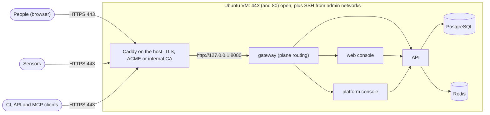

# Deploy without Cloudflare
{: .no_toc }

Install OpenCTEM on one Ubuntu VM and serve it yourself: a **TLS reverse proxy on
the VM** in front of the platform's gateway. Two variants share every step except
the certificate:

- **Public host**: the VM has a public address, DNS points at it, and the proxy gets
  free Let's Encrypt certificates automatically (ACME) on port 443.
- **Private network**: the VM is reachable only from a LAN or VPN, and the proxy issues
  certificates from its own internal certificate authority (CA), which you give to browsers
  and sensors.

Read [Install with Ansible](ansible.md) first for the VM, the controller, the inventory and
the stages; this page adds what is specific to serving it yourself. With Cloudflare, use
[Deploy with Cloudflare Tunnel and Access](ansible-cloudflare.md).

1. TOC
{:toc}

---

## How it fits together



- **The kit's gateway speaks plain HTTP.** With `openctem_ingress: loopback` it publishes
  only `127.0.0.1:8080`. The reverse proxy you install on the VM is the only thing that
  listens on a public or LAN address. TLS, the certificate lifecycle, the HSTS header and
  client-address forwarding are the proxy's job; routing by path and credential is the
  gateway's.
- **One origin for everything people and machines use**: `https://ctem.example.com`
  (your `openctem_app_host`). The platform console is a second origin,
  `https://admin.example.com`, restricted to your staff.
- **The proxy is a host service, not a container.** That matters: a port published by a
  container bypasses the host firewall, while a host service is filtered by it (see
  [Firewall](#step-3-firewall)).
- **No identity-provider gate in front of OpenCTEM.** People sign in to OpenCTEM itself
  (password and TOTP, or your SSO). You decide which networks can reach it; the checklist
  below is about keeping that list short.

{: .note }
This is the kit's design, and it does not render the gateway's own TLS modes. If you would
rather have the gateway terminate TLS itself (modes `acme`, `internal` or `files`) and
also offer sensors the gRPC mutual-TLS transport on port 443, run the stock Docker Compose
stack instead: see [TLS and the gateway](tls-and-gateway.md) and
[Docker Compose](docker-compose.md). You then give up the kit's host hardening,
signature-checked deploys, backups and monitor. Sensors behind this guide use the HTTPS
transport ([Sensor transport](../sensors/transport.md)).

## Before you start

- The VM, controller, age key and the rest of the [prerequisites](ansible.md#prerequisites).
- **Public variant**: a public IPv4 (and optionally IPv6) address on the VM or forwarded to it
  from your router for ports 443 and 80; DNS records `A`/`AAAA` for `ctem.example.com` and
  `admin.example.com` pointing at it; outbound access to `acme-v02.api.letsencrypt.org`; an
  address (for example `ops@example.com`) that Let's Encrypt can reach about expiring
  certificates.
- **Private variant**: DNS names that resolve inside your network (your resolver, or `hosts`
  entries on the few machines that need them), a way to distribute a root certificate to
  browsers (your device-management tool or group policy) and to sensor hosts, and the network
  ranges of your staff and sensors.
- Decide **who may reach what**, in terms of network ranges: the platform on 443 (everyone who
  uses it, and the sensors' egress addresses), the platform console only your administrators'
  ranges.

## Step 1: controller and inventory

Set up the controller as in [Set up the controller](ansible.md#set-up-the-controller), then
edit `group_vars/all.yml`:

```yaml
openctem_app_host: ctem.example.com
openctem_version: v0.15.5

openctem_ingress: loopback             # gateway on 127.0.0.1:8080 for your TLS proxy
openctem_loopback_port: 8080

admin_cidrs:
  - 192.0.2.0/24                       # where you administer from (SSH)

# Platform console on its own host name, only for your staff.
openctem_admin_site: host
openctem_admin_host: admin.example.com
openctem_admin_allowed_cidrs: [203.0.113.0/24]    # your staff's networks or VPN range

monitoring_external_probes: false      # those probes are for the Cloudflare path
monitoring_webhook_url: "{{ vault_monitoring_webhook_url | default('') }}"
backup_age_recipient: age1...          # your public key
backup_offsite_command: ''             # set it, see Backups
```

| Variable | What it does in this path |
|---|---|
| `openctem_ingress: loopback` | No tunnel connector. The gateway publishes `127.0.0.1:openctem_loopback_port` (default 8080) and trusts the forwarding headers only of the host's proxy, which reaches it through that published port. |
| `openctem_loopback_port` | The loopback port. Must differ from `openctem_admin_port`. |
| `openctem_admin_site: host`, `openctem_admin_host` | The platform console as its own service on its own host name. The gateway serves it on the same loopback port, selected by the `Host` header, so the proxy must keep the `Host` header (Caddy does). |
| `openctem_admin_allowed_cidrs` | The gateway admits only these client addresses to the console. The client address is what your proxy puts in `X-Forwarded-For`, that is the real visitor. The default (private networks only) suits the private variant. |
| `monitoring_external_probes: false` | The monitor's outside probes assume Cloudflare's Access challenge and edge certificate; without Cloudflare they would raise false alerts. The stack, disk and backup checks still run. |

**Console in port mode instead** (`openctem_admin_site: port`, the default): the console is served
on a second port (`openctem_admin_port`, 8443) of the loopback ingress, as plain HTTP. It needs TLS in
front like everything else, and a proxy site listening on a different port than that one. Host mode
below is simpler: one more name, one more proxy block.

## Step 2: host stages

From the controller, one stage at a time, following [the apply cycle](ansible.md#the-apply-cycle):

```bash
ansible-playbook -i $INV playbooks/00-preflight.yml -K
ansible-playbook -i $INV playbooks/10-os.yml -K -e apply_os=true
ansible-playbook -i $INV playbooks/20-ssh.yml -K -e apply_ssh=true
# open a NEW ssh session with your key; only then:
ansible-playbook -i $INV playbooks/20-ssh.yml -K -e apply_ssh=true -e ssh_stage=2
ansible-playbook -i $INV playbooks/30-docker.yml -K -e apply_docker=true -e docker_daemon_restart=true
```

## Step 3: firewall

The kit's firewall stage opens SSH from `admin_cidrs` and nothing else. **Opening 443 (and 80) is your
decision, made after that stage**, because it is the only difference from the Cloudflare path:

```bash
ansible-playbook -i $INV playbooks/35-firewall.yml -K -e apply_firewall=true
```

Then on the VM, open only what the variant needs. Public host:

```bash
sudo ufw allow 443/tcp     # the platform, sensors, CI, clients
sudo ufw allow 80/tcp      # certificate issuance (HTTP-01) and the redirect to https
sudo ufw status verbose
```

Port 443 alone is enough for Let's Encrypt (the TLS-ALPN-01 challenge); port 80 adds the HTTP-01
challenge and the redirect from `http://`, and is worth opening. The rules persist when you re-run the
firewall stage (it adds and removes only the SSH rules); re-check `ufw status` after a firewall change.

Private network: restrict the rules to your ranges instead of everyone:

```bash
sudo ufw allow from 203.0.113.0/24 to any port 443 proto tcp
sudo ufw allow from 198.51.100.0/24 to any port 443 proto tcp    # sensors
```

Use the ranges your staff, VPN and sensors really come from; add another rule when a new network
needs access. IPv6 is filtered by the same ufw but your admin SSH rules are IPv4 only; add IPv6
rules deliberately if you serve IPv6.

Keep `https` as the only way in: do not open 8080 (the gateway listens on loopback only; a rule
would do nothing, but the habit is worth keeping), 3000, 5432 or 6379.

## Step 4: deploy OpenCTEM

Rehearse, then apply:

```bash
ansible-playbook -i $INV playbooks/50-openctem.yml -K --check --diff -e apply_openctem=true
ansible-playbook -i $INV playbooks/50-openctem.yml -K -e apply_openctem=true
```

In the `--check --diff` output expect the gateway to publish `127.0.0.1:8080` and **no other port**.
There is no tunnel connector and no token to place. The play verifies image signatures, generates the
secrets on the VM, runs the migrations and starts the stack; `sudo openctem-verify` on the VM then
checks every service and the routing through the gateway. At this point OpenCTEM works on
`http://127.0.0.1:8080` of the VM only. Test it from the VM with the right host name (the gateway
answers only for your names):

```bash
curl -s -H 'Host: ctem.example.com' http://127.0.0.1:8080/health
```

## Step 5: install the reverse proxy

The guide uses [Caddy](https://caddyserver.com/) because it obtains and renews certificates by
itself in both variants. Any proxy works if it meets the requirements at the end of this step.

```bash
sudo apt-get install -y caddy
sudo systemctl stop caddy        # the packaged default site listens on :80 until you replace it
```

(Use Ubuntu's own `caddy` package, or Caddy's apt repository if you need a newer version; pin the
version either way, as the kit pins Docker's.)

### Variant A: public host, Let's Encrypt

DNS for both names must already point at the VM and ports 443 and 80 must be open. Write
`/etc/caddy/Caddyfile`:

```caddyfile
{
	email ops@example.com
}

ctem.example.com {
	header Strict-Transport-Security "max-age=31536000"
	request_body {
		max_size 256MB
	}
	reverse_proxy 127.0.0.1:8080 {
		flush_interval -1
	}
}

admin.example.com {
	@staff remote_ip 203.0.113.0/24
	handle @staff {
		header Strict-Transport-Security "max-age=31536000"
		reverse_proxy 127.0.0.1:8080 {
			flush_interval -1
		}
	}
	handle {
		respond "Forbidden" 403
	}
}
```

To test without using up Let's Encrypt's production rate limits, add
`acme_ca https://acme-staging-v02.api.letsencrypt.org/directory` to the global block first, check
that the certificate issues (browsers will not trust it), then remove the line and reload.

### Variant B: private network, internal CA

Same file with `tls internal` in each site and no ACME e-mail. Caddy creates a local CA and issues
and renews each site's certificate from it. Names and IP addresses both work.

```caddyfile
ctem.example.com {
	tls internal
	header Strict-Transport-Security "max-age=31536000"
	request_body {
		max_size 256MB
	}
	reverse_proxy 127.0.0.1:8080 {
		flush_interval -1
	}
}

admin.example.com {
	tls internal
	@staff remote_ip 203.0.113.0/24
	handle @staff {
		header Strict-Transport-Security "max-age=31536000"
		reverse_proxy 127.0.0.1:8080 {
			flush_interval -1
		}
	}
	handle {
		respond "Forbidden" 403
	}
}
```

If your organization already has an enterprise CA, use its certificate instead of `tls internal`:
`tls /etc/caddy/tls/ctem.crt /etc/caddy/tls/ctem.key` (a full chain, leaf first, with the key readable
only by the `caddy` user), and clients that already trust that CA need nothing more.

### Start it and check

```bash
sudo caddy validate --config /etc/caddy/Caddyfile --adapter caddyfile
sudo systemctl enable --now caddy
sudo journalctl -u caddy --since '5 min ago' | grep -iE 'obtain|certificate|error' | tail
```

**What the proxy must do** (so another proxy works too): terminate TLS for both names; forward
everything for each name to `127.0.0.1:8080` **without splitting paths**; keep the `Host` header (the
gateway answers 404 for any other name); set `X-Forwarded-For` to the real client address and
`X-Forwarded-Proto: https` (Caddy does both, and overwrites a client-supplied `X-Forwarded-For` because
it has no trusted proxy in front); allow WebSocket upgrades (Caddy does); not buffer or time out long
responses (`flush_interval -1`); allow request bodies as large as you accept uploads (the gateway allows
256 MB). The proxy also sets HSTS here; the gateway adds none in this mode.

The gateway believes `X-Forwarded-For` only from the host proxy's address on the Docker network (the
kit sets `OPENCTEM_TRUSTED_PROXIES` for it) and hands the API the one resolved address, which the audit
log, sign-in throttling, CI rate limits and organization IP allow-lists use.

## Step 6: DNS

Point `ctem.example.com` and `admin.example.com` at the VM.

- Public: `A` (and `AAAA`) records at your DNS provider. Do this before starting Caddy in variant A,
  or issuance fails and Caddy retries with backoff.
- Private: records in your internal resolver (or `hosts` entries). Sensors resolve the platform name the
  same way people do.

## Step 7: trust the certificate (private variant only)

Public certificates need nothing here. For the internal CA, give the **root certificate** to every
browser that will use OpenCTEM and every sensor host.

1. Find it on the VM (the Ubuntu package keeps Caddy's data in `/var/lib/caddy`):

   ```bash
   sudo find /var/lib/caddy -name root.crt
   sudo openssl x509 -in /var/lib/caddy/.local/share/caddy/pki/authorities/local/root.crt \
     -noout -subject -fingerprint -sha256
   ```

2. Copy only `root.crt` (a public certificate) to the controller and onto your distribution channel,
   and note the fingerprint. Never copy the CA's private key, which sits next to it.
3. **Browsers and operating systems**: import it into the trust store with your device-management
   tool or group policy. Check the fingerprint on one machine before pushing it to all.
4. **Sensors**: install it where the sensor runs, as described in
   [Trust a private certificate authority](../sensors/deploy-docker.md#trust-a-private-certificate-authority),
   and enroll the sensor with `https://ctem.example.com`. Other tools need the same trust:
   `curl --cacert root.crt`, `NODE_EXTRA_CA_CERTS` for Node.js, `REQUESTS_CA_BUNDLE` for Python.
5. **Back up Caddy's data directory** (`/var/lib/caddy`). The kit's backups do not contain it. If it is
   lost, Caddy creates a new CA and every browser and sensor must be given the new root. Copy it encrypted
   to your age key, for example
   `sudo tar -C /var/lib -cz caddy | age -r age1... > caddy-data.tar.gz.age`, and keep it with your
   other backups.

The root certificate is valid for years, and the proxy renews each site certificate itself, much more
often. Put the root's expiry date on a calendar.

## Step 8: backups, monitoring and the first administrator

```bash
ansible-playbook -i $INV playbooks/55-backup.yml -K -e apply_backup=true -e backup_run_now=true
ansible-playbook -i $INV playbooks/60-monitoring.yml -K -e apply_monitoring=true
```

Create the first platform administrator **on the VM in an interactive session**
([First administrator](ansible.md#first-administrator)), then sign in at `https://admin.example.com`
from one of the staff networks you allowed. Run a restore drill before you call the installation done
([Backups](ansible.md#backups-and-the-restore-drill)).

Without Cloudflare the monitor has no outside view of the service. Add your own: an uptime check
from outside the VM's network against `https://ctem.example.com/health`, and an alert on certificate
expiry (public variant: Caddy renews at about two thirds of the lifetime and logs failures in
`journalctl -u caddy`; private: your calendar entry for the root).

## Step 9: verify

On the VM:

```bash
sudo openctem-verify                                       # stack healthy, routing correct
ansible-playbook -i $INV playbooks/85-exposure-audit.yml -K  # no container publishes beyond loopback
sudo ss -ltnp | grep -E ':(80|443|8080) '                    # caddy on 80/443; the gateway on 127.0.0.1:8080
```

From a machine in an allowed network (use `--cacert root.crt` for the private variant):

```bash
H=https://ctem.example.com
A=https://admin.example.com
curl -sI $H/login | grep -iE '^(HTTP|strict-transport)'      # 200 and the HSTS header
curl -s -o /dev/null -w '%{http_code}\n' $H/metrics           # 404: internal endpoints are never served
curl -s -o /dev/null -w '%{http_code}\n' $H/api/v2/sensor/hello   # 401: reaches the API, needs a sensor key
curl -s -o /dev/null -w '%{http_code}\n' $H/admin             # 404: the console is not on the main host
curl -s -o /dev/null -w '%{http_code}\n' $A/                  # 200 or a redirect to the console sign-in
echo | openssl s_client -connect ctem.example.com:443 -servername ctem.example.com 2>/dev/null \
  | openssl x509 -noout -issuer -dates                       # Let's Encrypt, or your internal CA
```

From a machine **outside** the allowed networks:

```bash
curl -s -o /dev/null -w '%{http_code}\n' $A/                  # 403 from the proxy
nmap -Pn -p 22,80,443,3000,5432,6379,8080 VM_ADDRESS          # 443 (and 80) open; 22 only from admin networks; the rest closed
```

| Test | Expected |
|---|---|
| Browser to `https://ctem.example.com/` | the OpenCTEM sign-in page, a valid padlock (private variant: after the root is trusted) |
| `http://ctem.example.com/` | redirected to https (port 80 open) |
| Sign in with an account that has TOTP | works; a wrong password is throttled per client address |
| `https://admin.example.com` from a staff network | the console sign-in, then TOTP |
| `https://admin.example.com` from anywhere else | 403 |
| A sensor enrolled with `https://ctem.example.com` | heartbeats; Online under Sensors |
| A CI pipeline with the OpenCTEM CI action and that URL | exchange and upload succeed |
| Console, Audit, the last sign-in | the address is **yours**, not the Docker network's |
| Ports 3000, 5432, 6379 and 8080 from the network | closed |

## Security checklist for this path

In addition to [the shared checklist](ansible.md#security-checklist):

- [ ] Only 443 (and 80 if you chose to) are open beyond SSH, and only to the networks that need them
      where you can name them (private variant: always).
- [ ] The platform console answers only your administrators' networks, enforced twice: the proxy's
      `remote_ip` and `openctem_admin_allowed_cidrs`. Prefer reaching it over a VPN.
- [ ] Everyone has TOTP (or SSO with MFA at the identity provider); `openctem_signup_mode` is `disabled`
      unless you run a hosted service. Without Cloudflare there is no second login in front of the
      sign-in page, so keep [sign-in throttling and organization IP allow-lists](../identity/index.md) on.
- [ ] Certificates: public variant, issuance works and the e-mail address in the Caddyfile is monitored;
      private variant, the root is distributed by your management tool, its fingerprint was checked,
      Caddy's data directory is backed up (encrypted), and the root's expiry is on the calendar.
- [ ] HSTS is sent by the proxy.
- [ ] The proxy's access log is not shipped anywhere that keeps query strings and tokens longer than your
      policy allows; rotate it.
- [ ] Rate limits for the machine paths (`/api/v2/sensor/`, `/api/v3/sensor/`, `/api/v1/ci/`) are enforced
      by the API; add a network-level limit with your firewall or a proxy module if the VM is exposed to
      the whole internet.
- [ ] A hosting-provider firewall or security group allows only the same ports as ufw (two walls).
- [ ] A hosted service (`MANAGED_SERVICE`) has `openctem_admin_audit_sink` set ([the audit sink](ansible.md#hosted-service-the-administrators-audit-sink)).
- [ ] The outbound policy of the API container suits you ([firewall](ansible.md#outbound-firewall-of-the-stacks-containers)); the host's own outbound access is yours to restrict, and a restricted policy needs `openctem_egress_allow` for an internal SMTP relay.
- [ ] Optional: continuous archiving and point-in-time restore ([guide](ansible.md#continuous-archiving-and-point-in-time-restore)).
- [ ] Monitoring: your own outside uptime and certificate checks, in addition to the kit's monitor.

## Day-2 operations

- **Backups, restore drill, monitoring**: [shared sections](ansible.md#backups-and-the-restore-drill), plus the
  Caddy data directory in the private variant.
- **Upgrade**: [shared procedure](ansible.md#upgrade). The proxy needs no change for an OpenCTEM upgrade: it
  forwards to the same loopback port. During the few minutes the stack restarts the proxy answers 502; that
  is expected. Keep the proxy itself updated with the OS (`apt`), and re-run the checks of step 9 after.
- **Add a name or change the console host**: edit the inventory and the Caddyfile together, then re-run
  `playbooks/50-openctem.yml` and `sudo systemctl reload caddy`.
- **Rollback**: [shared procedure](ansible.md#rollback); the proxy is unaffected.
- **Take OpenCTEM offline at once**: `sudo systemctl stop caddy` (nothing reaches the gateway), or close 443 in
  ufw.
- **Rotate the age key or the VM's admin networks**: update `backup_age_recipient` or `admin_cidrs` and re-run
  the backup or firewall stage; the ufw rules you added for 443 are not touched.

## Troubleshooting

| Symptom | Cause and fix |
|---|---|
| Caddy cannot get a certificate (public variant) | DNS does not point at the VM yet; 443 or 80 is blocked by ufw or the provider; or Let's Encrypt rate limits after repeated failures (use the staging directory while testing). `journalctl -u caddy` names the failing challenge. |
| The browser warns about the certificate (private variant) | The root is not trusted on that machine. Import `root.crt` and check its fingerprint. Using an IP address or a name other than the one in the Caddyfile also fails: use the names in the Caddyfile. |
| 502 from Caddy | The gateway is not answering on `127.0.0.1:8080`: `sudo openctem-verify`, `sudo docker compose -p openctem -f /opt/openctem/compose.yml ps`. Expected for a few minutes during an upgrade. |
| 404 for every page | The proxy changes the `Host` header, or forwards a name the gateway does not serve. The gateway answers only `openctem_app_host` and `openctem_admin_host`. |
| `admin.example.com` answers 403 from a staff network | The staff network is missing from the Caddyfile's `remote_ip` or from `openctem_admin_allowed_cidrs` (re-run `playbooks/50-openctem.yml` after changing it), or the proxy does not set `X-Forwarded-For`. |
| The audit log shows the Docker network's address for every request; one person's sign-in throttling hits everyone | `X-Forwarded-For` is not reaching the gateway from the host proxy, or the proxy is not on the host (the kit trusts only the Docker network's address of the loopback port). Use the proxy as configured above. |
| The console loads but live updates never connect | The proxy does not upgrade WebSockets (Caddy does), or the public URL differs from the origin in the browser. |
| `413` on a large upload | The proxy's `request_body max_size`, or the gateway's 256 MB. |
| A port is open that should not be | Run `playbooks/85-exposure-audit.yml`; check `ufw status`. A container that publishes a port bypasses ufw. |
| Caddy fails to start: address already in use | The packaged default site still runs on port 80, or another service holds 80 or 443. `sudo ss -ltnp | grep -E ':(80|443) '`. |
| Sensors cannot connect (private variant) | The sensor host does not trust the root certificate, or its network is not allowed through ufw on 443. See step 7 and [Sensors, network](../sensors/network.md). |

The shared table in [Install with Ansible](ansible.md#troubleshooting) covers the controller, sudo, firewall and
Docker problems.
