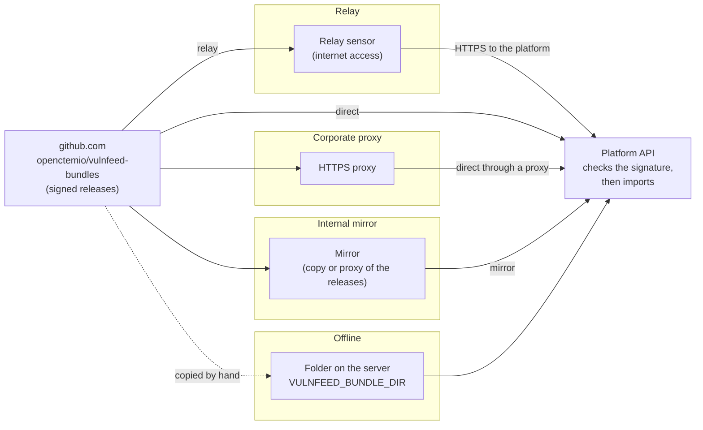
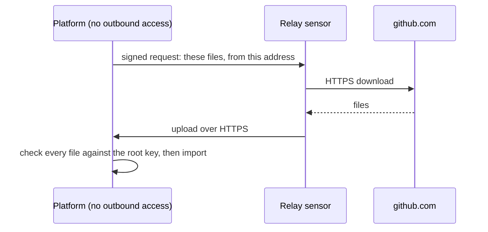
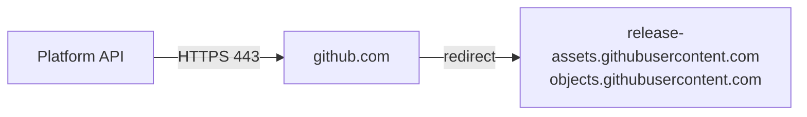
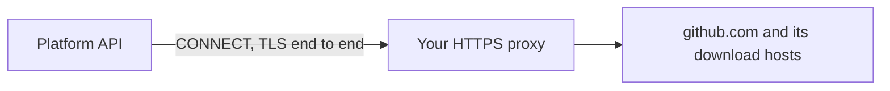
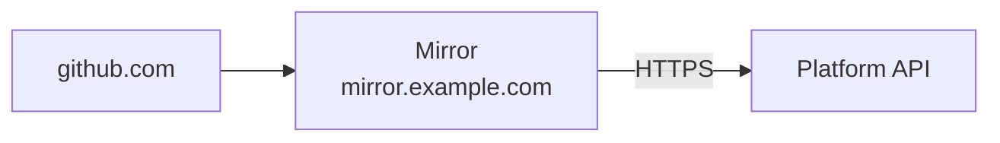
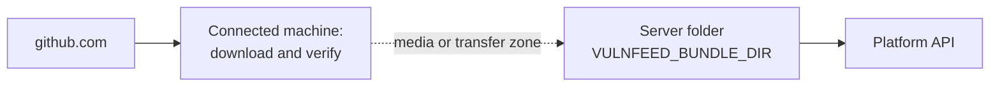

# Set up the vulnerability feed
{: .no_toc }

If every user sees this banner at the top of the web app:

> Vulnerability data has not been loaded yet. New vulnerabilities may not be shown. The platform administrators have been told.

the platform has not received its vulnerability data. This page explains how the data
reaches the platform, helps you pick the setup that fits your network, and walks you
through it, then shows how to check that it works and what each error means.

The reference for every setting is [Vulnerability and program feeds](feeds.md).

**Versions.** Everything on this page applies to v0.24.0 to v0.24.2, except what is marked
as v0.24.2 only: Docker Compose passing the feed settings from `.env` to the API (before
v0.24.2 they never reached it), `install.sh` using `docker-compose.override.yml` and
printing a feed summary, the clearer feed diagnostics and error codes, and the setting for
how old the data may be. Steps marked **From v0.25.0** describe changes that first shipped in
v0.25.0 (the feed address in the console, a relay-only sensor for Docker Compose) and
do not exist in v0.24.2 or earlier.

1. TOC
{:toc}

---

## How it works

The platform gets all of its vulnerability data from **one signed feed**, the
vulnerability feed (`vulnfeed`), published as GitHub releases of
[`openctemio/vulnfeed-bundles`](https://github.com/openctemio/vulnfeed-bundles)
several times a day. Each release carries:

- the CVE catalog: products, CVEs and affected version ranges, used to match the software
  found on your assets;
- as side files, the CISA Known Exploited Vulnerabilities list (KEV) and the EPSS scores.

From v0.24.0 the platform **never calls CISA or FIRST itself**: KEV and EPSS arrive only
inside the signed feed. An installation that does not receive the feed has no CVE
updates, no KEV flags and no EPSS scores.

Before anything is imported, the platform checks every file against the **official root
key, which is built into each release**, and refuses a file that does not match. Because
the signature is checked, it does not matter which host or sensor delivered the files.
Nothing needs to be configured for the key.

The files can reach the platform in four ways:



- **Relay**: one to three of the platform's own sensors download the files and send them to
  the platform. The platform makes no outbound request for the feed.
- **Direct**: the platform downloads the files itself over HTTPS.
- **Direct through a proxy**: the same, through your HTTPS proxy.
- **Mirror**: the platform downloads from a server inside your network.
- **Offline**: you copy the files to a folder on the server.

The platform looks for a new release every **20 minutes**, in every mode.

## Choose your setup

| Your situation | Use | Where the setting lives |
|---|---|---|
| New Docker Compose install with the bundled sensor (the default of `install.sh` with a host name) | **Relay** (already on) | Console > System > Threat intelligence > Feed delivery |
| The platform must have no outbound internet access, and a sensor host may reach GitHub | **Relay** | Console, plus one to three platform sensors |
| The platform server may reach GitHub on port 443 | **Direct** | Console (Feed delivery = Direct); nothing else |
| The only way out is a corporate HTTPS proxy | **Direct through a proxy** | `OPENCTEM_HTTPSEC_FEED_PROXY` on the server |
| You keep your own copy or caching proxy of the releases inside the network | **Mirror** | `VULNFEED_BASE_URL` or `VULNFEED_MIRRORS` on the server |
| No network path to the internet at all | **Offline** | `VULNFEED_BUNDLE_DIR` on the server |
| You build and sign the feed yourself with your own key | **Private collector** | `VULNFEED_ROOT_KEY_ID` on the server, plus one of the above |

`HTTPS_PROXY` and `HTTP_PROXY` are **not read** by the platform. Setting them changes nothing.

### Which mode am I in now?

Open the platform console, **System > Threat intelligence**, and look at the
**Feed delivery** card: it says **Direct** or **Relay**.

- A new Compose install with the bundled sensor starts in **Relay**.
- Every other install (Compose without the bundled sensor, Helm by default, the Ansible
  installer kit, any upgraded install) starts in **Direct**.
- When `VULNFEED_BUNDLE_DIR` is set, the folder is the only source and relay mode is not
  offered.

## Before you start

- **Who.** Changing **Feed delivery** needs the **Platform owner** role and a step-up
  (the console asks for your authenticator code). **Sync now** needs a Platform owner, Platform admin or Operator. Any
  console role can read the status.
- **Where.** The platform console is a separate site: by default
  `https://<your host>:8443` on Compose (see [Platform console](../console/index.md)).
- **Clock.** Signatures carry dates. Keep the server clock synchronized (NTP); a clock that
  is far off makes the platform refuse the feed.
- **Compose and server settings.** Before v0.24.2 the Compose `api` service passes only a fixed
  list of variables from `.env`. The feed settings on this page (`OPENCTEM_HTTPSEC_FEED_PROXY`,
  `OPENCTEM_HTTPSEC_FEED_NO_PROXY`, `VULNFEED_*`, `OPENCTEM_HTTPSEC_ALLOW_PRIVATE_CIDRS`) are
  **not** on that list: put them in an extra Compose file, as shown in each section below.
  **From v0.24.2** the `api` service passes all of them from `.env` (empty means the
  built-in default), so a line in `.env` and `docker compose up -d` is enough; only the
  offline folder still needs an extra file for its volume.

## Relay

The platform asks its designated relay sensors for the exact files it needs. A relay
sensor downloads them from the official address and uploads them to the platform, which
checks every file against the root key before it imports anything. A relay can delay the
feed but never change it.



### What a relay sensor needs

| Need | Detail |
|---|---|
| A **platform sensor** | A shared sensor of the installation, not an organization's sensor. The Compose bundled sensor is one. |
| A **pinned job-signing key** | The sensor trusts only requests signed by the platform's job signer. The Compose bundled sensor gets the key from the `signer-pub` volume. |
| The feed relay **on** | `SENSOR_FEED_RELAY` unset (or `auto`) turns it on for a platform sensor with a pinned key. `0` turns it off. |
| A sensor release with the relay | v0.36.0 or later. The Compose bundled sensor of v0.24.1 and v0.24.2 is v0.41.1. |
| **Online** | Seen by the platform in the last 10 minutes. |
| **Designated** | Chosen in **Feed delivery** (one to three sensors). |
| Outbound **HTTPS (443)** | To `github.com`, `release-assets.githubusercontent.com` and `objects.githubusercontent.com`. The sensor also needs HTTPS to the platform. |
| A **job signer** on the platform | Part of the base Compose file. Without one, relay mode cannot be chosen. |

A sensor that meets these conditions reports the capability `feed.relay@1`, and only such
sensors are offered in the console.

### Set it up (v0.24.2, Docker Compose with the bundled sensor)

1. Check that the bundled sensor runs and says the relay is on:

   ```bash
   cd {{ site.data.versions.backend_dir }}/deploy
   docker compose ps sensor
   docker compose logs sensor | grep -i "feed relay"
   # expected:  Feed relay: on, origins https://github.com/openctemio/vulnfeed-bundles/releases/latest/download, ...
   ```

   No `sensor` service: the install ran without the bundled sensor (`install.sh` leaves it
   out when the host is an IP address). Add `docker-compose.sensor.yml` to `COMPOSE_FILE`
   in `.env` and run `docker compose up -d`, or use **Direct** instead. From v0.24.2 the
   summary at the end of `install.sh` prints the feed mode and what it needs (the egress
   hosts, or a relay sensor to designate), and says when the sensor was left out because
   the host is an IP address (`./install.sh --sensor` adds it).
2. Allow the sensor host to reach `github.com`, `release-assets.githubusercontent.com` and
   `objects.githubusercontent.com` on port 443. If the sensor host itself must use a proxy,
   set the sensor's own proxy (`HTTPS_PROXY` or `SENSOR_CONTENT_PROXY` on the sensor, see
   [Sensor network](../sensors/network.md)). Sensor proxy settings apply to the sensor only.
3. In the console, open **System > Threat intelligence > Feed delivery**. On a new install
   the bundled sensor is designated automatically once it is online. Otherwise select
   **Relay**, tick the sensor (one to three), and save. The console asks for your
   authenticator code (step-up); the change is recorded in the admin audit log.
4. Wait. The first rounds download the whole catalog (up to about 120 MB). The cycle is 20
   minutes, and the first import can take **up to about 45 minutes**. The Feed delivery
   card shows the round in progress: files and bytes delivered, and which sensor holds it.

The same change through the API (console session):
`PUT /api/v1/admin/settings/feed-relay` with
`{"mode": "relay", "sensor_ids": ["<sensor id>"], "expected_version": <version from GET>}`.

### Other installs

- **Ansible installer kit.** The kit installs no bundled sensor. Pair a platform sensor on
  a host with internet access ([Shared sensors](../sensors/shared-sensors.md)), then
  designate it in **Feed delivery**.
- **Helm.** The bundled sensor (`sensor.enabled: true`, `sensor.enrollment: instance`)
  relays by default; designate it in the console. `feedRelay.newInstallRelay: true` starts a
  new database in relay mode. See [Kubernetes: Feeds](../install/kubernetes.md#feeds).
- **A relay from your own mirror.** A relay downloads only from the official address. To
  relay from a mirror, add it to `SIGNER_FEED_ORIGINS` on the job signer **and** to
  `SENSOR_FEED_RELAY_ORIGINS` on the sensor.
- **Two or three relays.** If one relay stops, another takes over its round after 10
  minutes. Two relays give automatic failover.

**From v0.25.0.** Compose gets `docker-compose.relay-sensor.yml`: a separate container
that only relays (the sensor's `-relay` image, no scan tools, 256 MiB and half a CPU). It
needs sensor v0.42.0 or later and its own enrollment token,
`SENSOR_RELAY_ENROLLMENT_TOKEN` (`setup.sh` writes it; an older `.env` needs the line
from `.env.example`). Add the file to `COMPOSE_FILE`. With the bundled sensor too, add the
second sensor in **Feed delivery** for failover. Helm offers the same image with
`sensor.profile: relay`.

## Direct



1. Allow the platform server (on Compose: the `api` container) to reach these hosts on
   port **443**:

   | Host | Why |
   |---|---|
   | `github.com` | The release address |
   | `release-assets.githubusercontent.com` | GitHub redirects the downloads here |
   | `objects.githubusercontent.com` | Older address of the same downloads |

   With the Ansible kit and `openctem_egress_policy: restricted`, public hosts stay
   reachable; nothing to add.
2. In **Feed delivery**, select **Direct** if it shows Relay (Platform owner, step-up). **Switch to direct now** on the card does the same.
3. Nothing else: the address and the root key are built in.

The first import of the whole catalog can take up to about 45 minutes; later imports
fetch only the changed parts.

## Direct through a corporate proxy



1. Set `OPENCTEM_HTTPSEC_FEED_PROXY` to the proxy, `http://host:port` or
   `https://host:port`, with `user:password@` if the proxy needs a sign-in.
2. Allow the proxy to reach the three GitHub hosts above on port 443.
3. Keep **Feed delivery** on **Direct**.

On Docker Compose, create `docker-compose.feeds.yml` next to `docker-compose.yml`:

```yaml
services:
  api:
    environment:
      OPENCTEM_HTTPSEC_FEED_PROXY: ${OPENCTEM_HTTPSEC_FEED_PROXY}
```

put the value in `.env` (it may hold a password; `.env` is mode 0600):

```bash
OPENCTEM_HTTPSEC_FEED_PROXY=http://proxy.example.com:3128
COMPOSE_FILE=docker-compose.yml:docker-compose.sensor.yml:docker-compose.feeds.yml
```

and apply with `docker compose up -d`. Keep the files already listed in `COMPOSE_FILE`
and add yours at the end. (A `docker-compose.override.yml` is read only when
`COMPOSE_FILE` is not set; `install.sh` always sets it.)

**From v0.24.2:** put only `OPENCTEM_HTTPSEC_FEED_PROXY=...` in `.env` and run
`docker compose up -d`; no extra Compose file. `install.sh` also adds an existing
`docker-compose.override.yml` to `COMPOSE_FILE` (run it again after you create one).

- **Ansible installer kit:** `openctem_feed_proxy` (and `openctem_feed_no_proxy`); a proxy
  with a password goes in `<openctem_secrets_dir>/feed_proxy_url` on the server.
- **Helm:** put the variable in a Secret and pass it with `api.extraEnvFrom`.

What uses this proxy: only the platform's own feeds (the vulnerability feed, the CTEM-ID
catalog, the program feed and the release feed). Webhooks, integrations, identity
providers, mail and anything an organization configures **never** use it. Only `https`
addresses go through it, TLS stays end to end (the proxy cannot read or change the
files), and the platform still checks each destination before the request reaches the
proxy. The API refuses to start on a value that is not a proxy URL and never prints the
password.

## Internal mirror

A mirror is a server inside your network that serves the release files: a caching
proxy of the GitHub releases (for example a raw proxy repository), or a web server that
holds a copy of the newest release.



There are two settings, with different layouts:

| Setting | Points at | Example |
|---|---|---|
| `VULNFEED_BASE_URL` | A **proxy of the GitHub release path**. The platform adds `/latest/download/<file>` and `/download/<tag>/<file>`. Replaces the official address. | `https://mirror.example.com/repository/github-openctemio/vulnfeed-bundles/releases` |
| `VULNFEED_MIRRORS` | A **folder that holds the files of the newest release** (`latest.v2.dsse.json`, `keyset.dsse.json`, the manifests and the `sha256-*.jsonl.gz` files). Comma separated, tried in order after the release address. | `https://mirror.example.com/vulnfeed/` |

Addresses must be `https`, without a user name, password, query or fragment.

1. Set up the mirror and give it a TLS certificate the platform trusts.
2. Set one of the variables. On Compose, in `docker-compose.feeds.yml`:

   ```yaml
   services:
     api:
       environment:
         VULNFEED_BASE_URL: https://mirror.example.com/repository/github-openctemio/vulnfeed-bundles/releases
         OPENCTEM_HTTPSEC_ALLOW_PRIVATE_CIDRS: 192.0.2.0/28
   ```

   Ansible kit: `openctem_api_env`. Helm: `api.extraEnv`.
3. **A mirror on a private address** (10.0.0.0/8, 172.16.0.0/12, 192.168.0.0/16, fc00::/7)
   is blocked unless its range is allowed. Set `OPENCTEM_HTTPSEC_ALLOW_PRIVATE_CIDRS` on
   the server for `VULNFEED_BASE_URL`: the address is checked when the API starts, and a
   blocked one turns the import off until the next start. For `VULNFEED_MIRRORS`, the
   console's **System > Private networks** (Platform owner) also works. Allow the
   smallest range that holds the mirror. The console list opens nothing while
   `SIGNUP_MODE=open`.
4. **With a feed proxy too**, list the mirror in `OPENCTEM_HTTPSEC_FEED_NO_PROXY`, or the
   request goes to the proxy.
5. Keep **Feed delivery** on **Direct**. Mirrors are not used in relay mode.
6. Apply with `docker compose up -d`.

**From v0.24.2:** the variables go straight into `.env` (no extra Compose file). A
`VULNFEED_BASE_URL` that is refused at start (a private address that is not allowed, or
not an `https` address) no longer turns the import off with only a log line: the
**Vulnerability bundles** card shows `blocked_address` or `config_invalid` with the
setting and host, and the administrators are alerted at the next check. Fix the setting
and restart the API.

The mirror needs no trust of its own: the platform checks the same signatures, sizes and
hashes. A mirror that stops updating shows up as out-of-date data (see
[Troubleshooting](#troubleshooting)).

**From v0.25.0.** The release address and up to five mirrors can be managed in the
console: **System > Threat intelligence > Vulnerability feed address** (Platform owner,
fresh authenticator code and a reason). **Test fetch** checks each address against the
root key without importing anything. While `VULNFEED_BASE_URL` or `VULNFEED_MIRRORS` is
set on the server, the card is locked; remove the variables to manage the address there.

## Offline (no network path)



1. On a machine with internet access, download the newest release and verify it with the
   feed's own tool:

   ```bash
   gh release download --repo openctemio/vulnfeed-bundles --dir vulnfeed-new
   git clone https://github.com/openctemio/vulnfeed
   (cd vulnfeed && go build -o ../vulnfeed-bin ./cmd/vulnfeed)
   ./vulnfeed-bin verify --dir vulnfeed-new --root-key-id "$(cat vulnfeed/keys/root-keyid.txt)"
   ```

   One release is about 120 MB.
2. Carry the folder to the platform server and make it readable by the user the API
   container runs as.
   On Compose, mount it read-only in `docker-compose.feeds.yml`:

   ```yaml
   services:
     api:
       environment:
         VULNFEED_BUNDLE_DIR: /var/lib/openctem-vulnfeed
       volumes:
         - /srv/openctem/vulnfeed:/var/lib/openctem-vulnfeed:ro
   ```

   Add the file to `COMPOSE_FILE` and run `docker compose up -d`.
3. The platform reads the folder every 20 minutes. Relay mode is turned off while the
   folder is set.

**Refresh on a schedule.** Replace the folder's content with a newer release regularly:

- data older than its limit (12 hours for the catalog and for KEV, the catalog limit plus a
  day for EPSS and at least 36 hours; v0.24.0 and v0.24.1 use 6 hours for KEV) is shown as out of date and the banner appears, so refresh **every few hours**
  (for example every 4 hours) if you want no banner;
- a release older than **7 days** is refused as expired.

From v0.24.2 a super admin can raise the limit for the catalog and KEV (EPSS follows it)
in **System > Threat intelligence > How old the data may be**, from 6 to 168 hours, for a
site that copies releases in by hand. The change needs a fresh authenticator code and a
reason, is audited, and every administrator is told. A release older than 7 days is
still refused.

Swap the content in one step, so the platform never reads half a release: download into a
new folder, verify it, then rename it into place (or switch a symbolic link), for example
from a cron job on the transfer side. An older release than the one already imported is
refused, so a mistake cannot roll the data back.

## Private collector (own signing key)

Only if you run the feed collector ([`openctemio/vulnfeed`](https://github.com/openctemio/vulnfeed))
yourself and sign the feed with **your own** root key: set `VULNFEED_ROOT_KEY_ID` to your
key id (`SHA256:...`), and deliver the files with one of the modes above. Do not set it
in any other case. The official key is built in, and a wrong value makes the platform
refuse every official release (`signature_invalid`).

## Check that it works

### In the console

**System > Threat intelligence** shows one card per feed: **Vulnerability bundles**,
**CISA KEV** and **EPSS**. A working feed shows **Up to date** on all three, and the
vulnerability card shows:

| Field | Healthy value |
|---|---|
| Applied sequence | A number (not "None yet") |
| Published | A few hours ago at most |
| Signature | Verified (key set v*N*, root `SHA256:cb88187...a246c2`) |
| Last success | Within the last 20 minutes or so |
| Next run | In 20 minutes or less (from v0.24.2 the KEV and EPSS cards show the same next run: they arrive with the bundles) |
| Source table (NVD, CISA KEV, EPSS ...) | **Fresh** |

KEV and EPSS show **In the catalog** above zero and their own **Data as of** date. In relay
mode the **Feed delivery** card also shows each feed's last good import and each relay
sensor as online.

To start an import at once, use **Sync now** on a card (or **Sync all now**). It answers at
once and the card shows the outcome.

### Through the API

In a browser tab signed in to the platform console, open:

```text
https://<console address>/api/v1/admin/threat-intel/freshness
https://<console address>/api/v1/admin/threat-intel/sync
https://<console address>/api/v1/admin/settings/feed-relay
```

`freshness` returns `"stale": false` when everything is current; otherwise `reasons` and
`conditions` name each problem in a plain sentence (for example
`"CISA KEV: no data has been loaded yet (limit 12 hours)."`). `sync` returns the state and
error code of each feed; `feed-relay` the delivery mode, the relay sensors and why a feed is
stale in relay mode. Any signed-in user of the web app can read
`GET /api/v1/threat-intel/freshness` (the banner state only).

### In the logs

```bash
cd {{ site.data.versions.backend_dir }}/deploy
docker compose logs --since 2h api | grep -E "vulnerability bundle|KEV applied|EPSS applied|feed relay|feed freshness"
```

| Log message | Meaning |
|---|---|
| `vulnerability bundle chunks applied` | The catalog was imported (with `sequence` and the number of chunks) |
| `vulnerability bundle imported` | The same, for the older whole-bundle format |
| `KEV applied from the bundle` | KEV imported (`records`, `as_of`) |
| `EPSS applied from the bundle` | EPSS imported (`records`, `as_of`) |
| `feed relay: bundled sensor designated as the relay` | Relay mode picked up the bundled sensor |
| `vulnerability bundle not imported` | A run failed; the `error` field says why |
| `vulnerability corpus is stale: no successful import recently` | The newest release applied is too old, or no import has worked for 6 hours |
| `vulnerability bundle import disabled` | The import could not start at all (logged once at start-up, for example a refused `VULNFEED_BASE_URL`). From v0.24.2 the card shows it too (`blocked_address` or `config_invalid`) |
| `feed freshness alert` / `feed freshness alert resolved` | A banner condition opened or cleared |

### When the banner goes away

The freshness check runs every **10 minutes** and the web app asks every 5 minutes. After
the first successful import of all three feeds the banner disappears within about 15
minutes, or at once on a page reload after the next check. The administrators get one
"resolved" e-mail (and alert webhook message).

## Troubleshooting

### By banner text

| Banner | What it means | What to do |
|---|---|---|
| **Vulnerability data has not been loaded yet.** | At least one of the three feeds (vulnerability bundles, KEV, EPSS) has never been loaded, 2 hours after the platform started checking. The banner does not say which one. | Open **System > Threat intelligence** and find the card that says **Never** under **Last success**, then use the tables below. |
| **Vulnerability data is out of date: the newest data is from *date*.** | A feed's data is older than its limit (catalog and KEV 12 hours, EPSS 36 hours; KEV 6 hours before v0.24.2), or the newest CVE in the catalog was published more than 12 hours ago. | Same: find the card that is **Stale**, **Failing** or **Refused**. |
| **The platform has not been able to check its vulnerability data recently.** | The freshness check itself has not run for 30 minutes. | Check that the API runs and is healthy (`docker compose ps api`, its log). With several API replicas, check that they reach PostgreSQL. |

A feed that an administrator switched off (the switch on its card) is never reported.

**From v0.24.2** the users' banner adds which data is affected ("Affected: the known
exploited list (CISA KEV)"), and the platform console's banner names each feed, what is
wrong with its data, why (the feed's last error) and the fix, with a link to **System >
Threat intelligence**.

### By what the console shows

| Symptom | Cause | Fix |
|---|---|---|
| All three cards **Stale**, **Last attempt: Never**, Feed delivery shows **Relay** with reason `no_relay_designated` | Relay mode, but no relay sensor is designated. On a new install: the bundled sensor never enrolled or cannot relay. | Check the sensor (see [Relay](#set-it-up-v0242-docker-compose-with-the-bundled-sensor), step 1), then designate it in **Feed delivery**. Or switch to **Direct**. |
| Reason `relay_offline` | No designated relay sensor seen for 10 minutes (alert after 1 hour). | Start the sensor; check that it reaches the platform ([Sensors: troubleshooting](../sensors/troubleshooting.md)). |
| The sensor is not offered in Feed delivery, or is listed with **cannot relay** | Not a platform sensor, no pinned job-signing key, `SENSOR_FEED_RELAY=0`, a sensor release older than v0.36.0, or not active. From v0.24.2 the list names the reason for each sensor: not active, release too old (with the release to upgrade to), no pinned job-signing key, relay turned off on its host, or "does not report that it can relay" (an older sensor that reports too little to tell). | Fix the named reason. The sensor log says `Feed relay off: ...` or, with `SENSOR_FEED_RELAY=1`, refuses to start and says why. |
| Reason `signer_refused` | The job signer refused the round, usually an address missing from `SIGNER_FEED_ORIGINS`. | Add the address to `SIGNER_FEED_ORIGINS` on the signer, or remove the custom address. |
| Reason `sensor_refused`, `upstream_missing` or `nothing_delivered` | The sensor refused the request (signature or address rule on the sensor), got 404, or could not download. | Check the sensor's outbound access to the three GitHub hosts and its `SENSOR_FEED_RELAY_ORIGINS`. |
| Reason `round_expired` | A round did not finish within 30 minutes. | Usually a slow or interrupted download on the sensor side; it is retried. Check the sensor's bandwidth and log. |
| Relay mode cannot be selected | `VULNFEED_BUNDLE_DIR` is set, or there is no job signer. | Remove the folder setting, or run the signer (part of the base Compose file). |

### By error code on a card

| Code (message on the card) | Cause | Fix |
|---|---|---|
| `unreachable` (Cannot reach *host*) | No route, DNS failure or timeout. Before v0.24.2 also a blocked private address or a refused proxy: **Details** shows the exact text, and `host resolves to a blocked address` means a private address that is not allowed. | Direct: open port 443 to the three GitHub hosts. Proxy: check `OPENCTEM_HTTPSEC_FEED_PROXY` and that the proxy allows the hosts. Mirror on a private address: allow its range ([Internal mirror](#internal-mirror), step 3). |
| `blocked_address` (*host* is on a private address that is not allowed), from v0.24.2 | The feed host or mirror resolves to a private range that is not allowed. With the setting named (`VULNFEED_BASE_URL`), it was refused at start and the import is off. | Allow the smallest range that holds the mirror ([Internal mirror](#internal-mirror), step 3), or use a public address. For `VULNFEED_BASE_URL`, restart the API afterwards. |
| `proxy_refused` (The feed proxy refused the connection (*status*)), from v0.24.2 | The proxy answered with a refusal: `407` wants a sign-in, `403` a rule blocks the host. | `407`: put `user:password@` in `OPENCTEM_HTTPSEC_FEED_PROXY`. `403`: allow the three GitHub hosts on the proxy, or list an internal mirror in `OPENCTEM_HTTPSEC_FEED_NO_PROXY`. |
| `proxy_unreachable` (The feed proxy cannot be reached), from v0.24.2 | The proxy itself does not answer. | Check the address and port in `OPENCTEM_HTTPSEC_FEED_PROXY` and the route from the API host. |
| `config_invalid` (The feed address set on the server is not valid), from v0.24.2 | `VULNFEED_BASE_URL` is not an `https` address, or has a user name, password, query or fragment. The import is off. | Fix or remove the variable, then restart the API. |
| `http_status` (*host* answered *status*) | The host answered with an error. `403` or `407` usually means a proxy or firewall that blocks or wants a sign-in; `404` a wrong mirror path. | Fix the proxy rule or credentials, or the mirror address and layout. Other statuses are retried on the next run. |
| `signature_invalid` (signature does not match the pinned root) | The files are not signed by the trusted root. Either `VULNFEED_ROOT_KEY_ID` is set to something else, or someone served altered files. | Remove `VULNFEED_ROOT_KEY_ID` unless you run a private collector. Do **not** try to work around it; if the setting is right, report it to security@openctem.io. |
| `expired` (the newest bundle has expired) | The release is older than 7 days, or the server clock is far ahead or behind. | Check the server clock (NTP). Offline: copy a newer release. Mirror: it stopped updating. |
| `keyset_rollback`, `sequence_rollback` (older than the one applied) | A mirror or folder serves an older release than the platform already has. | Update the mirror or folder. The platform keeps the newer data. |
| `bundle_invalid` (did not verify) | A file is damaged or does not match its listed size and hash, often a half-copied folder or a proxy that changes downloads. | Copy the whole release again (swap it in one step); check that the proxy does not change content. |
| `guard_refused` | The update would remove too much data at once, or a snapshot is far smaller than what is stored. | Nothing to do; the stored data is kept and the next release is checked. |
| `source_stale` | The release carries an old copy of KEV or EPSS (the publisher could not read the source). | Nothing to fix locally; it clears with a newer release. |
| `not_configured` | No root key id. Only on a platform release older than the built-in key; v0.24.x always has one. | Upgrade, or set `VULNFEED_ROOT_KEY_ID` on the old release. |
| `interrupted` | A run stopped half way (restart, timeout). | Runs again on the next schedule. |

The platform administrators are told by e-mail and on the alert webhook (Console >
Settings > Alerts) when a condition opens and when it clears, once each. Without SMTP
or a webhook, only the console and the logs show it.

## Upgrading from an older release

- **From v0.23.x or older to v0.24.x:** the platform **no longer fetches KEV or EPSS
  itself** (the calls to `www.cisa.gov`, `raw.githubusercontent.com` and
  `epss.empiricalsecurity.com` are gone, with the console setting "Where KEV and EPSS come
  from"). They arrive only inside the vulnerability feed. **An installation that does not
  receive the vulnerability feed no longer gets KEV or EPSS**, and every user sees the
  banner. Before you upgrade, make sure one of the modes on this page works.
- **Firewall rules to remove** once the feed works: `www.cisa.gov`,
  `raw.githubusercontent.com` and `epss.empiricalsecurity.com`. Keep (or add) `github.com`,
  `release-assets.githubusercontent.com` and `objects.githubusercontent.com` on 443 for the
  direct mode or for the relay sensor's host.
- **`VULNFEED_ROOT_KEY_ID`:** releases since the built-in key need no value. Remove an old
  value copied from the official repository; keep it only for a private collector.
- **`VULNFEED_BASE_URL` pointing at `openctemio/vulnfeed`:** the feed moved to
  `openctemio/vulnfeed-bundles`. Remove the variable to use the built-in address.
- **Relay alerts:** the relay's own 48-hour "feed out of date" alert is replaced by the
  freshness check, which works in every mode.
- **From v0.25.0:** `VULNFEED_BASE_URL` and `VULNFEED_MIRRORS` keep working and lock the
  console's feed address card while they are set.

## Security notes

- **The signature is trusted, not the host.** Every file is checked against the official
  root key built into the release (or the key you pin for a private collector), with its
  size and SHA-256, and a release older than the one applied is refused. A mirror, proxy,
  relay sensor or copied folder can delay the feed, never change what is imported.
- **Zero platform egress.** In relay mode the platform makes no outbound request for the
  feed; only the relay sensors do, and only to the fixed feed addresses that the job signer
  allows. A relay downloads named files; it is never a way out for platform data.
- **What never uses the feed proxy:** webhooks, integrations, identity providers, mail and
  anything an organization configures. They keep the normal outbound rules.
- **Changes are restricted and recorded.** Feed delivery and private network ranges need the
  Platform owner role and an authenticator code, and every change is in the admin audit log.
- **The feed holds public data only.** The import writes platform-wide tables; each
  organization's matches are computed inside that organization afterwards.

## Related

[Vulnerability and program feeds](feeds.md) (every setting),
[Feed delivery](../how-it-works/vulnerability-intel/feed-delivery.md) (how it works),
[KEV and EPSS updates](../how-it-works/vulnerability-intel/kev-epss.md),
[Content and intelligence feeds in air-gapped sites](../airgap/feeds.md),
[Environment variables](../configuration/environment-variables.md).
