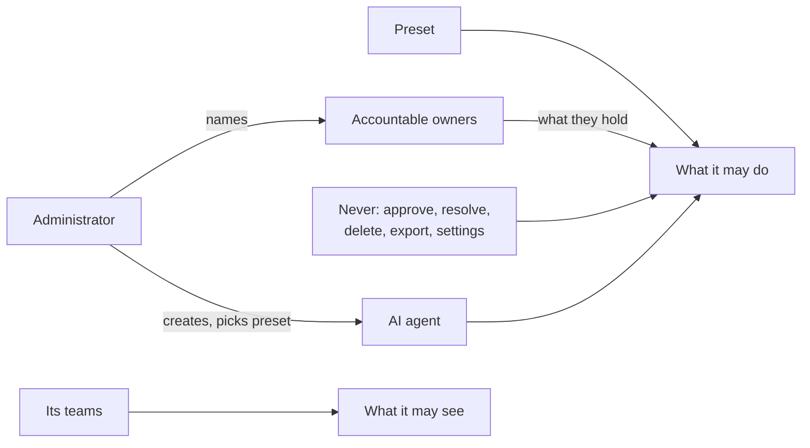
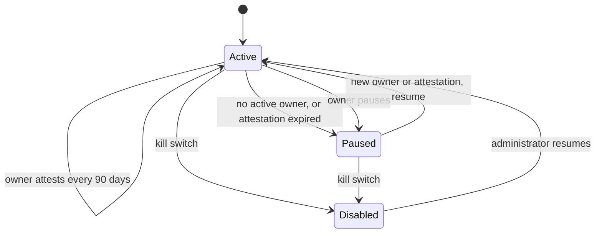
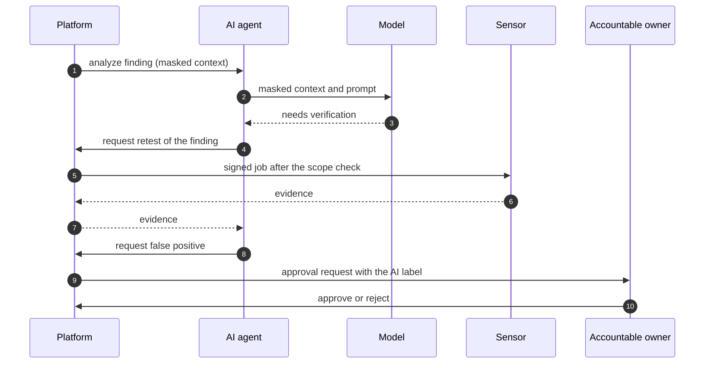

# AI agents
{: .no_toc }

An AI agent takes part in triage like a member of your team. It uses the same actions, follows
the same approvals and is recorded in the same audit trail. Everything it does carries an AI badge
and says which model, which prompt and which people answer for it. An AI agent has a role; the
analyst, who triages findings, is the first. You manage AI agents in
[Settings > AI: AI agents](../user-guide/ai-agents.md). Engineering detail is in
[ai-analysis.md](https://github.com/openctemio/openctem/blob/develop/api/docs/architecture/ai-analysis.md)
in the openctem repository.

1. TOC
{:toc}

---

## What an AI agent is

- **Its own identity.** An AI agent is a service account of your organization, not a person's
  delegate. It cannot sign in, has no password or MFA, holds no API key or MCP grant, and does not use a seat.
- **A preset.** *Suggest* reads findings, writes comments and opens approval requests. *Triage* can
  also confirm findings, move their status, raise severity, link duplicates and assign.
- **Accountable owners.** Every AI agent has people or teams who answer for its results. An AI agent
  never does more than its owners could do themselves.
- **Never an approver.** Approving, verifying, resolving, deleting, exporting, revealing secrets, bulk changes and changing
  settings always stay with people. Anything that lowers risk (false positive, accepted risk, lower
  severity) becomes a request that a person approves, whatever your organization's approval settings
  are.

## Accountable owners

| Duty | How |
|---|---|
| Answer for the AI agent | Named on every change it makes: "AI agent *name*" with "Accountable: *owners*" |
| Review its requests | Notified first for its approval requests; they approve only if they could approve anyway |
| Attest | Confirm every 90 days that its preset, scope and behavior are still right |
| Stop it | Pause it at any time; administrators can disable it |

The AI agent pauses on its own when no owner is active any more (someone left, a team was emptied) or
when the attestation is older than 90 days. Naming a new owner or attesting again resumes it.

## Where it runs and how it uses tools

- **Your platform holds identity and governance**: the AI agent, its owners, approvals and audit.
- **The reasoning** runs in the platform (the default, with masked data sent to your chosen model).
  Running it in an AI worker that your organization operates next to its own model is planned.
- **Tools always run on your sensors.** An AI agent never connects to a target. It asks the platform
  to retest a finding, exactly like a person clicking Retest; the platform checks scope and sends a
  signed job to a sensor. The AI agent never picks a target itself.

| Deployment | Reasoning | Model | Tools |
|---|---|---|---|
| Cloud | platform | platform or your own key | your sensors or platform sensors |
| Self-hosted with a cloud model | platform | your provider key | your sensors |
| Self-hosted with a local model | platform (an AI worker is planned) | local | your sensors |
| Air-gapped | platform (an AI worker is planned) | local | your sensors |

## What you see

- An **AI agent** badge, "AI agent {name}", with "Accountable: {owners}" on the finding timeline.
- Settings > Security > AI > AI agents: each AI agent's preset, status, owners and attestation date.
- Each AI run with its model, prompt version and the fields sent and withheld (API).
- AI comments are internal: they are never sent to tickets or integrations.
