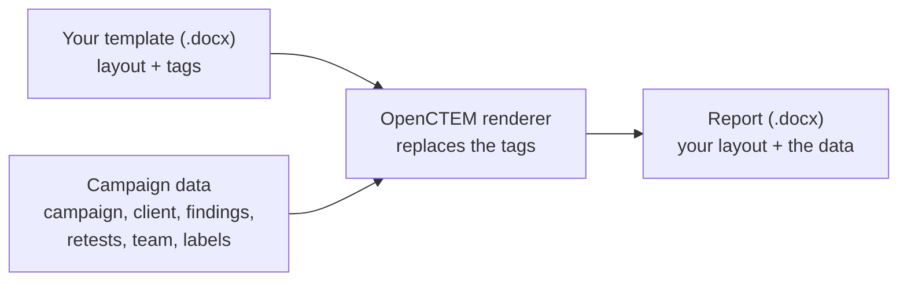



# Report templates

A report template is a Word document (`.docx`) in your organization's own
layout. Where campaign data belongs, it holds **tags** in curly braces, such
as `{client.name}`. When someone generates a campaign report in Word format
with the template, OpenCTEM replaces the tags with that campaign's data and
returns a new `.docx`. The rest of the file stays exactly as you designed it:
styles, fonts, colors, logo, headers and footers, page setup and fixed text.

**In the template**


**In the generated report**


On this page:

- [Quick start](#quick-start): your first template in five minutes
- [How it works](#how-it-works)
- [Worked example](#worked-example-from-template-to-report): a starter template next to the report it produces
- [The tag language](#the-tag-language)
- [Layout, styles and formatting](#layout-styles-and-formatting)
- [Evidence screenshots and images](#evidence-screenshots-and-images)
- [Recipes](#recipes)
- [Checking a template and fixing problems](#checking-a-template-and-fixing-problems)
- [What is not supported](#what-is-not-supported)
- [Security](#security) and [Limits](#limits)
- [API](#api)
- [Tag reference](#tag-reference): every tag, with its type and an example

## Quick start

1. **Download a starter.** In the console, open **Settings › Pentest
   methodology › Report templates**, click **Starter template** and pick
   **Standard report**.
2. **Make it yours in Word** (or LibreOffice Writer). Change the styles, fonts
   and colors, add your logo, rewrite the fixed text. Leave the text in braces
   alone for now.
3. **Save as `.docx`** (Word Document).
4. **Upload.** Click **Upload template**, choose the file, give it a name and
   the language of its built-in labels. The file is checked at once: errors
   are listed with the fix. Click **Check and save**.
5. **Preview.** Click **Preview with sample data** on the template. You get
   the template filled with a fictional campaign.
6. **Use it.** On a campaign, click **Generate report**, choose **Word
   (DOCX)** and pick your template.

{: .tip }
Open the **Tag reference** panel on the Report templates page while you edit.
Click a tag to copy it, then paste it into Word. Copying avoids typos.

## How it works



| Term | Meaning |
|---|---|
| **Template** | A `.docx` (or `.dotx`) file uploaded under **Settings › Pentest methodology › Report templates** (`/settings/pentest/report-templates`). An organization keeps up to 20 templates, each with a unique name. |
| **Tag** | Text in braces that the renderer replaces. There are five kinds (value, section, inverted section, Markdown block, current item) and no expressions: a template can only read the data it is given. |
| **Report data** | One campaign's report: the campaign, the client, the team, counts per severity, the findings the report options select (most severe first), retest results and built-in labels. The full list is the [Tag reference](#tag-reference). |
| **Template language** | English or Vietnamese, chosen at upload. It sets the built-in labels (`{labels.severity}` prints "Severity" in English), the severity and status names (`{severity_label}`) and the report title. Your own fixed text prints as you typed it. |
| **Sample data** | A fictional campaign ("Example Corp external assessment", three findings, one retest) used by the check, the preview and the examples on this page. Download it as JSON from the **Tag reference** panel. |
| **Check** | Every file is checked when you pick it in the upload dialog and again when it is saved. Errors (the template cannot work) block saving. Warnings (it works, probably not as you meant) come with the fix. |

{: .note }
Everyone who may generate pentest reports can download starters, open the tag
reference, check files, and preview and download templates. Only owners and
admins upload and delete templates. Uploads and deletions are recorded in the
audit log.

### The starters

| Starter | What it contains |
|---|---|
| **Standard report** | Cover page, table of contents, summary with a severity table, findings table, one section per finding (details table, description with evidence screenshots, steps, proof of concept, impact, remediation, references), remediation plan, retests, appendix (methodology, team, severity ratings). |
| **Executive one-pager** | Overview, counts per severity, critical and high findings and retests, on one page. |
| **Detailed technical** | Like the standard report, with one finding per page, every field and a severity-colored row. |

Every heading, label and code block in the starters uses a named style, so
one change in Word (Home › Styles) restyles the whole report. Section tags
use the small purple **Template Tag** style so you can see them. Paragraphs
that hold only a section tag disappear from the report.

## Worked example: from template to report

The images below are pages of the **Standard report** starter, first as you
download it and then as OpenCTEM renders it with the sample data.

### A table with one row per finding

The table has a header row and one data row. `{#findings}` opens the loop at
the start of the first cell and `{/findings}` closes it at the end of the last
cell, so the row repeats once per finding. The paragraph
`{^has_findings}{labels.no_findings}{/has_findings}` above it prints "No
findings were reported." only when there are none.

**In the template**


**In the generated report**


### Rows that appear only when they apply

Each finding gets a details table. Five severity rows, each colored in Word,
are wrapped in `{#is_critical}` … `{/is_critical}`, `{#is_high}` …
`{/is_high}` and so on; only the row of the finding's severity is kept. The
CVSS, CWE and affected-targets rows are wrapped in sections over their own
values, so they disappear when the finding has no such data.

**In the template**


**In the generated report**


### Markdown, lists and optional blocks

`{@description}` turns the finding's Markdown description into Word
paragraphs. `{#steps}` … `{/steps}` repeats the bullet `• {.}` once per step;
`{.}` is the step itself. The "Steps to reproduce" heading sits inside
`{#has_steps}` … `{/has_steps}` and the proof of concept inside `{#poc}` …
`{/poc}`, so both disappear for findings without them.

**In the template**


**In the generated report**


## The tag language

A tag is `{`, an optional marker, a path and `}`. A path is names (letters,
digits, underscores) joined by dots: `campaign.name`, `stats.critical`,
`findings_by_severity.high`. Spaces inside the braces are allowed:
`{ campaign.name }`.

| Tag | Kind | What it does |
|---|---|---|
| `{path}` | Value | Prints the value as text. |
| `{#path}` … `{/path}` | Section | Repeats the content for each item of a list, or shows it once when the value is yes or not empty. |
| `{^path}` … `{/path}` | Inverted section | Shows the content once when the value is no, empty or missing. |
| `{@path}` | Markdown block | Replaces its paragraph with the value's Markdown, rendered as Word paragraphs. |
| `{.}` | Current item | Inside a section over a list of text: the item itself. |

The examples below use the sample data. Each line of the template is one
paragraph in Word.

### Values

Template:

```
{labels.prepared_for}: {client.name}
{labels.period}: {campaign.start_date} – {campaign.end_date}
```

Report:

```
Prepared for: Example Corp
Testing period: 2026-01-12 – 2026-01-23
```

Line breaks in a value are kept. A missing or empty value prints nothing. A
list of text prints as `a, b, c`: `{targets}` prints `portal.example.com` for
the first finding.

### Sections over a list (loops)

Template:

```
{#findings}
{number}. {title} ({severity_label})
{/findings}
```

Report:

```
1. SQL injection in the login form (Critical)
2. Missing rate limit on password reset (Medium)
3. Server version disclosed (Info)
```

Inside `{#findings}` … `{/findings}`, a tag is looked up in the current
finding first, then outward: `{title}` is the finding's title, while
`{campaign.name}` and `{labels.severity}` still work. Outside the loop,
`{title}` prints nothing, and the check tells you where to put it.

Loops nest, up to 8 sections deep. A finding has the lists `steps`, `targets`
and `references`:

```
{#findings}
{number}. {title}
{#steps}
• {.}
{/steps}
{/findings}
```

### Conditions

A section over a yes/no value or a single value shows its content once when
the value is yes or not empty, and hides it otherwise. Inside the findings
loop:

Template:

```
{#cvss_score}CVSS {cvss_score}{/cvss_score}
```

Report: `CVSS 9.8` for the first finding, `CVSS 5.3` for the second, and
nothing for the third, which has no score.

Useful yes/no fields:

- `is_critical`, `is_high`, `is_medium`, `is_low`, `is_info`: content for one
  severity only.
- `has_steps`, `has_targets`, `has_references`: a heading shown only when the
  finding has that list. Example: `{#has_steps}{labels.steps}{/has_steps}`.
- `has_findings`, `has_retests`, `stats.has_critical`, `stats.has_high`:
  report-level conditions.

An **inverted section** shows its content when the value is no, empty or
missing:

```
{^has_findings}{labels.no_findings}{/has_findings}
```

prints "No findings were reported." in a report without findings, and nothing
otherwise.

{: .note }
There are no comparisons (`severity == "high"`) and no "and"/"or". Use the
yes/no fields; nest two sections for "and"; put two sections side by side for
"or".

### Markdown blocks

Finding descriptions, impacts and remediation, and the campaign description,
are written in Markdown in OpenCTEM. Put `{@description}` alone in a
paragraph; style that paragraph as you want the body text to look.

Template:

```
{@remediation}
```

Report (the first finding's remediation):

```
Use parameterized queries.
• Bind every parameter
• Add a WAF rule as a stopgap
```

| Markdown | In the report |
|---|---|
| Paragraphs, line breaks | Paragraphs in the style of the `{@…}` paragraph |
| `# Heading` | A bold paragraph |
| `- item`, `1. item` | Bulleted or numbered paragraphs |
| `> quote` | Italic paragraph |
| Fenced code | Monospace paragraphs |
| `**bold**`, `*italic*`, `` `code` `` | Bold, italic, monospace |
| Links | `text (url)` |
| `` | The evidence screenshot (see [Evidence](#evidence-screenshots-and-images)) |

{: .warning }
`{description}` without `@` prints the raw Markdown markup, asterisks and
all. The check warns about it.

### The current item

`{.}` is the item itself inside a section over a list of text (`steps`,
`targets`, `references`):

Template:

```
{#references}
• {.}
{/references}
```

Report:

```
• https://owasp.org/www-community/attacks/SQL_Injection
```

### Where sections may sit

A section must enclose whole pieces of the document. Three placements work:

1. **Each tag alone in its own paragraph**, both paragraphs at the same level
   (both in the body, or both in the same table cell). Everything between
   them (paragraphs, headings, tables, page breaks) repeats or shows.
2. **Both tags in the same table row**, usually the opening tag at the start
   of the first cell and the closing tag at the end of the last cell. The row
   repeats; this is how you build a table with one row per finding. A row
   section over a yes/no value keeps or drops the row.
3. **Both tags in the same paragraph**: the text between them repeats or
   shows, for example `{#cve}CVE: {cve}{/cve}`.

{: .warning }
One tag inside a table and the other outside it does not work. Neither does a
section tag that shares its paragraph with other text when the section spans
several paragraphs. The check reports both, with the fix.

## Layout, styles and formatting

- **Styles are kept.** The renderer only replaces tags, so styles, themes,
  fonts, numbering, page size, margins, columns, section breaks and
  watermarks stay as you set them. Prefer named styles over direct
  formatting: they survive edits and keep the report consistent.
- **A value takes the formatting of its tag.** Make `{client.name}` bold, and
  the client name prints bold. A tag gets the formatting of its first
  character, so format the whole tag.
- **Headers and footers** can hold tags such as
  `{report.classification_label}`, `{client.name}` and `{campaign.name}`.
  Page numbers are Word fields (Insert › Page Number) and stay fields. Loops
  work in headers and footers too, but screenshots there print their alt
  text.
- **Page breaks.** A page break (Ctrl+Enter) inside a section repeats with
  it. To start each finding on a new page, give the finding's heading style
  *Page break before* (Paragraph › Line and Page Breaks). The technical
  starter does this with its **Finding Heading** style.
- **Table of contents.** Insert one over your heading styles (References ›
  Table of Contents). The starters mark their contents field to update when
  the report opens: when Word asks to update the fields in the document,
  answer yes. In LibreOffice use *Tools › Update › Update All*.
- **Tables with one row per item.** Mark the header row *Repeat as header
  row* so it repeats on every page. A table whose only repeating rows are
  empty keeps its header row. A table whose every row repeated zero times is
  left out.
- **Dates** print as `YYYY-MM-DD` (`2026-01-23`). **Numbers** print plain:
  counts as integers, CVSS scores with one decimal (`9.8`). There is no date
  or number formatting in the template.
- **Languages.** `report.title`, every `labels.*` text and every `*_label`
  value (severity, status, retest result, classification) follow the
  template language. Data typed into OpenCTEM (titles, descriptions) prints
  as typed.
- **Fixed text** is yours: legal notices, methodology chapters, contact
  details. Braces in fixed text that are not tags print as typed (the check
  warns in case they are a typo).

## Evidence screenshots and images

- **Evidence.** A finding's Markdown can show evidence screenshots
  (``, which the finding form inserts
  when you attach a screenshot). In a `{@…}` block in the document body, the
  screenshot is embedded as a picture, at most 6 inches (15.2 cm) wide,
  keeping its proportions.
- **Only that finding's evidence.** A screenshot is embedded only when it
  belongs to the finding, its retests or its campaign: a report cannot pull
  in another campaign's files.
- **Formats and sizes.** PNG, JPEG and GIF, each up to 5 MiB, up to 40 MiB and
  200 pictures per report. Anything else, and any image in a header or
  footer, prints as its alt text.
- **Your logo and fixed pictures.** Insert them in Word like any picture
  (Insert › Pictures, *Insert*, not *Link to file*). They are part of the
  template and appear in every report.

{: .tip }
The whole template must stay under 10 MiB. Compress pictures before saving
(Picture Format › Compress Pictures, 150 ppi).

{: .note }
Image tags (`{%logo}`) are reserved and refused: a picture chosen per report
is not supported.

## Recipes

Each recipe is the text to type in Word. One line is one paragraph unless it
says *table*; `←` notes the paragraph style to use.

### Cover page with your logo

```
[your logo, inserted as a picture]
{report.title}                          ← style Title
{campaign.name}                         ← style Subtitle
{labels.prepared_for}: {client.name}
{labels.period}: {campaign.start_date} – {campaign.end_date}
{labels.classification}: {report.classification_label}
[page break]
```

To keep the header off the cover, tick *Different First Page* (Header &
Footer options). For per-client branding (a client's logo or colors), keep
one template per client.

### Executive summary

```
{labels.summary}                        ← style Heading 1
{@campaign.description}
In total {stats.total} findings: {stats.critical} critical, {stats.high} high, {stats.medium} medium, {stats.low} low and {stats.info} informational.
{#stats.has_critical}
Critical issues need immediate action.
{/stats.has_critical}
```

### Severity table

*Table* with a header row and one row per severity. Shade each severity cell
in Word (Table Design › Shading).

| `{labels.severity}` | `{labels.count}` |
|---|---|
| `{labels.critical}` | `{stats.critical}` |
| `{labels.high}` | `{stats.high}` |
| `{labels.medium}` | `{stats.medium}` |
| `{labels.low}` | `{stats.low}` |
| `{labels.info}` | `{stats.info}` |
| `{labels.total}` | `{stats.total}` |

### Findings table

*Table* with a header row and one repeating row (see the
[worked example](#a-table-with-one-row-per-finding)):

| # | `{labels.title}` | `{labels.severity}` | CVSS | `{labels.status}` |
|---|---|---|---|---|
| `{#findings}{number}` | `{title}` | `{severity_label}` | `{cvss_score}` | `{status_label}{/findings}` |

### Only critical and high findings

*Table* with two repeating rows: one over
`{#findings_by_severity.critical}` … `{/findings_by_severity.critical}`, the
other over `{#findings_by_severity.high}` … `{/findings_by_severity.high}`.
The executive starter does this. With the sample data the high row
disappears, because there are no high findings.

**In the template**


**In the generated report**


### Findings with evidence

```
{#findings}
{number}. {title}                       ← style Heading 2
{labels.severity}: {severity_label}    CVSS: {cvss_score} {cvss_vector}
{#cwe}CWE: {cwe}  {/cwe}{#cve}CVE: {cve}  {/cve}{#owasp}OWASP: {owasp}{/owasp}
{#has_targets}
{labels.affected_targets}: {targets}
{/has_targets}
{labels.description}                    ← style Label
{@description}
{#has_steps}
{labels.steps}
{/has_steps}
{#steps}
• {.}
{/steps}
{#poc}
{labels.poc}
{poc}                                   ← style Code
{/poc}
{#remediation}
{labels.remediation}
{@remediation}
{/remediation}
{/findings}
```

`{poc}` is empty when the report was generated without proofs of concept, so
the whole block disappears.

### A severity-colored row per finding

In a finding's details *table*, add five rows, one per severity, each colored
in Word. Only the matching row is kept (see the
[worked example](#rows-that-appear-only-when-they-apply)).

| Left cell | Right cell, shaded in Word |
|---|---|
| `{#is_critical}{labels.severity}` | `{severity_label}{/is_critical}` (dark red) |
| `{#is_high}{labels.severity}` | `{severity_label}{/is_high}` (red) |
| `{#is_medium}{labels.severity}` | `{severity_label}{/is_medium}` (orange) |
| `{#is_low}{labels.severity}` | `{severity_label}{/is_low}` (blue) |
| `{#is_info}{labels.severity}` | `{severity_label}{/is_info}` (grey) |

### Findings grouped by severity

```
{#stats.has_critical}
{labels.critical}                       ← style Heading 2
{/stats.has_critical}
{#findings_by_severity.critical}
{number}. {title}
{/findings_by_severity.critical}
{#stats.has_high}
{labels.high}                           ← style Heading 2
{/stats.has_high}
{#findings_by_severity.high}
{number}. {title}
{/findings_by_severity.high}
```

### Retests

```
{#has_retests}
{labels.retests}                        ← style Heading 1
[table: {labels.finding} | {labels.result} | {labels.tested_at} | {labels.notes}]
[row:   {#retests}{finding_title} | {status_label} | {tested_at} | {notes}{/retests}]
{/has_retests}
```

### Appendix

```
{labels.appendix}                       ← style Heading 1
{#campaign.methodology}
{labels.methodology}: {campaign.methodology}
{/campaign.methodology}
[table: {labels.name} | {labels.role}]
[row:   {#team}{name} | {role}{/team}]
```

The starters also include a severity ratings table built from
`{labels.critical}` and `{labels.critical_desc}`, and so on for each severity.

## Checking a template and fixing problems

The upload dialog checks a file as soon as you pick it, and **Preview** checks
a stored template again. Each problem names where it is (body, header,
footer, footnotes) and quotes the text of its paragraph, so you can find it
with Word's Find (Ctrl+F).

### Errors (the template cannot be saved)

| Problem | How to fix it |
|---|---|
| *{#x} is never closed* | Add `{/x}` where the repeated or conditional part ends. |
| *{/x} closes a section that was never opened* | Add `{#x}` before it, or delete it. |
| *{/y} does not match the open section* | Sections close in reverse order: the inner one first. Use the suggested tag. |
| *{#x} and its closing tag cannot enclose this content* | See [Where sections may sit](#where-sections-may-sit): move both tags out of (or into) the table, or put each alone in its paragraph. |
| *{@x} must be alone in its paragraph* | Move other text to a separate paragraph. |
| *Image tags such as {%x} are not supported* | Insert fixed pictures in Word; evidence comes from findings. |
| *The file was refused* | Save as a plain Word document (`.docx`), without macros, embedded objects, ActiveX controls or linked pictures and templates. |

### Warnings (the template works, probably not as meant)

| Problem | How to fix it |
|---|---|
| *{x} is not in the report data* | Usually a typo: use the suggested tag, or copy the tag from the Tag reference. |
| *{title} is a field of each item of findings* | Move it between `{#findings}` and `{/findings}`. |
| *{description} holds Markdown* | Use `{@description}` alone in a paragraph. |
| *{findings} is a list* | Use `{#findings}` … `{/findings}` and the item fields inside. |
| *{.} only works inside a list of text* | Put it inside `{#steps}` … `{/steps}` (or `targets`, `references`). |
| *"{campaign name}" is not a template tag* | Tags use dots and underscores, no spaces or hyphens: use the suggested tag. If the braces are meant as text, ignore the warning. |
| *a brace that is not closed in this paragraph* | A tag was split by a line or paragraph break, or a `}` is missing. Retype the tag in one paragraph. |
| *The file has tracked changes* | Review › Accept All Changes, turn off Track Changes, save. |

### Word split my tag

While you type, Word stores text in pieces ("runs") whenever spelling, the
language, formatting or editing history changes, so `{campaign.name}` may be
stored as `{camp` + `aign.na` + `me}`. The renderer joins the pieces of each
paragraph before reading tags, so this needs no action.

{: .warning }
What the renderer cannot join is a tag broken by a paragraph or line break,
or one whose halves sit in different text boxes or table cells. Retype such
tags in one go.

### Other symptoms

| Symptom | Cause and fix |
|---|---|
| A value prints nothing | The campaign has no data for it (no CVSS score, no CWE), the tag is outside its loop, or it is misspelled. The check and the preview's issue list name the last two. |
| A whole table disappeared | All of its rows repeat over an empty list. Add a header row that is not part of the section. |
| Extra empty lines | The paragraphs holding only `{#x}` and `{/x}` are removed, but empty paragraphs you typed around them stay. |
| The table of contents says "Update this field" | Update fields when the report opens (Word asks), or right-click the table › Update Field. |
| A screenshot shows as text | It is not evidence of that finding or its campaign, it is not PNG, JPEG or GIF, it is larger than 5 MiB, the report's pictures passed 40 MiB, or the tag is in a header or footer. |
| The template is too large | The limit is 10 MiB: compress pictures and remove embedded fonts (File › Options › Save). |

## What is not supported

| Not supported | Why, and what to do instead |
|---|---|
| Expressions, functions, filters (`{severity | upper}`, `{stats.total > 0}`, formulas) | Templates are files from outside the platform. A template language that can only read the given data cannot run code, call services or reach other organizations' data. Use the yes/no fields and the `*_label` values. |
| Custom date or number formats | Dates are `YYYY-MM-DD`, scores have one decimal. |
| Per-report pictures (`{%…}`) | Use fixed pictures in the template, and evidence screenshots through Markdown. |
| Macros, ActiveX, embedded objects (OLE), linked pictures, attached templates | Refused (see [Security](#security)). |
| `.doc`, `.docm`, `.odt` | Save as `.docx`. In LibreOffice choose *Keep current format* › *Word 2007–365*. |
| Tags across paragraphs, text boxes or table cells | Type each tag in one go, inside one paragraph. |
| PDF output from a template | Open the `.docx` and export it to PDF. |

## Security

- **Files are untrusted input.** Every upload is checked before it is stored:
  a real Word package, at most 10 MiB, at most 300 parts, each at most
  20 MiB and 60 MiB unpacked (zip bombs are refused), no unsafe part names, no
  DTD or entity declarations in the XML.
- **No active content.** Macro-enabled documents, VBA projects, ActiveX
  controls and embedded objects are refused.
- **No external references.** Linked pictures, attached templates, frames and
  OLE links (which would make Word fetch a URL when the report is opened) are
  refused; only ordinary hyperlinks are allowed.
- **No code execution in rendering.** Tags read data; nothing else runs.
  Values are escaped, so data cannot inject Word markup. Rendering is bounded
  (output size, number of repetitions, nesting depth).
- **Isolation.** A template belongs to one organization and renders only that
  organization's campaigns; evidence pictures come only from the finding's
  own campaign.

## Limits

| What | Limit |
|---|---|
| File | `.docx` or `.dotx`, at most 10 MiB, 300 parts, 20 MiB per part, 60 MiB unpacked |
| Templates | 20 per organization, unique names |
| Rendering | 50 MiB per document part, 200,000 repetitions, sections nested 8 deep |
| Evidence pictures | PNG, JPEG, GIF; 5 MiB each, 40 MiB and 200 per report; at most 6 inches wide |

## API

| Method | Path | Purpose |
|---|---|---|
| GET | `/api/v1/pentest/report-templates` | List the organization's templates |
| GET | `/api/v1/pentest/report-templates/starter?variant=standard|executive|technical` | A starter template |
| GET | `/api/v1/pentest/report-templates/reference?language=en&locale=en` | The tag reference and the sample data |
| POST | `/api/v1/pentest/report-templates/verify` | Check a file (multipart `file`, `language`) without storing it |
| POST | `/api/v1/pentest/report-templates` | Upload (multipart `file`, `name`, `description`, `language`); owners and admins |
| GET | `/api/v1/pentest/report-templates/{id}/issues` | Check a stored template |
| GET | `/api/v1/pentest/report-templates/{id}/preview` | The template rendered with the sample data |
| GET | `/api/v1/pentest/report-templates/{id}/file` | The uploaded file |
| DELETE | `/api/v1/pentest/report-templates/{id}` | Delete; owners and admins |

To generate a report through a template, call
`POST /api/v1/pentest/campaigns/{id}/reports` with `"format": "docx"` and
`"options": {"template_id": "<id>"}`, then
`GET /api/v1/pentest/reports/{id}/download`. A check answers `valid` and a
list of issues, each with `level`, `code`, `tag`, `part`, `context`,
`suggestion`, `within` and an English `message`.

Design and threat model:
[RFC-076](https://github.com/openctemio/openctem/blob/develop/api/docs/rfcs/RFC-076-pentest-report-templates.md);
code map:
[architecture note](https://github.com/openctemio/openctem/blob/develop/api/docs/architecture/pentest-report-templates.md).

## Tag reference

Every tag a template can read, generated from the renderer's data model: the
same list as the console's **Tag reference** panel (which adds search and
click-to-copy) and `GET /api/v1/pentest/report-templates/reference`. Examples
are the sample data. Tags in the *Each finding*, *Each retest* and *Each team
member* groups are read inside a loop over that list.

<!-- The block below is generated: refresh it with
     scripts/regen-report-tag-reference.sh <openctem checkout>. -->
<!-- BEGIN GENERATED TAG REFERENCE -->

### Report

| Tag | Type | Description | Example |
|---|---|---|---|
| `{report.title}` | text | The report type's name in the template language. | `Technical report` |
| `{report.type}` | text | Report type: executive_summary, technical_report, finding_report, compliance_report, remediation_report or retest_report. | `technical_report` |
| `{report.language}` | text | Language of the template's built-in labels: en or vi. | `en` |
| `{report.generated_at}` | text | Date the report was generated, YYYY-MM-DD. | `2026-02-03` |
| `{report.classification}` | text | Classification: public, internal, confidential or restricted. | `confidential` |
| `{report.classification_label}` | text | The classification in the template language, for a header or cover. | `Confidential` |
| `{report.watermark}` | text | Watermark text chosen when generating the report; may be empty. |  |

### Campaign

| Tag | Type | Description | Example |
|---|---|---|---|
| `{campaign.name}` | text | Campaign name. | `Example Corp external assessment` |
| `{@campaign.description}` | markdown | Campaign description (Markdown): use {@campaign.description} alone in a paragraph. | `External black-box assessment of the **customer portal** and its API.` |
| `{campaign.type}` | text | The campaign's target types in words, comma-separated. | `Web application, API` |
| `{#campaign.targets}{.}{/campaign.targets}` | text_list | Target type values; loop with {#campaign.targets}{.}{/campaign.targets}. | `web_app | api` |
| `{campaign.status}` | text | Campaign status: planning, in_progress (testing), reporting, completed (remediation), on_hold, canceled or archived. | `completed` |
| `{campaign.status_label}` | text | The campaign phase in the template language, such as Testing, Reporting or Remediation. | `Remediation` |
| `{campaign.approach}` | text | Testing approach: black_box, grey_box or white_box. | `grey_box` |
| `{campaign.environment}` | text | Environment tested, production, staging, development or other. | `staging` |
| `{campaign.tlp}` | text | Traffic Light Protocol marking: clear, green, amber, amber_strict or red. | `amber` |
| `{campaign.methodology}` | text | Testing methodology, such as OWASP WSTG or PTES. | `OWASP WSTG` |
| `{campaign.start_date}` | text | First day of testing, YYYY-MM-DD. | `2026-01-12` |
| `{campaign.end_date}` | text | Last day of testing, YYYY-MM-DD. | `2026-01-23` |

### Client

| Tag | Type | Description | Example |
|---|---|---|---|
| `{client.name}` | text | Client organization name. | `Example Corp` |
| `{client.contact}` | text | Client contact as entered on the campaign. | `security@example.com` |

### Statistics

| Tag | Type | Description | Example |
|---|---|---|---|
| `{stats.total}` | number | Number of findings in the report. | `3` |
| `{stats.critical}` | number | Number of critical findings. | `1` |
| `{stats.high}` | number | Number of high findings. | `0` |
| `{stats.medium}` | number | Number of medium findings. | `1` |
| `{stats.low}` | number | Number of low findings. | `0` |
| `{stats.info}` | number | Number of informational findings. | `1` |
| `{stats.avg_cvss}` | number | Average CVSS score of the findings that have one, one decimal. | `7.6` |
| `{stats.max_cvss}` | number | Highest CVSS score, one decimal. | `9.8` |
| `{#stats.has_critical}…{/stats.has_critical}` | boolean | Yes when there is at least one critical finding; for {#stats.has_critical}…{/stats.has_critical}. | `true` |
| `{#stats.has_high}…{/stats.has_high}` | boolean | Yes when there is at least one high finding. | `false` |

### Finding lists

| Tag | Type | Description | Example |
|---|---|---|---|
| `{#findings}…{/findings}` | list | The findings in the report, most severe first; loop with {#findings}…{/findings}. |  |
| `{#findings_by_severity.critical}…{/findings_by_severity.critical}` | list | Only the critical findings; same fields as each finding. |  |
| `{#findings_by_severity.high}…{/findings_by_severity.high}` | list | Only the high findings. |  |
| `{#findings_by_severity.medium}…{/findings_by_severity.medium}` | list | Only the medium findings. |  |
| `{#findings_by_severity.low}…{/findings_by_severity.low}` | list | Only the low findings. |  |
| `{#findings_by_severity.info}…{/findings_by_severity.info}` | list | Only the informational findings. |  |
| `{#has_findings}…{/has_findings}` | boolean | Yes when the report has findings; {^has_findings}…{/has_findings} shows content when it has none. | `true` |

### Each finding (inside {#findings}…{/findings} or a findings_by_severity list)

| Tag | Type | Description | Example |
|---|---|---|---|
| `{number}` | text | Finding number in report order: 1, 2, 3… | `1` |
| `{title}` | text | Finding title. | `SQL injection in the login form` |
| `{severity}` | text | Severity: critical, high, medium, low or info. | `critical` |
| `{severity_label}` | text | Severity in the template language. | `Critical` |
| `{status}` | text | Status, such as confirmed, fix_applied or resolved. | `confirmed` |
| `{status_label}` | text | Status in the template language. | `Confirmed` |
| `{cvss_score}` | text | CVSS score with one decimal; empty when none. | `9.8` |
| `{cvss_vector}` | text | CVSS vector string; may be empty. | `CVSS:3.1/AV:N/AC:L/PR:N/UI:N/S:U/C:H/I:H/A:H` |
| `{cwe}` | text | CWE identifier; may be empty. | `CWE-89` |
| `{cve}` | text | CVE identifier; may be empty. |  |
| `{owasp}` | text | OWASP Top 10 category; may be empty. | `A03:2021` |
| `{@description}` | markdown | Description (Markdown, may embed evidence screenshots): use {@description} alone in a paragraph. | `The 'username' parameter is concatenated into a SQL query.  An attacker can read every table.` |
| `{@business_impact}` | markdown | Business impact (Markdown). | `Full read access to customer records.` |
| `{@technical_impact}` | markdown | Technical impact (Markdown). |  |
| `{@remediation}` | markdown | Remediation advice (Markdown). | `Use parameterized queries.  - Bind every parameter - Add a WAF rule as a stopgap` |
| `{poc}` | text | Proof of concept as plain text; empty when the report leaves proofs of concept out. | `POST /login HTTP/1.1 Host: portal.example.com  username=' OR 1=1 --&password=x` |
| `{#steps}{.}{/steps}` | text_list | Steps to reproduce; loop with {#steps}{.}{/steps}. | `Open https://portal.example.com/login | Enter '' OR 1=1 --' as the username | Observe the admin dashboard` |
| `{#targets}{.}{/targets}` | text_list | Affected targets (hosts, URLs); loop with {#targets}{.}{/targets}. | `portal.example.com` |
| `{#references}{.}{/references}` | text_list | Reference links; loop with {#references}{.}{/references}. | `https://owasp.org/www-community/attacks/SQL_Injection` |
| `{#has_steps}…{/has_steps}` | boolean | Yes when the finding has steps; for a heading shown only then. | `true` |
| `{#has_targets}…{/has_targets}` | boolean | Yes when the finding has affected targets. | `true` |
| `{#has_references}…{/has_references}` | boolean | Yes when the finding has references. | `true` |
| `{#is_critical}…{/is_critical}` | boolean | Yes for a critical finding; for severity-specific content. | `true` |
| `{#is_high}…{/is_high}` | boolean | Yes for a high finding. | `false` |
| `{#is_medium}…{/is_medium}` | boolean | Yes for a medium finding. | `true` |
| `{#is_low}…{/is_low}` | boolean | Yes for a low finding. | `false` |
| `{#is_info}…{/is_info}` | boolean | Yes for an informational finding. | `true` |
| `{created_at}` | text | Date the finding was reported, YYYY-MM-DD. | `2026-01-15` |

### Retests

| Tag | Type | Description | Example |
|---|---|---|---|
| `{#retests}…{/retests}` | list | Retest results; loop with {#retests}…{/retests}. |  |
| `{#has_retests}…{/has_retests}` | boolean | Yes when there are retest results. | `true` |

### Each retest (inside {#retests}…{/retests})

| Tag | Type | Description | Example |
|---|---|---|---|
| `{finding_title}` | text | Title of the retested finding. | `Server version disclosed` |
| `{finding_severity}` | text | Severity of the retested finding. | `info` |
| `{finding_severity_label}` | text | That severity in the template language. | `Info` |
| `{status}` | text | Retest result: passed, failed, partial, inconclusive (unable to verify), pending, in_progress or canceled. | `passed` |
| `{status_label}` | text | Retest result in the template language. | `Passed` |
| `{notes}` | text | Tester's notes. | `Header removed.` |
| `{tested_at}` | text | Date of the retest, YYYY-MM-DD. | `2026-02-02` |
| `{environment}` | text | Where the fix was verified: production, staging, development or qa; empty when not recorded. | `staging` |

### Team

| Tag | Type | Description | Example |
|---|---|---|---|
| `{#team}…{/team}` | list | The campaign team; loop with {#team}…{/team}. No e-mail addresses. |  |

### Each team member (inside {#team}…{/team})

| Tag | Type | Description | Example |
|---|---|---|---|
| `{name}` | text | Team member's name. | `Alex Tester` |
| `{role}` | text | Team member's role on the campaign, such as lead or tester. | `lead` |

### Methodology checklists

| Tag | Type | Description | Example |
|---|---|---|---|
| `{#checklists}…{/checklists}` | list | The methodology checklists the campaign ran; loop with {#checklists}…{/checklists}. |  |
| `{#has_checklists}…{/has_checklists}` | boolean | Yes when the campaign ran at least one checklist. | `true` |
| `{#has_checklist_failures}…{/has_checklist_failures}` | boolean | Yes when at least one checklist item failed. | `true` |
| `{checklist_summary.total}` | number | Number of items in all checklists. | `12` |
| `{checklist_summary.passed}` | number | Items that passed. | `7` |
| `{checklist_summary.failed}` | number | Items that failed. | `2` |
| `{checklist_summary.not_applicable}` | number | Items marked not applicable. | `1` |
| `{checklist_summary.untested}` | number | Items without a result. | `2` |
| `{checklist_summary.tested}` | number | Items with a result (passed, failed or not applicable). | `10` |
| `{checklist_summary.coverage}` | number | Share of items with a result, in percent, one decimal. | `83.3` |
| `{#checklist_sections}…{/checklist_sections}` | list | Coverage of each checklist section; loop with {#checklist_sections}…{/checklist_sections}. |  |
| `{#checklist_failed_items}…{/checklist_failed_items}` | list | The checklist items that failed; loop with {#checklist_failed_items}…{/checklist_failed_items}. |  |

### Each checklist (inside {#checklists}…{/checklists})

| Tag | Type | Description | Example |
|---|---|---|---|
| `{name}` | text | Checklist name. | `OWASP Web Security Testing Guide` |
| `{standard}` | text | Standard the checklist follows, such as OWASP WSTG; may be empty. | `OWASP WSTG` |
| `{standard_version}` | text | Version of the standard, such as 4.2; may be empty. | `4.2` |
| `{template_version}` | number | Version of the organization's checklist template the campaign ran. | `1` |
| `{#has_failed}…{/has_failed}` | boolean | Yes when an item of this checklist failed. | `true` |
| `{total}` | number | Number of items in the checklist. | `12` |
| `{passed}` | number | Items that passed. | `7` |
| `{failed}` | number | Items that failed. | `2` |
| `{not_applicable}` | number | Items marked not applicable. | `1` |
| `{untested}` | number | Items without a result. | `2` |
| `{tested}` | number | Items with a result (passed, failed or not applicable). | `10` |
| `{coverage}` | number | Share of items with a result, in percent, one decimal. | `83.3` |

### Each checklist section (inside {#checklist_sections}…{/checklist_sections})

| Tag | Type | Description | Example |
|---|---|---|---|
| `{checklist}` | text | Name of the checklist the section belongs to. | `OWASP Web Security Testing Guide` |
| `{id}` | text | Section ID, such as WSTG-ATHN. | `WSTG-ATHN` |
| `{title}` | text | Section title. | `Authentication Testing` |
| `{total}` | number | Number of items in the section. | `6` |
| `{passed}` | number | Items that passed. | `4` |
| `{failed}` | number | Items that failed. | `1` |
| `{not_applicable}` | number | Items marked not applicable. | `0` |
| `{untested}` | number | Items without a result. | `1` |
| `{tested}` | number | Items with a result (passed, failed or not applicable). | `5` |
| `{coverage}` | number | Share of items with a result, in percent, one decimal. | `83.3` |

### Each failed checklist item (inside {#checklist_failed_items}…{/checklist_failed_items})

| Tag | Type | Description | Example |
|---|---|---|---|
| `{checklist}` | text | Name of the checklist. | `OWASP Web Security Testing Guide` |
| `{section}` | text | Title of the item's section. | `Authentication Testing` |
| `{id}` | text | Item ID, such as WSTG-INPV-05. | `WSTG-ATHN-03` |
| `{title}` | text | Item title. | `Testing for Weak Lock Out Mechanism` |
| `{severity}` | text | The item's severity hint; may be empty. | `medium` |
| `{severity_label}` | text | That severity in the template language. | `Medium` |

### Labels

Built-in text in the template's language (`{labels.<key>}`); the English text is shown.

| Tag | Text |
|---|---|
| `{labels.affected_targets}` | Affected targets |
| `{labels.appendix}` | Appendix |
| `{labels.business_impact}` | Business impact |
| `{labels.checklist}` | Checklist |
| `{labels.classification}` | Classification |
| `{labels.client}` | Client |
| `{labels.compliance_report}` | Compliance report |
| `{labels.confidential}` | Confidential |
| `{labels.contact}` | Contact |
| `{labels.contents}` | Contents |
| `{labels.count}` | Count |
| `{labels.coverage}` | Coverage |
| `{labels.critical}` | Critical |
| `{labels.critical_desc}` | Easily exploited; leads to full compromise of the system or its data. Fix immediately. |
| `{labels.cs_archived}` | Closed |
| `{labels.cs_canceled}` | Canceled |
| `{labels.cs_completed}` | Remediation |
| `{labels.cs_in_progress}` | Testing |
| `{labels.cs_on_hold}` | On hold |
| `{labels.cs_planning}` | Planning |
| `{labels.cs_reporting}` | Reporting |
| `{labels.cvss}` | CVSS |
| `{labels.description}` | Description |
| `{labels.details}` | Details |
| `{labels.executive_summary}` | Executive summary |
| `{labels.failed}` | Failed |
| `{labels.failed_checks}` | Failed checks |
| `{labels.finding}` | Finding |
| `{labels.finding_report}` | Findings report |
| `{labels.findings}` | Findings |
| `{labels.generated_at}` | Generated |
| `{labels.high}` | High |
| `{labels.high_desc}` | Exploitable with moderate effort; significant impact on confidentiality, integrity or availability. Fix as a priority. |
| `{labels.info}` | Info |
| `{labels.info_desc}` | No direct risk; a hardening recommendation or an observation. |
| `{labels.internal}` | Internal use only |
| `{labels.key_findings}` | Key findings |
| `{labels.low}` | Low |
| `{labels.low_desc}` | Minor impact or hard to exploit. Fix when convenient. |
| `{labels.medium}` | Medium |
| `{labels.medium_desc}` | Exploitable under specific conditions or with limited impact. Fix in the normal release cycle. |
| `{labels.methodology}` | Methodology |
| `{labels.methodology_coverage}` | Methodology coverage |
| `{labels.name}` | Name |
| `{labels.no_findings}` | No findings were reported. |
| `{labels.no_key_findings}` | No critical or high severity findings were reported. |
| `{labels.not_applicable}` | Not applicable |
| `{labels.notes}` | Notes |
| `{labels.overview}` | Overview |
| `{labels.passed}` | Passed |
| `{labels.period}` | Testing period |
| `{labels.poc}` | Proof of concept |
| `{labels.prepared_for}` | Prepared for |
| `{labels.public}` | Public |
| `{labels.references}` | References |
| `{labels.remediation}` | Remediation |
| `{labels.remediation_plan}` | Remediation plan |
| `{labels.remediation_report}` | Remediation report |
| `{labels.reported}` | Reported |
| `{labels.restricted}` | Restricted |
| `{labels.result}` | Result |
| `{labels.retest_report}` | Retest report |
| `{labels.retests}` | Retest results |
| `{labels.role}` | Role |
| `{labels.section}` | Section |
| `{labels.severity}` | Severity |
| `{labels.severity_ratings}` | Severity ratings |
| `{labels.status}` | Status |
| `{labels.steps}` | Steps to reproduce |
| `{labels.summary}` | Summary |
| `{labels.team}` | Team |
| `{labels.technical_impact}` | Technical impact |
| `{labels.technical_report}` | Technical report |
| `{labels.tested}` | Tested |
| `{labels.tested_at}` | Tested |
| `{labels.title}` | Title |
| `{labels.total}` | Total |
| `{labels.untested}` | Untested |

<!-- END GENERATED TAG REFERENCE -->


