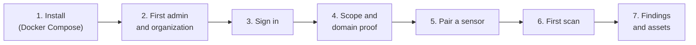

# Quickstart
{: .no_toc }

From nothing to your first findings in about 15 minutes: install the platform
on one host with Docker Compose, create the first administrator and
organization, authorize a target, pair a sensor, run a scan and read the
results. Each step links to the full page when you need more than the short
path.

1. TOC
{:toc}

---



## What you need

- A Linux host with 2 vCPU, 4 GB of memory and 20 GB of disk, Docker Engine and
  the Compose plugin 2.24 or later, `git` and `openssl`
  ([Requirements and sizing](install/index.md)).
- A DNS name or IP address for the platform. This guide uses
  `ctem.example.com`.
- A second host (or the same one) in the network you want to scan, with Docker,
  for the sensor. It needs only outbound HTTPS to the platform.
- A domain you control and may scan, and access to its DNS to add one TXT
  record. This guide uses `example.com`.

{: .warning }
Scan only systems you own or are authorized to test. OpenCTEM refuses targets
that no scope entry of your organization covers, but deciding what you may
test is your responsibility.

## 1. Install the platform

```bash
git clone https://github.com/openctemio/openctem.git
cd openctem
git checkout v0.11.0         # the release you deploy
cd api/deploy
./setup.sh ctem.example.com  # writes .env: the host name and generated secrets
```

`setup.sh` never overwrites an existing `.env` and never prints a secret. It
selects the gateway's own certificate authority (TLS mode `internal`, for a LAN
or an IP address); for a public DNS name with Let's Encrypt run
`./setup.sh ctem.example.com --acme you@example.com` instead. It also sets up
the platform console's own site (see step 2). Check the configuration and start
the stack:

```bash
docker compose run --rm api -check-config   # optional preflight
docker compose up -d
docker compose ps
curl --cacert ca/openctem-root-ca.crt https://ctem.example.com/health
```

The one-shot jobs (`gateway-init`, `datastore-tls`, `db-roles`, `migrate`,
`db-grants`) exit with code 0; `gateway`, `web`, `console`, `api`, `postgres`
and `redis` stay up. Back up `.env` now: `APP_ENCRYPTION_KEY` cannot be
recovered, and `FINGERPRINT_KEY` must be kept with it.

Full guide: [Docker Compose](install/docker-compose.md). TLS choices:
[TLS and the gateway](install/tls-and-gateway.md).

## 2. Create the first administrator and organization

```bash
docker compose exec \
  -e DB_MIGRATE_USER="$(grep ^DB_MIGRATE_USER= .env | cut -d= -f2-)" \
  -e DB_MIGRATE_PASSWORD="$(grep ^DB_MIGRATE_PASSWORD= .env | cut -d= -f2-)" \
  api /app/bootstrap-admin \
  -email=admin@example.com \
  -backup-email=breakglass@example.com \
  -org-name="Example Corp" \
  -org-owner-email=owner@example.com
```

The output prints a temporary password for the platform administrator and the
break-glass administrator, and a one-time set-password link for the
organization owner (also emailed when the platform e-mail is configured). Copy them now: they
are shown once.

The tool ends with a line saying to sign in at `<ui-url>/login`; that is out of
date for the platform administrator, who uses the console address below. The
two `-e` options pass the schema owner's credentials: the default stack uses
separate database roles and the tool fails without them (see
[First administrator](install/first-admin.md)).

- The **platform administrator** runs the installation from the platform
  console, a separate site of its own (by default `https://ctem.example.com:8443/`,
  reachable from private networks only; `setup.sh` prints its address) with its
  own sign-in and second factor. The platform administrator cannot see
  organization data. See [Platform administration](user-guide/11-platform-administration.md).
- The **organization owner** works inside the organization. The rest of this
  guide uses the owner's account.

Full guide: [First administrator](install/first-admin.md).

## 3. Sign in as the owner

Open the set-password link, choose a password, and sign in at
`https://ctem.example.com/login` (the platform administrator signs in on the
console site instead). With TLS mode `internal`, the browser warns
until you import `ca/openctem-root-ca.crt`. You land on the dashboard of
**Example Corp**; lists are empty until the first scan.


*Figure: the dashboard, here for an organization that already has scan results. A new organization shows empty lists until its first scan.*

A new organization requires two-factor authentication for its owner and
administrators, so the first sign-in ends with setting up an authenticator app
(scan the QR code, enter the code, save the recovery codes). Anyone else can
enroll under **Settings > My account > Security**
([Two-factor authentication](identity/two-factor.md)).

## 4. Authorize a target: scope and domain proof

Nothing is actively probed unless an **active scope entry** of your
organization covers it.

1. Open **Scoping > Scope**, tab **In scope**, choose **Add to scope** and
   type `example.com`. The kind (domain) is detected. Under **Covers**, keep
   the domain and every name below it (`*.example.com`), keep the duration
   **Permanent**, and give a **Reason**.
2. Adding scope widens what may be probed, so the console asks you to confirm
   your identity. Under the default scan approval no second person is needed:
   the entry is **Active** at once. (Organizations that turn on **Strict** scan
   approval get a request that another approver must approve.)
3. Open the **Domain proof** tab, enter `example.com`, choose **Prove a
   domain** and publish the TXT record it shows:

   | Host | Value |
   |---|---|
   | `_openctem-verify.example.com` | `openctem-domain-verification=<token>` |

   Then choose **Check**. Proof is not authorization (the scope entry is), but
   intrusive (T2) checks need it, and so do scans on shared sensors when the
   platform administrator requires it.


*Figure: scope entries. Each entry names what the organization may actively probe.*

Details: [Scope and authorization to scan](scanning/scope.md).

## 5. Pair a sensor

On the host in the network you want to scan (the full walk-through, with
what each flag does, is the [sensor quickstart](sensors/index.md#quickstart-a-working-sensor-in-five-minutes)):

```bash
curl -fsSLo openctem-sensor-seccomp.json \
  https://raw.githubusercontent.com/openctemio/sensor/v0.23.2/docker/seccomp/sensor.json
docker run -d --name openctem-sensor --restart unless-stopped \
  --read-only --tmpfs /tmp --cap-drop ALL \
  --security-opt no-new-privileges:true \
  --security-opt seccomp="$PWD/openctem-sensor-seccomp.json" \
  -e XDG_CONFIG_HOME=/tmp/.config -e XDG_CACHE_HOME=/tmp/.cache \
  -e SENSOR_API_URL=https://ctem.example.com \
  -e SENSOR_ALLOWED_RANGES='*.example.com' \
  -v openctem-sensor-data:/var/lib/openctem \
  ghcr.io/openctemio/sensor:v0.23.2
docker logs openctem-sensor
```

`SENSOR_ALLOWED_RANGES` is what this sensor may scan, set on the sensor host
by the owner of the network: a paired sensor without it (or a policy file)
refuses every scan with network targets. Keep it in line with the scope from
step 4. The seccomp profile lets the sensor confine each scan's network to its
targets. No mode or tool flags are needed: the sensor runs as the daemon and
enables every tool in the image that works. If an administrator created a code
with **Expect a sensor** first, add `-e SENSOR_PAIRING_CODE=XXXX-XXXX` and the
sensor attaches to it on first start.

With TLS mode `internal`, give the sensor the platform's CA as well: mount
`ca/openctem-root-ca.crt` read-only and set `SENSOR_CA_CERT_FILE` (see
[Trust a private certificate authority](sensors/deploy-docker.md#trust-a-private-certificate-authority)).

The log shows a pairing **code** and a **fingerprint**. In the console:

1. Open **Discovery > Sensors > Pair a sensor**, tab **Enter code**, and type
   the code.
2. Compare the fingerprint word for word with the sensor's log. If it differs,
   deny the request.
3. Keep the profile **Internal network scanner** (or **External attack
   surface** for a sensor that scans only internet-facing targets), tick the
   fingerprint confirmation, re-authenticate and **Approve**.
4. Open the sensor and choose **Promote to Trusted**. A new sensor receives only
   passive work (subdomain discovery, DNS resolution) until it is trusted.


*Figure: approving a pairing request. Compare the fingerprint with the one the sensor printed.*

The sensor shows as `online` within a few seconds. Details:
[Pairing and enrollment](sensors/pairing.md).

## 6. Run your first scan

1. Open **Discovery > Scans > New scan**.
2. Targets: `example.com`.
3. What to run: the starter scan workflow **Discover** (find subdomains,
   resolve them, probe their web services) or **Discover + Vuln** (adds port
   scans and non-intrusive nuclei templates).
4. The **Review** step shows which scan zone and sensor take each target, and
   whether every step has a sensor that can run it. A **Scope check** on the
   **Targets** step refuses names that no scope entry covers.
5. On the **Schedule** step keep **Run immediately** and choose **Start scan**
   (or **Save without running** and start it later from the scan's page).


*Figure: the New scan wizard.*

Follow the run under **Discovery > Scans > Runs**: each step, its tasks, the
sensor that claimed them and their logs. A run ends `completed`, or `partial`
when part of the work could not be done. Details:
[Scans and scan runs](scanning/scans-and-runs.md).

## 7. Read the results

- **Assets**: the subdomains, addresses, services and certificates the scan
  found, merged into one inventory.
- **Attack surface > Suggestions**: decisions that need a person, such as the
  addresses your in-scope names resolve to and names that may or may not be
  yours (ours, not ours, a dependency).
- **Findings**: each weakness on an asset, with its severity, priority and
  evidence. Open one to triage it, assign it or ask for a retest.
- **Discovery > Exposures**: attack-surface changes such as new subdomains,
  open ports or expiring certificates.


*Figure: the findings list after the first scans.*

## Next

- Invite your team: [Sign-up and invitations](identity/sign-up-and-invitations.md)
  and [Roles, groups and permissions](identity/roles-and-permissions.md), or
  connect your identity provider ([Identity and access](identity/index.md)).
- Schedule the scan, and scan code in CI with
  [CI integration](scanning/ci-integration.md).
- Add business context and run the loop as CTEM cycles: [User guide](user-guide/index.md).
- Before production: [email](configuration/email.md),
  [backups](operations/backup-restore.md),
  [monitoring](operations/monitoring.md) and [hardening](security/hardening.md).
