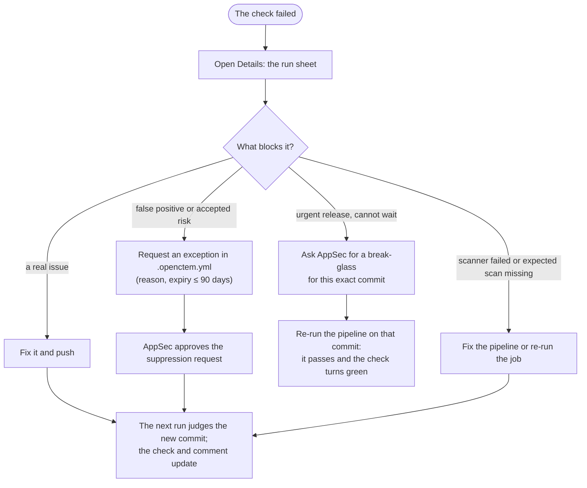

# Understand a blocked pull request
{: .no_toc }

For developers: what the **OpenCTEM gate** check means, how to see why it
failed, and what to do next.

1. TOC
{:toc}

## What you see on the pull request

- **One check**, **OpenCTEM gate** (GitHub), or a commit status of the same
  name (GitLab). It succeeds or fails. It is neutral when the gate would fail
  but runs in warn mode or under a break-glass. It asks for action when a
  scanner failed and the run could not be judged.
- **One comment** that the platform keeps up to date. It lists the findings
  this change **introduced** that block it, with file, line and rule.
  Findings already on the target branch are counted but not listed as
  blocking.
- **Details** on the check opens the run in the console.

## Read the run

The run sheet shows the verdict, the policy that applied, how many findings
were judged (new, already on the target branch, accepted) and each blocking
reason.


*Figure: A failed run. Two of five findings are new and block. Three were already on `main`.*

If the sheet says **This run is not available to you**, the run's repository
is not in your access. The pull request comment still lists what blocked it.
Ask an administrator for access to the repository.

## Why it failed

| Reason | Means | Usual fix |
|---|---|---|
| Secret | The change adds a committed credential | Remove it from the code **and rotate it**: it is in the history |
| Secret already on the default branch | A secret that is open on the default branch. On a pull request this is a note, not a block; it blocks default-branch runs | Rotate it and close the finding |
| Known exploited | A dependency vulnerability on the CISA KEV list | Upgrade the dependency |
| EPSS | A vulnerability at or above the policy's exploit-probability threshold | Upgrade the dependency |
| Severity | A new finding at or above the policy's severity | Fix the code or upgrade |
| Scan failure | A scanner failed to run or to report: the run cannot be judged | Re-run; see the job log |
| Expected scan missing | The repository must report this capability (for example SAST) and the run did not, often because the pipeline was edited | Restore the scan in the pipeline |
| No baseline | The target branch was never scanned, so every finding counts as new (a note) | Run the pipeline once on the target branch |
| Break-glass | An administrator let this commit through (a note) | Nothing; the reason is recorded |

**New compared with what?** A pull request into a release line (the default
branch, a protected branch, or a `main` or `release` branch the repository
has scanned) is compared with that branch. Anything else is compared with the
default branch.

## Fix it, or ask for an exception



### Request an exception from the repository

Add an exception to `.openctem.yml` at the repository root. It becomes a
**pending suppression request** that an administrator approves. The file can
never make a finding pass on its own.

```yaml
gate:
  exceptions:
    - rule_id: python.lang.security.audit.formatted-sql-query
      path: app/reports/legacy.py
      reason: Query string is a constant; tracked in SEC-142
      expires: 2026-12-31
```

The reason must be 10 to 500 characters. The expiry must be at most 90 days
ahead. The same file can make the gate **stricter** for the repository: see
[Gate policies](ci-policies.md#a-repositorys-own-file).

Accepted risks, false positives and suppressions decided in the console are
always honored while they apply.

### Ask for a break-glass

For an urgent release, ask someone with `scans:ci:override` to break-glass the
commit ([Break-glass](ci-break-glass.md)). It covers that exact commit for a
limited time. After it is created, **re-run the pipeline on that commit**: the
new run passes and the check turns green.
