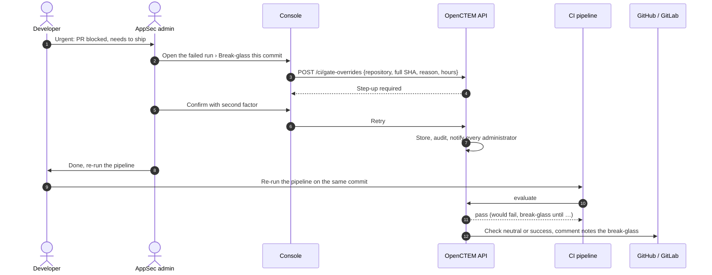

# Break-glass
{: .no_toc }

A break-glass lets **one commit of one repository** pass the gate for a
limited time, for example an urgent fix that must ship before a finding can be
resolved. It is the exception, not the way to handle false positives: for
those, use an exception or a suppression
([Understand a blocked pull request](ci-blocked-pr.md#fix-it-or-ask-for-an-exception)).

1. TOC
{:toc}

## Rules

- You need `scans:ci:override` (owners, administrators, and the AppSec
  engineer role template) and a recent sign-in (step-up).
- It names the **full** commit id (40 or 64 characters) and covers exactly that
  commit. Abbreviated ids are refused.
- It needs a reason of at least 10 characters, and lasts 1 to 168 hours
  (default 24).
- It applies only to a commit its CI provider signed. A commit a job reported
  itself (CircleCI, or Jenkins without a `sha` claim) never matches.
- It is audited. Every owner and administrator is notified when it is created
  and each time a run uses it. The verdict shows "Break-glass" with the reason
  and expiry; it never names the person, because CI logs may be public.

## Flow

The override does not change a verdict that already exists. **Re-run the
pipeline on that commit**: its next run passes, and because the check takes
each pipeline's latest verdict, the check turns green.

## Create one

1. Open the failed run (**Pipelines › Runs**, or **Details** on the pull
   request check).
2. **Break-glass this commit** fills in the repository and the full commit.
3. Enter the reason and the hours, then **Override the gate**, and confirm
   with your second factor.

## Review and revoke

**Trust and gate › Break-glass** lists the overrides with who created them,
the reason and the expiry. **Revoke** ends one early; the next
run of that commit is judged normally.

