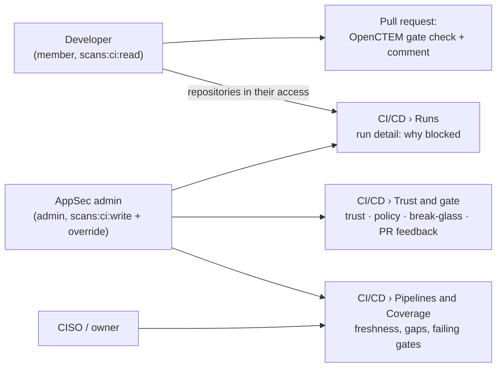
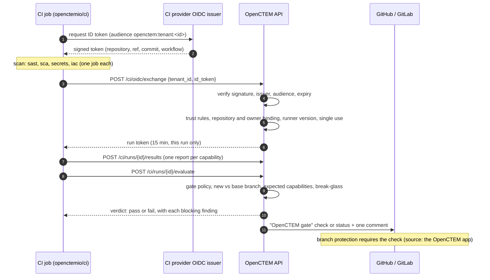
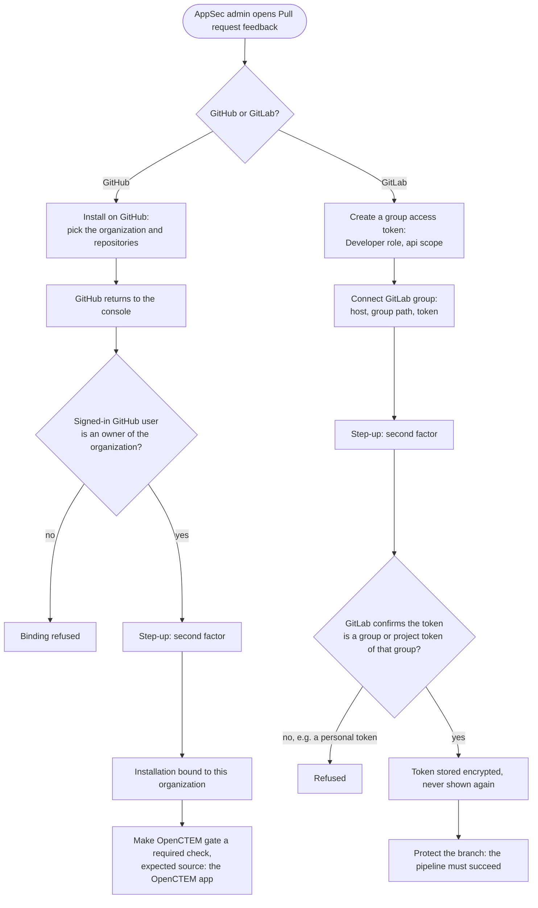
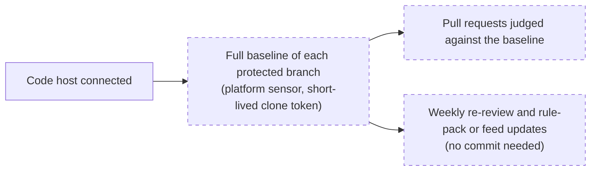

# CI/CD integration
{: .no_toc }

[`openctemio/ci`](https://github.com/openctemio/ci) scans code in your CI
pipelines and reports to OpenCTEM. A CI job proves who it is with the OIDC
token its CI system issues, so **no API key or other secret is stored in CI**.
The platform judges the results with its **CI gate**. The job passes or fails,
and the pull request shows one **OpenCTEM gate** check.

CI pipelines are not sensors. Sensors run long-lived scans, dispatched by the
platform, inside your networks. A CI job runs a one-shot binary in a small
image per tool. Both produce the same CTIS reports.

1. TOC
{:toc}

## Pick your job

| I want to… | Read | Who |
|---|---|---|
| Connect a first pipeline in five minutes | [Quickstart](ci-quickstart.md) | AppSec admin |
| Find out why my pull request was blocked, and fix it or ask for an exception | [Understand a blocked pull request](ci-blocked-pr.md) | Developer |
| Decide what fails a pipeline, safely | [Gate policies](ci-policies.md) | AppSec admin |
| Let one urgent commit through | [Break-glass](ci-break-glass.md) | AppSec admin, owner |
| Roll out to every repository of an organization | [Organization rollout](ci-rollout.md) | AppSec admin, CISO |
| Fix a refused pipeline or a failing upload | [Troubleshooting](ci-troubleshooting.md) | Everyone |
| Look up an input, a variable, an exit code or a version pin | [Reference](ci-reference.md) | Everyone |

## Who sees what

- **Developers** work from the pull request: the check and the comment list
  what blocked it. **Details** opens the run in the console. A developer sees
  the runs of the repositories in their access. Anyone else sees "This run is
  not available to you", and an administrator can grant access to the
  repository.
- **AppSec admins** (`scans:ci:write`) set up trust, gate policies and pull
  request feedback. They see refused pipelines. Break-glass also needs
  `scans:ci:override`.
- **CISOs and owners** read the pipelines' freshness, failing default-branch
  gates and repository coverage.

| Permission | Allows |
|---|---|
| `scans:ci:read` | Pipelines, runs, coverage, trust configurations and gate policies (read) |
| `scans:ci:write` | Create and change trust, gate policies, coverage expectations and code host connections; see refused pipelines |
| `scans:ci:override` | Create and revoke break-glass overrides |

Creating or changing a trust configuration, changing the CI settings,
loosening a gate policy, connecting a code host and creating a break-glass
all ask for a recent sign-in (step-up).

## How a pull request is gated

- The job exchanges its token at its first upload, not at the start, so a
  long scan does not use up the run token's 15 minutes. GitHub and Azure jobs
  renew it.
- The platform takes the repository, branch and commit from the **verified
  token**, never from the report. A report can describe only the job's own
  repository.
- The first verdict of a run is final. The check on a commit takes the
  **strictest** latest verdict of every pipeline on that commit, so a second
  workflow cannot turn a failing check green.
- When the platform cannot be reached, the local `fail-on` threshold applies.
  A broken scan never exits 0.

## Connect GitHub and GitLab

Trust and the gate work without a code host connection. The connection lets
the platform post the **OpenCTEM gate** check and the comment on the pull or
merge request. Open **Discovery › CI/CD › Trust and gate › Pull request
feedback**.

*Figure: Pull request feedback, with the GitHub App installed on example-org and one GitLab group.*

### GitHub App permissions

An operator registers the GitHub App once per deployment
([GitHub App guide](https://github.com/openctemio/openctem/blob/develop/api/docs/how-to/github-app.md)).
Each organization then installs it from **Pull request feedback**.

| Permission | Access | Why |
|---|---|---|
| Checks | Read and write | Post the gate's check on the commit. |
| Pull requests | Read and write | The summary comment; find the pull request of a commit. |
| Metadata | Read | Required by GitHub for every app. |
| Members (organization) | Read | **Required.** Binding an installation checks that the person is an owner of the GitHub organization. Without it, no organization installation can be bound. |
| Contents | Read (optional) | Only to read a merge commit's parents, so the check still lands when the pull request's base moved. Without it such a check is skipped, and the next run posts it. |

Installation tokens are narrowed to one repository, and to checks, pull
requests and metadata.

### GitLab connection

**Connect GitLab group** takes a **group access token** (Developer role, `api`
scope). A project access token also works. A personal access token is
refused, so the status is never posted as a person and does not depend on
anyone's membership. A connection made earlier with a personal token keeps
working until it is removed; reconnect it with a group access token.

## Where pipelines show up

**Discovery › CI/CD › Pipelines** lists each workflow file of each repository
that reported. A pipeline is Running, Fresh, Stale, Failing or Degraded, or
inactive (Archived, Revoked, Never). It is never "offline". **Runs** lists
every run with its verdict. **Coverage** shows, per repository, which
capabilities ran recently.

*Figure: Pipelines.*

*Figure: Coverage. **Expect** marks the capabilities a repository must report.*

Disabling or deleting a trust configuration revokes its pipelines and stops
the upload tokens of their running jobs.

## Branch findings

A finding seen only on a feature or merge request branch is **branch-only**.
It shows in the CI gate, on the run and on the branch. It does not show in
exposure views, dashboards, SLA clocks or notifications. It joins the
organization's exposure when the code reaches a branch that counts: the
default branch, a protected branch, or a `main` or `release` branch. In a
repository whose default branch is not known yet, nothing is hidden.
Branch-only findings that no branch reports any longer expire.

## Platform code scanning (planned)

The API already stores code scanning settings: the protected branches,
capabilities and a weekly rescan per repository. These are
`GET`/`PUT /api/v1/ci/code-scanning/settings`, per repository, plus a
re-baseline call. The scans themselves do not run yet, the console has no
page for them, and the CI gate does not read this baseline yet. The planned
flow:

