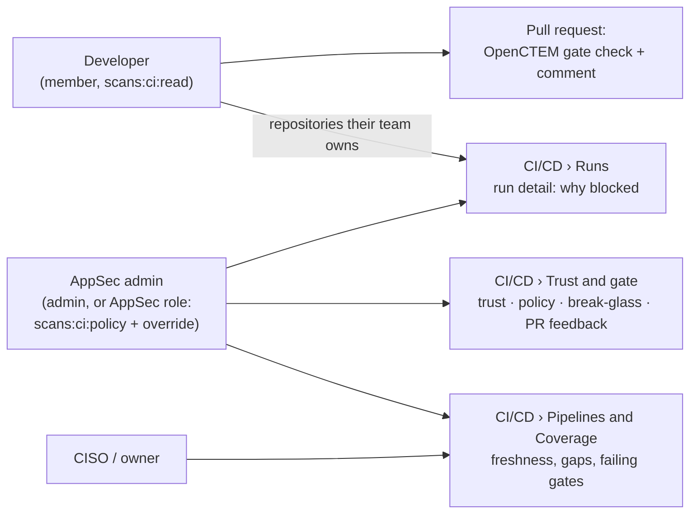
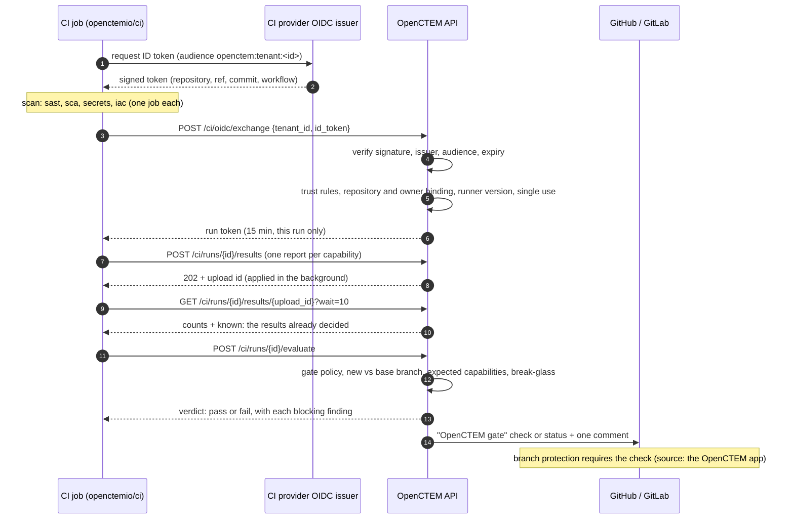

# CI/CD integration
{: .no_toc }

[`openctemio/ci`](https://github.com/openctemio/ci) scans code in your CI
pipelines and reports to OpenCTEM. A CI job proves who it is with the OIDC
token its CI system issues, so **no API key or other secret is stored in CI**.
The platform judges the results with its **CI gate**. The job passes or fails,
and the pull request shows one **OpenCTEM gate** check.

CI pipelines are not sensors. Sensors run long-lived scans, dispatched by the
platform, inside your networks. A CI job runs a one-shot binary in a small
image per tool. Both produce the same CTIS reports.

1. TOC
{:toc}

## Pick your job

| I want to… | Read | Who |
|---|---|---|
| Connect a first pipeline in five minutes | [Quickstart](ci-quickstart.md) | AppSec admin |
| Find out why my pull request was blocked, and fix it or ask for an exception | [Understand a blocked pull request](ci-blocked-pr.md) | Developer |
| Decide what fails a pipeline, safely | [Gate policies](ci-policies.md) | AppSec admin |
| Let one urgent commit through | [Break-glass](ci-break-glass.md) | AppSec admin, owner |
| Roll out to every repository of an organization | [Organization rollout](ci-rollout.md) | AppSec admin, CISO |
| Send reports my pipeline's own scanners already write (SARIF, trivy, ZAP, ...) | [Upload existing reports](ci-upload.md) | Developer, AppSec admin |
| Fix a refused pipeline or a failing upload | [Troubleshooting](ci-troubleshooting.md) | Everyone |
| Look up an input, a variable, an exit code or a version pin | [Reference](ci-reference.md) | Everyone |

## Who sees what

- **Developers** work from the pull request: the check and the comment list
  what blocked it. **Details** opens the run in the console. A developer sees
  the runs, pipelines and coverage of the repositories in their data scope.
  The usual way to give a team its runs: assign the repository asset to the
  team, which makes the team an owner of it (**Settings › Teams › team ›
  Assets**, see [data scope](../identity/roles-and-permissions.md#groups-and-data-scope)).
  Leaving the team takes the runs away. Anyone else sees "This run is not available to you", and an
  administrator can grant access to the repository.
- **Owners and administrators** (`scans:ci:write`) set up trust, the CI
  settings and pull request feedback. They see refused pipelines.
- **AppSec engineers** can run the gate without being administrators: the
  **AppSec engineer** role template carries `scans:ci:read`,
  `scans:ci:policy` (gate policies and expected scans) and
  `scans:ci:override` (break-glass). See
  [Roles and permissions](../identity/roles-and-permissions.md#custom-roles).
- **CISOs and owners** read the pipelines' freshness, failing default-branch
  gates and repository coverage.

| Permission | Allows |
|---|---|
| `scans:ci:read` | Pipelines, runs, coverage, trust configurations and gate policies (read) |
| `scans:ci:policy` | Create, change and delete gate policies and coverage expectations (expected scans) |
| `scans:ci:override` | Create and revoke break-glass overrides |
| `scans:ci:write` | Create and change trust configurations, the CI settings and code host connections; see refused pipelines. Owners and administrators only: it can never be part of a custom role |

Owners and administrators hold all four. `scans:ci:policy` and
`scans:ci:override` can be put on a custom role.

Creating or changing a trust configuration, changing the CI settings,
loosening a gate policy, connecting a code host and creating a break-glass
all ask for a recent sign-in (step-up). Deleting a trust configuration only
withdraws trust and does not.

## How a pull request is gated

- The job exchanges its token at its first upload, not at the start, so a
  long scan does not use up the run token's 15 minutes. GitHub and Azure jobs
  renew it, and any job may present the same still-valid OIDC token again (at
  most 5 times) to get a fresh run token for the same run, and for no other.
- The platform takes the repository, branch and commit from the **verified
  token**, never from the report. A report can describe only the job's own
  repository.
- All jobs, retries and re-runs of one pipeline run report into **one** run.
  A re-run of only the gate job is judged on everything the earlier attempts
  uploaded, never on an empty run, so it cannot pass on nothing. An exception
  approved since then, or a flaky scan that succeeds on re-run, can turn it
  green without a new commit. Scanner failures of the earlier verdict keep
  failing it until a later attempt uploads, and a run nothing was uploaded to
  fails. The check on a commit takes the **strictest** latest verdict of every
  pipeline on that commit, so a second workflow cannot turn a failing check
  green.
- When the platform cannot be reached, the local `fail-on` threshold applies.
  A broken scan never exits 0.

## The gate baseline

A repository with existing findings would otherwise stay red forever. The
**gate baseline** is the set of findings open on the repository's default
branch when it was recorded:

- The **first verified run on the default branch** records it and passes.
  Its verdict says "first run: N existing findings recorded as the gate
  baseline". This happens once per repository, and never for a fork.
- After that, a default-branch run is judged against the baseline only. A
  finding in it shows as baseline (not blocking); anything else is new. The
  run view shows "N baseline · M new". Running a failed run again does not
  change what counts as new.
- A pull request into the default branch treats a finding as pre-existing
  only when it is open on that branch **and** in the baseline. A finding that
  reached the default branch later keeps blocking until it is fixed, accepted
  or baselined.
- Secrets in the baseline still block default-branch runs, unless the
  organization turns that off.
- An administrator with the CI policy permission can **record a new baseline
  now** (sign-in again, audited, every administrator is told) or remove it
  (every finding counts as new again). The repository's `.openctem.yml`
  cannot touch the baseline.
- An optional **grace period** (days) gives baseline findings a due date.
  After it, they block again.

## Gate settings per repository

Settings → CI/CD holds the organization's gate policy. Each pipeline's
**Settings** tab shows the policy that applies to its repository, setting by
setting: the effective value, where it comes from (default, organization,
business unit or this repository), and any lock.

- A repository override sets only the settings it changes. Everything else
  follows the organization, including later changes.
- The organization (or a business unit) can **lock** a setting. Below a lock,
  a setting can only be made stricter, whoever asks.
- Loosening a setting for one repository needs the CI policy permission, a
  reason and a recent sign-in. It is audited and announced, and it can have an
  end date, after which the repository follows the organization again.
- The repository's `.openctem.yml` can only make the gate stricter.
- The Pipelines list filters on repositories with overrides, and the
  organization policy shows how many repositories override each setting.

| Setting | Locks | A repository may loosen |
|---|---|---|
| Mode (enforce / warn) | yes | with permission, reason, sign-in |
| Fail-on severity | yes | same |
| New findings only | yes | same |
| KEV fails, EPSS threshold, fixable only | yes | same |
| Per-capability and per-rule modes | yes | same |
| Allow `.openctem.yml` | yes | turning it off is stricter |
| First-run baseline, baseline grace, baseline secrets block | yes | same |

## Require OIDC for CI

**Discovery › CI/CD › Trust and gate** has a **Require OIDC for CI** switch
(`GET` and `PUT /api/v1/ci/settings`; changing it needs `scans:ci:write` and a
recent sign-in). When on, a one-shot CI sensor key is refused on every sensor
route (`403`, problem `ci-oidc-required`), so a stored key that leaks cannot
send results. Organizations created before the setting existed keep accepting
CI sensor keys and see a banner until they turn it on; every organization
created since starts with it on. Move your pipelines to OIDC (add trust, set
`OPENCTEM_TENANT_ID` in the pipeline), then turn it on.

## Trust: issuers, audience and keys

- **Audience.** Every trust audience except Azure Pipelines' fixed one must
  contain the organization id. The default is `openctem:tenant:<id>`. A token
  made for one organization is then refused by every other.
- **Older GitHub and GitLab trusts.** Platform v0.9.6 moved GitHub and GitLab
  trust configurations whose audience did not name the organization to the
  default audience. For 90 days after the upgrade, a pipeline that already
  existed may still ask for the old audience, until it uses the new one once.
  A new pipeline must use the new audience. Otherwise the exchange is refused
  with `legacy_audience`. After the 90 days the old audience is refused like
  any wrong audience. The trust card shows the old audience and the date
  it stops working. Update each pipeline to the current snippet.
- **GitHub issuers.** A GitHub Actions trust accepts github.com
  (`https://token.actions.githubusercontent.com`, the default), an
  enterprise's own issuer
  (`https://token.actions.githubusercontent.com/<enterprise slug>`) or a
  GitHub Enterprise Server (`https://<host>/_services/token`). Set it in
  **GitHub Enterprise issuer** in the trust dialog. Repositories of a server
  are named with its host, for example `github.example.com/acme/api`. A
  server on a private network needs its range in
  `OPENCTEM_HTTPSEC_ALLOW_PRIVATE_CIDRS` on the API.
- **Signing keys.** The platform fetches each issuer's signing keys and
  refreshes them. When the issuer cannot be reached, keys fetched earlier keep
  verifying tokens for at most 6 hours. After that, exchanges against that
  issuer are refused until it can be reached again.

## Connect GitHub and GitLab

Trust and the gate work without a code host connection. The connection lets
the platform post the **OpenCTEM gate** check and the comment on the pull or
merge request. Open **Discovery › CI/CD › Trust and gate › Pull request
feedback**.

*Figure: Pull request feedback, with the GitHub App installed on example-org and one GitLab group.*

### GitHub App permissions

An operator registers the GitHub App once per deployment
([GitHub App guide](https://github.com/openctemio/openctem/blob/develop/api/docs/how-to/github-app.md)).
Each organization then installs it from **Pull request feedback**.

| Permission | Access | Why |
|---|---|---|
| Checks | Read and write | Post the gate's check on the commit. |
| Pull requests | Read and write | The summary comment; find the pull request of a commit. |
| Metadata | Read | Required by GitHub for every app. |
| Members (organization) | Read | **Required.** Binding an installation checks that the person is an owner of the GitHub organization. Without it, no organization installation can be bound. |
| Contents | Read (optional) | Only to read a merge commit's parents, so the check still lands when the pull request's base moved. Without it such a check is skipped, and the next run posts it. |

Installation tokens are narrowed to one repository, and to checks, pull
requests and metadata.

### GitLab connection

**Connect GitLab group** takes a **group access token** (Developer role, `api`
scope). A project access token also works. A personal access token is
refused, so the status is never posted as a person and does not depend on
anyone's membership. A connection made earlier with a personal token keeps
working until it is removed; reconnect it with a group access token.

## Where pipelines show up

**Discovery › CI/CD › Pipelines** lists each workflow file of each repository
that reported. A pipeline is Running, Fresh, Stale, Failing or Degraded, or
inactive (Archived, Revoked, Never). It is never "offline". **Runs** lists
every run with its verdict. **Coverage** shows, per repository, which
capabilities ran recently.

*Figure: Pipelines.*

*Figure: Coverage. **Expect** marks the capabilities a repository must report.*

A container scan whose report carries the image's content digest also
suggests relationships from the repository to the assets running that image
(`contains` for an image asset, `deployed_to` for a workload, cluster or
host). They wait in the relationship review; nothing is linked without
approval.

Disabling or deleting a trust configuration revokes its pipelines and stops
the upload tokens of their running jobs.

## Results already decided

The upload's result (read after the platform applied the report) carries `known`: the results of that report that already
carry a decision in OpenCTEM, by their position in the report. A decision is
a false positive, a duplicate, an accepted risk that has not ended, or an
approved suppression rule. `openctem-ci` leaves them out of its log summary,
its SARIF and its GitLab report, and logs how many it left out and why. The
platform still records them, and the CTIS file keeps every result. A job
learns nothing about findings it did not report. See
[Known false positives](../user-guide/known-false-positives.md).

## Secret findings

The token exchange gives the job a key for its organization and repository.
The job sends each secret as a keyed hash of its raw value (HMAC-SHA256, the
CTIS fingerprint `secretHMAC/v1`). The raw value never leaves the job. Two
different secrets that look the same once masked are two findings, and a
change in masking does not create a new finding. A finding keyed on its masked
value moves to the new key the next time it is seen, and keeps its triage.

## Branch findings

A finding seen only on a feature or merge request branch is **branch-only**.
It shows in the CI gate, on the run and on the branch. It does not show in
exposure views, dashboards, SLA clocks or notifications. It joins the
organization's exposure when the code reaches a branch that counts: the
default branch, a protected branch, or a `main` or `release` branch. In a
repository whose default branch is not known yet, nothing is hidden.
Branch-only findings that no branch reports any longer expire.
