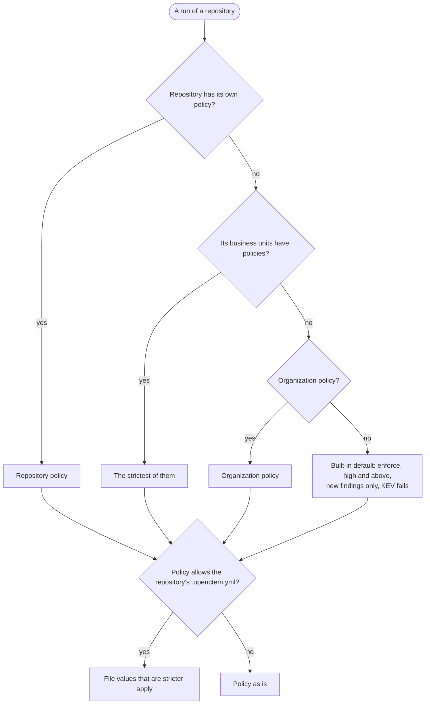
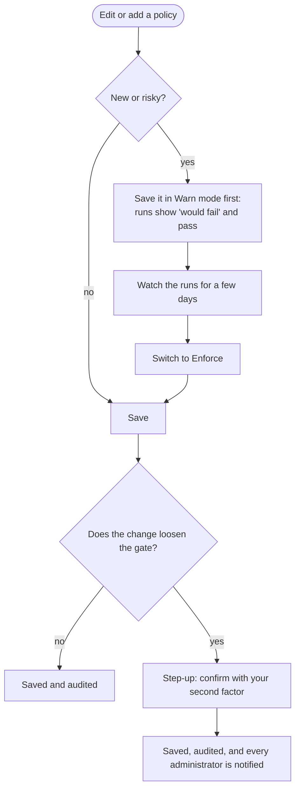

# Gate policies
{: .no_toc }

For AppSec admins: what fails a pipeline, how a policy is chosen, and how to
change it safely. Open **Discovery › CI/CD › Trust and gate › Gate policy**.
Changing policies and expected scans needs `scans:ci:policy` (owners,
administrators, and the AppSec engineer role template).

1. TOC
{:toc}


*Figure: Gate policies of example-org.*

## Always on

Whatever the policy says:

- a committed secret that the change adds fails the run, and every
  default-branch run fails while a secret is open;
- accepted risks, false positives and suppressions are honored while they
  apply;
- a scanner that fails to run fails the run;
- a repository that is **expected** to report a capability fails a run that
  does not report it (see [Expected scans](#expected-scans)).

## Which policy applies



## Settings

| Setting | Values | Default |
|---|---|---|
| Mode | **Enforce** (fail the run) or **Warn** (report what would fail and pass) | Enforce |
| Fail on severity | critical, high, medium, low, or none (only secrets, KEV and EPSS fail) | high and above |
| New findings only | Only findings the change introduced count, compared with the target branch | On |
| Known exploited (KEV) fails | A vulnerability on the CISA KEV list fails, whatever its severity | On |
| EPSS threshold | 0 to 1; a vulnerability at or above it fails | Off |
| Block only when a fix exists | A dependency or image vulnerability without a fixed version is listed as "no fixed version yet" and does not block. KEV still fails; code, secret and IaC findings are not affected | Off |

The API also takes per-capability and per-rule modes (block, comment,
monitor), `allow_repo_policy` and `enabled`
(`PATCH /api/v1/ci/gate-policies/{id}`). The console does not edit them yet.

## Change a policy safely



- **Loosening** means: enforce to warn, a higher severity threshold, turning
  on "new findings only", turning KEV off, turning on "block only when a fix
  exists", clearing or raising the EPSS threshold, a weaker capability or rule
  mode, or disabling or deleting a policy so that a looser one applies.
- A repository policy can be created, changed or deleted only for a
  repository in your access.


## Expected scans

On **Pipelines › Coverage**, **Expect** marks the capabilities a repository
must report: sast, sca, secrets, iac, or all four. Each CI run of an expected
repository must report every expected capability. A run that reports no tool
for one fails with **Expected scan missing**. A pull request that edits its
pipeline to drop a scanner therefore cannot pass on silence. Coverage also
alerts when an expected repository stops being scanned.

The tools a run reports are self-declared, so this cannot prove that a scan
really ran. It closes the "report nothing" path.

## A repository's own file

A repository can make the gate **stricter** for itself, and request
exceptions, with `.openctem.yml` at its root:

```yaml
gate:
  fail_on_severity: medium      # critical | high | medium | low
  new_findings_only: false
  fail_on_kev: true
  epss_threshold: 0.2
  block_rules:                  # at most 100
    - go.lang.security.audit.crypto.math_random
  exceptions:                   # at most 20; each becomes a pending request
    - rule_id: python.lang.security.audit.md5-used
      path: app/util.py
      reason: MD5 is used for a cache key, not for security
      expires: 2026-12-31       # at most 90 days ahead
```

A value applies only when it is stricter than the policy. The file can never
make a finding pass. A policy with `allow_repo_policy` off ignores the file.
