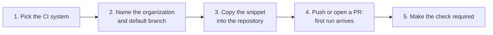

# CI/CD quickstart: connect a pipeline
{: .no_toc }

This page connects one GitHub Actions or GitLab CI pipeline to OpenCTEM. The
pipeline scans code, dependencies, secrets and infrastructure-as-code on
every push and pull request. It reports with its own short-lived OIDC
identity, so nothing secret goes into CI, and it fails when the CI gate does.

1. TOC
{:toc}



## What you need

- An OpenCTEM account with `scans:ci:write` (owners and administrators). Saving
  the trust asks for a recent sign-in (step-up).
- A repository on github.com, or on GitLab (gitlab.com or self-managed), where
  you can add a workflow file. For GitHub Enterprise Server, or an enterprise
  with its own token issuer, use **Trust › Add trust** instead of the wizard
  ([Organization rollout](ci-rollout.md#github-enterprise)).
- The platform URL as the CI runners reach it, for example
  `https://openctem.example.com`. The runners need outbound HTTPS to it.

## 1. Open the wizard

Open **Discovery › CI/CD**. On a new organization, the **Pipelines** tab is
empty and shows **Connect a pipeline**. Otherwise the button is on the
**Trust and gate** tab.


## 2. Name the organization

Enter the **Organizations or owners** whose pipelines may report, comma
separated. For GitLab, enter the top-level group, and its URL if it is
self-managed. If the GitHub App is installed, its organizations are offered.
Set the **Default branch**: pushes to it are scanned in full and become the
baseline that pull requests are compared with.


**Create trust** saves the trust configuration and asks for your second
factor. If a trust configuration already admits these organizations, the
wizard reuses it and shows its snippet: running the wizard again never creates
a duplicate.

## 3. Add the snippet to the repository

The snippet has your platform URL and organization id filled in. Its jobs ask
for a token whose audience is `openctem:tenant:<organization id>`, so a token
made for your organization is useless to any other.


### GitHub Actions

Save as `.github/workflows/openctem.yml`:

```yaml
name: OpenCTEM
on:
  pull_request:
  push:
    branches: [main]

jobs:
  openctem:
    uses: openctemio/ci/.github/workflows/scan.yml@v0.3.0
    with:
      capabilities: sast,sca,secrets,iac
      api-url: https://openctem.example.com
      tenant-id: <organization id>
    permissions:
      contents: read
      id-token: write          # the job asks GitHub for an OIDC token; no stored secret
      security-events: write   # the workflow's scan job asks for it
```

Grant all three permissions. The reusable workflow's scan job asks for
`security-events: write` even when `upload-sarif` is off, and GitHub refuses
to start a called job that asks for more than its caller grants. If the
console's snippet lacks the line, add it.

### GitLab CI

Add to `.gitlab-ci.yml` (the jobs run in the `test` stage):

```yaml
include:
  - remote: https://raw.githubusercontent.com/openctemio/ci/v0.3.0/gitlab/templates/all.yml

variables:
  OPENCTEM_API_URL: https://openctem.example.com
  OPENCTEM_TENANT_ID: <organization id> # jobs use their ID token; no stored secret
```

Pin `v0.3.0` (or its commit) as shown, never a branch such as `main`. From
platform v0.9.6, v0.3.0 is also the oldest release the platform accepts by
default: an older one is refused with `RUNNER_OUTDATED`. See [Reference](ci-reference.md#versions-to-pin).

## 4. Push and watch the first run

Push a commit to the default branch, or open a pull request. The wizard waits
and then shows **First run received from** your repository. **Open the run**
shows the findings and the verdict.


Run the pipeline once on the default branch first. Until that branch has been
scanned, every finding on a pull request counts as new.

If the wizard says **A pipeline was refused**, it shows the rule that refused
the pipeline and how to fix it. **Trust and gate › Recent refused pipelines**
keeps the latest ones. Every code is listed in
[Troubleshooting](ci-troubleshooting.md).

## 5. Make the check required

1. Under **Trust and gate › Pull request feedback**, install the GitHub App, or
   connect the GitLab group with a group access token
   ([details](ci-integration.md#connect-github-and-gitlab)).
2. In the repository's branch protection (or ruleset), require the
   **OpenCTEM gate** check, and set its expected source to the OpenCTEM app.
   Any other source, such as a workflow's own token, could post a check with
   the same name.

## Next

- Start the gate in **Warn** mode while teams get used to it:
  [Gate policies](ci-policies.md).
- Admit only your central workflow, and leave fork pull requests off:
  [Organization rollout](ci-rollout.md).
- Show developers how to read a blocked pull request:
  [Understand a blocked pull request](ci-blocked-pr.md).
