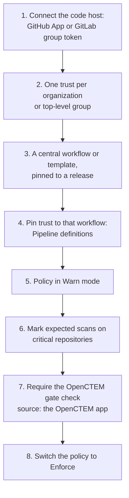

# Organization rollout
{: .no_toc }

For AppSec admins and CISOs: put the gate on every repository of an
organization, keep it unbeatable, and keep track of coverage.

1. TOC
{:toc}

## The plan

## 1. Connect the code host

Install the GitHub App on the organization, or connect the GitLab group with a
group access token
([Connect GitHub and GitLab](ci-integration.md#connect-github-and-gitlab)).
This is what posts the **OpenCTEM gate** check and the comment.

## 2. One trust per organization

A trust configuration that names an **owner** (a GitHub organization or a
GitLab top-level group) admits every repository in it. You do not need a
configuration per repository. Narrow it only when you need to:

| Rule | Use it to |
|---|---|
| Repositories | Admit only some repositories: `acme/api`, `acme/*` (one level), `acme/**` (any depth) |
| Branches and tags | Admit only some refs: `main`, `release/*`. For a pull request, its source branch |
| Events, Environments | Admit only some triggers or deployment environments |
| Pipeline definitions | Admit only jobs that run your central workflow (see below) |
| Protected branches and tags only | Deploy-grade trust: GitLab reads `ref_protected`. On GitHub, list environments whose deployment branch rules admit only protected refs |
| Admit fork pull requests | Leave it off. `pull_request_target` and `workflow_run` run fork code with your repository's identity |

*Figure: Trust for GitHub example-org and the GitLab platform group.*

For GitHub Enterprise Server, set the trust's **GitHub Enterprise issuer**
to `https://<host>/_services/token`. For an enterprise with a customized
issuer on github.com, set it to
`https://token.actions.githubusercontent.com/<enterprise>`. A server on a
private network needs the operator setting
`OPENCTEM_HTTPSEC_ALLOW_PRIVATE_CIDRS`.

Every trust audience contains the organization id (`openctem:tenant:<id>`),
so a token minted for one organization is useless to another. GitHub and
GitLab trusts created with another audience were moved to the default. For 90
days, a pipeline that existed before may still request the old audience,
until it requests the new one once. The trust card shows the old audience and
its end date, so update those pipelines to the current snippet.

The first exchange of an organization **pins** its immutable id. A
repository name is bound to the repository id that first reported under it.
An organization that is deleted and whose name is registered again cannot
report as the old one, and neither can a recreated repository (see
[Troubleshooting](ci-troubleshooting.md)).

## 3. A central workflow

Keep one reusable workflow (GitHub) or template (GitLab) in a repository your
security team controls. Each repository calls it in a few lines and pins it to
a release ([Reference](ci-reference.md#versions-to-pin)).

## 4. Pin trust to it

In the trust's **Pipeline definitions**, list that workflow:

- GitHub: `example-org/security/.github/workflows/openctem.yml@refs/heads/main`
  (the token's `job_workflow_ref`; `*` allowed in the ref);
- GitLab: `gitlab.example.com/platform/ci//openctem.yml@refs/heads/main` (the
  token's `ci_config_ref_uri`).

A pull request that edits or adds a workflow file is then refused
(`workflow_not_allowed`), so it cannot report for the repository. Pipeline
definitions pin **which** workflow runs, not its inputs. That is why step 6
matters.

## 5. Warn first

Set the organization policy to **Warn**. Runs show "would fail" and pass, so
teams see what the gate will block before it does. Watch **Runs** for a few
days, then tune the severity, EPSS and "block only when a fix exists"
settings ([Gate policies](ci-policies.md)).

## 6. Expected scans

On **Pipelines › Coverage**, **Expect** the capabilities each critical
repository must report. A run that skips one fails with **Expected scan
missing**, and Coverage alerts when an expected repository stops being
scanned.

## 7. Require the check

In each repository's branch protection or an organization ruleset, require
**OpenCTEM gate** with the OpenCTEM app as its expected source. On GitLab,
require the pipeline to succeed. The check takes the strictest latest verdict
of every pipeline on a commit, so a second workflow cannot turn it green.

## 8. Enforce

Switch the policy to **Enforce**. A change that loosens it later asks for
step-up and notifies every administrator.

## Developers' access

Developers see the runs of the repositories in their data scope. Give each
team its runs by making the team (a group) an owner of its repository assets.
A developer who leaves the team loses the runs. Everyone with access to the
pull request still sees the check and the comment.

## Track it

| Signal | Where |
|---|---|
| Pipelines that are stale, failing or degraded | **Pipelines** cards and list |
| Repositories with no scan, or with gaps against their expectation | **Coverage** |
| Pipelines refused at the token exchange | **Trust and gate › Recent refused pipelines** |
| Break-glass created or used, gate failing, ungated merge, coverage regression, runner outdated, token refusals | Notifications (`ci.*` events) to your channels |

## Offboarding

- **A repository:** retire its pipeline (pipeline sheet › **Retire**). History
  stays. A recreated repository under the same name can report only after the
  old pipeline is retired.
- **An organization:** delete (or disable) its trust configuration, which
  revokes its pipelines and stops running jobs' upload tokens. Then remove the
  GitHub installation or the GitLab connection under **Pull request feedback**.
