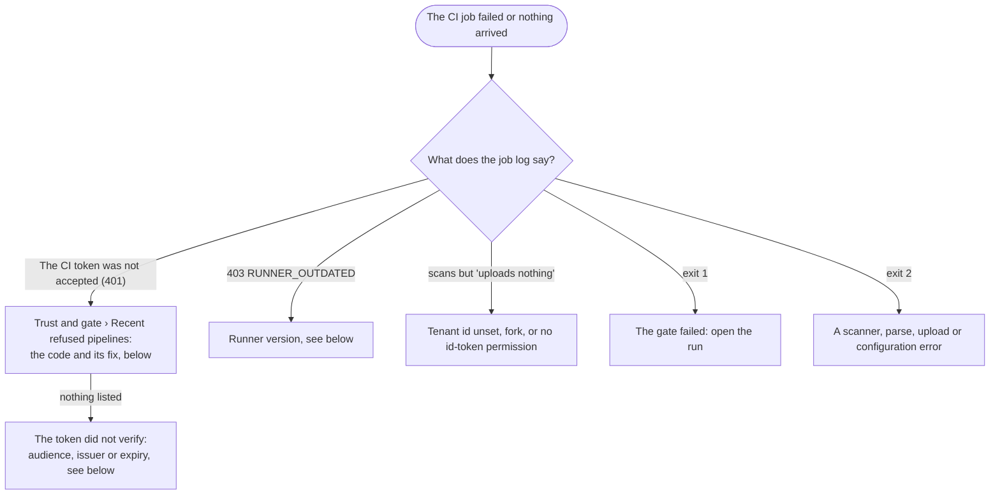

# CI/CD troubleshooting
{: .no_toc }

1. TOC
{:toc}

## Where to look

The job exits `0` when it passes, `1` when the gate failed, and `2` when the
scan cannot be trusted. A broken scan never exits 0.

## Refused pipelines (codes)

Every refused exchange answers the job with the same
`401 The CI token was not accepted`, so the job learns nothing about your
configuration. Owners and administrators see the reason in **Trust and gate ›
Recent refused pipelines** (the latest 50) and in the audit log
(`ci_run.token_refused`). Only tokens that verified are listed.

| Code | Console says | Fix |
|---|---|---|
| `no_matching_configuration` | No trust configuration exists for this CI provider or issuer. | Create a trust configuration for this provider (Connect a pipeline). |
| `missing_claims` | The token lacks the repository, commit, ref or id. | Run the scan in a pipeline job of the repository, not a manual or detached job. |
| `owner_not_allowed` | The repository's organization is not in the trust configuration. | Add the organization to Owners, or check the spelling. |
| `repository_not_allowed` | The repository is not in the trust configuration's repositories. | Add the repository, or a pattern that covers it. |
| `ref_not_allowed` | The branch or tag is not in the allowed refs. | Add the branch, or leave Branches and tags empty to allow every branch. |
| `ref_not_protected` | The configuration requires a protected branch and this one is not. | Protect the branch in the code host, or turn off the protected-branch rule. |
| `environment_not_allowed` | The job's deployment environment is not allowed. | Add the environment, or run the scan in an allowed one. |
| `event_not_allowed` | The pipeline event (push, pull request, schedule) is not allowed. | Add the event to Events, or leave Events empty. |
| `fork_pull_request` | The run comes from a pull request from a fork. | By design: fork runs scan without reporting. Allow forks only if you accept their results. |
| `workflow_not_allowed` | The pipeline definition is not one of the allowed central workflows. | Use the organization's central workflow, or add its path and ref to Pipeline definitions. |
| `organization_mismatch` | The token's organization is not the configured one. | Check the organization id or workspace in the trust configuration. |
| `owner_id_mismatch` | The organization name now belongs to a different organization than the one first trusted. | If the organization was really recreated, re-pin it: change the configuration's owners or repositories, which drops its pins. |
| `repository_binding` | The repository name is bound to a different repository that reported first. | If the repository was recreated, retire its old pipeline first. |
| `pipeline_identity` | The token does not identify the pipeline. | Use a supported CI provider job with its OIDC token. |
| `ssh_rerun` | The job is a re-run with SSH access (CircleCI). | Re-run the job without SSH. |
| `replay` | The same token was used twice. | Each job must exchange its own fresh token; check for copied tokens. |
| `runner_outdated` | The CI scanner is older than the minimum version. | Pin a current release (see below). |
| `pipeline_cap` | The organization reached its number of pipelines. | Retire unused pipelines. |
| `pipeline_rate` | This pipeline started too many runs in a short time. | Wait and retry; check for a loop in the pipeline. |
| `run_mismatch` | The job named a run of another pipeline. | Let each pipeline run use its own run. |
| `aggregate_no_run_id` | A combined run needs the pipeline's run id, which the token does not carry. | Run one job per capability without combining, or use a provider that names the run. |
| `legacy_audience` | The pipeline used the trust configuration's old audience, which it may no longer use. | Update the pipeline to the current snippet. Its audience names the organization (`openctem:tenant:<id>`). |

### Refused, but nothing is listed

These failures happen **before** the token is verified, so they are never
written to your audit log. Otherwise anyone could fill it with forged tokens.
The job only sees `401`.

| Cause | Check |
|---|---|
| No enabled trust configuration for the token's issuer | The trust exists and is enabled. For self-managed GitLab, the issuer URL is exactly the instance URL. |
| Wrong audience | The job requests `openctem:tenant:<organization id>`, or the trust's own audience, which always contains the organization id. On GitHub, pass `oidc-audience` only when the trust uses another one. |
| Wrong organization id in the job | `tenant-id` / `OPENCTEM_TENANT_ID` is the id shown in the snippet. |
| Expired token | The job ran longer than its provider's token lifetime before the first upload. |
| Issuer unreachable from the platform | For a self-managed GitLab on a private network, the operator allows its range with `OPENCTEM_HTTPSEC_ALLOW_PRIVATE_CIDRS`. A private CA must be in the API's trust store. |

## Runner version (`403 RUNNER_OUTDATED`)

The platform refuses a CI runner below the minimum CI runner release
(`CI_RUNNER_MIN_VERSION`, v0.3.0 by default). Pin the current release
([Reference](ci-reference.md#versions-to-pin)).

Platform releases up to v0.9.5 compare the CI runner's version with the
**sensor** minimum (`SENSOR_MIN_VERSION`, default v0.9.0) instead. Every
`openctem-ci` release (v0.1.0, v0.2.0) is below it, so every exchange from a
released runner is refused with `RUNNER_OUTDATED`. Until the platform is
upgraded to a release with `CI_RUNNER_MIN_VERSION`, an operator can set
`SENSOR_MIN_VERSION=none` on the API. That turns the sensor minimum off too.

## Other symptoms

| Symptom | Cause and fix |
|---|---|
| The job scans but never uploads | `OPENCTEM_TENANT_ID` / `tenant-id` is unset, the change comes from a fork, or (GitHub) the job lacks `id-token: write`. |
| GitHub: "The nested job 'scan' is requesting 'security-events: write', but is only allowed 'none'" | You pin `scan.yml@v0.2.0`, whose scan job always asks for it. Pin v0.3.0 ([Reference](ci-reference.md#versions-to-pin)). |
| Every finding counts as new | The default branch, or the release branch the pull request targets, was never scanned. Run the pipeline on it once. |
| The check stays red after a break-glass | The override applies to the next run: re-run the pipeline on that commit. |
| A break-glass does not apply | It must name the full commit id, and the provider must have signed the commit. |
| `Expected scan missing` | The repository is expected to report that capability: restore the scan in the pipeline. |
| `REPORT_OUT_OF_SCOPE` on upload | The report names an asset other than the job's repository. |
| `401` on upload after a long run | The 15-minute run token expired. GitHub and Azure jobs renew it. Elsewhere, the first upload starts the clock: shorten the time from the first upload to the gate. |
| "This run is not available to you" in the console | The run's repository is not in your access. Ask an administrator. |
| The check is not posted | **Pull request feedback** has no GitHub installation or GitLab connection for the repository. The run sheet's **Check and comment** says why. |
