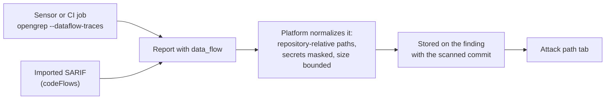

# Data-flow traces

A taint rule follows untrusted data from where it enters the code (the
**source**) to where it is used unsafely (the **sink**). The path between them
is the finding's **data-flow trace**: each step with its file, line and code.
The trace shows a reviewer why the finding is real, or why it is not.

This needs platform v0.9.6 or later.

## How a trace reaches a finding

- **Sensor.** The sensor runs opengrep and semgrep with `--dataflow-traces`.
  The opengrep tool also has a **Cross-function taint** scan setting
  (`--taint-intrafile`), which follows tainted data across the functions of a
  file; it finds more paths and takes longer.
- **CI.** The CI CLI runs opengrep with `--dataflow-traces`. semgrep's
  open-source engine no longer writes traces, so results from the semgrep CI
  image carry none.
- **Imports.** A SARIF report's `codeFlows` become the trace, as do the traces
  in a semgrep or opengrep JSON report.

Whatever sent it, the platform normalizes every trace on receipt:

- Paths become relative to the repository. Absolute paths of the scanning
  machine and paths that leave the repository are dropped.
- Credentials in a step's code are masked.
- At most 50 flows per finding and 100 steps per flow.
- Sanitizer steps are kept, in step order, with the function and the end line
  and column of each step.

## Re-scans

- An identical trace leaves the stored one alone, including the commit it was
  first reported for.
- A changed trace replaces the stored one.
- A report without a trace keeps the stored one: a missing trace is not
  evidence that the path is gone.
- The trace is never part of the finding's identity. A finding reported with,
  without or with a different trace stays the same finding.

A false positive or accepted risk on a taint finding is suspended when a
re-scan reports a different **source** (another file, or other code at the
source step): the finding returns to Confirmed for review, and the earlier
decision is kept and audited. A change only in the steps in between keeps the
decision. See
[Known false positives](../user-guide/known-false-positives.md#when-a-decision-ends).

## In the console

A finding with a trace has an **Attack path** tab, with the number of steps.
It lists the steps in order from source to sink, sanitizers included. Each
step shows its type (Source, Propagation, Sanitizer, Sink), its file and
line, its function and class, and its code, with buttons to copy the code or
the file and line.

**View this line at the scanned commit** opens the file at the commit the
trace was reported for, when the repository's web address is known. The link
never points at a branch or at a later commit, which could show other code.

## API

- `GET /api/v1/findings/{id}` returns the trace as `data_flow`; each trace
  carries `commit_sha`, the commit it was reported for.
- `GET /api/v1/findings/{id}/dataflows` returns the traces.

Both apply the finding's own access check: organization, data scope and
pentest campaign membership. A caller who may not read the finding gets
`404`.
