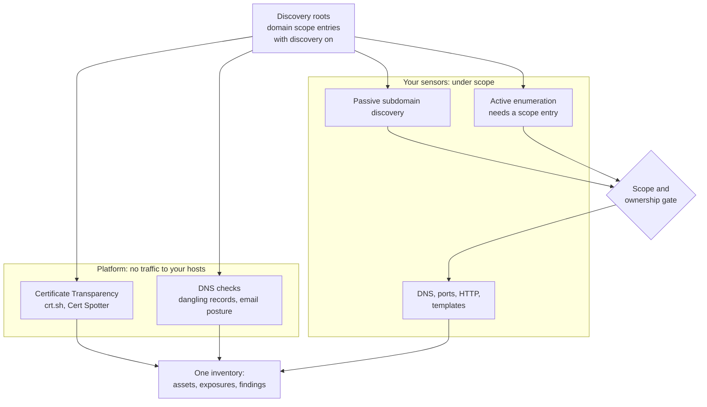

# Attack surface monitoring

Attack surface monitoring (EASM) keeps track of your internet-facing names
and what is wrong with them:

1. **What do we have on the internet?** Discovery from your domains.
2. **Is it really ours?** Attribution, with evidence and suggestions.
3. **What is wrong with it?** Passive DNS checks and non-intrusive scans.
4. **What changed?** Continuous monitoring and alerts.

It needs the **Attack surface** module. The pages are under
**Discovery › Attack surface** (`/attack-surface`), five views: **Overview**,
**Inventory** (**Technologies**, **Certificates**, **Web surface**),
**Exposures** (**Exposure items**, **Lookalikes**), **Changes** and
**Discovery** (**Stages**, **Decisions**). The
[user guide](../user-guide/04-discovery.md#attack-surface) describes each page.
Only your own attack surface is covered, under your own scope.

*Figure: Discovery, Attack surface, Overview.*

The overview opens with five tiles (**Surface assets**, **Internet-facing
assets**, **New in the last 7 days**, **Open exposures**, **Waiting for a
decision**), then **Fix first** and **Discovery**.

Discovered assets join the inventory at once. Scope decides what is actively
scanned: entries authorize the full scan, and assets no entry covers get
low-impact checks by default
([Unclassified assets](scope.md#unclassified-assets)).

## How it works

| Part | Runs on | Sends traffic to your hosts? |
|---|---|---|
| Certificate Transparency discovery | the platform | No: it queries public CT log aggregators |
| DNS checks | the platform | No: DNS questions about your names only |
| Passive subdomain discovery (`discover.subdomains`) | your [sensors](../sensors/index.md) | No: it asks passive sources, not your hosts |
| Active subdomain enumeration (`enumerate.subdomains`) | your sensors | DNS questions for candidate names under your domain; needs a scope entry |
| Active assessment (DNS, ports, HTTP, templates) | your sensors, as [scans](scans-and-runs.md) and [automatic coverage](asset-coverage.md) | Yes, under [scope](scope.md) |

Everything found goes into the same asset inventory, exposures and findings
as any other source.

## Discovery roots

Discovery starts from your **permanent domain scope entries with discovery
on**, for example `*.example.com` (**Scoping > Scope > In scope**). Turning
discovery on needs the scope approval permission and re-authentication, like
any widening. One-off and non-domain entries never discover. Certificate
Transparency also watches your domain assets and verified domains.

## Certificate Transparency

The platform queries crt.sh (with Cert Spotter as a fallback) for the names
it watches and raises:

| Exposure | When |
|---|---|
| `subdomain_discovered` | A host below a watched name appears in a logged certificate |
| `certificate_expiring` | A host's newest certificate expires within 30 days |
| `certificate_expired` | A host's newest certificate lapsed within the last 30 days and nothing replaced it |

Names named exactly on a recent certificate become `subdomain` assets.
Excluded names are not queried and raise nothing. A name that resolves to an
address you put out of scope as a dedicated address is skipped too: it is not
promoted again and gets no Certificate Transparency evidence. An address on a
shared provider front end never carries this over, so names behind a CDN edge
are still promoted. If the address lookup fails, nothing is promoted in that
run; the exposures are still written. Each run queries at most
`CERT_MONITOR_MAX_DOMAINS_PER_RUN` domains per organization (default 50); the
rest follow in later runs.

Turning Certificate Transparency off (below) stops your domain names from
being sent to these third-party services.

## DNS checks

Daily, the platform asks its own resolver about your names. Nothing is sent
to your hosts or to CNAME targets, and no HTTP request is made.

| Check | Finds | Exposure |
|---|---|---|
| Dangling DNS | A CNAME whose target does not exist (high when the target's registrable domain is unregistered; medium when it points at a provider where anyone can claim the name); a delegation whose name servers do not exist or do not answer for the zone | `dangling_cname`, `dangling_ns` |
| Email posture | SPF, DMARC, MTA-STS and TLS-RPT gaps on registrable domains | `email_security_weak` |

A provider-claimable dangling CNAME stays medium until a sensor confirms it:
a nuclei `takeover` template that matches the same name in a scan your sensor
ran raises `subdomain_takeover` (high). Such a name may be probed by a
takeover-only nuclei scan even though it is classified as a dependency.

The takeover check step of the **Subdomains** and **Deep recon** workflows runs
the capability `check.takeover` (active, T1) on domains and subdomains. Nuclei
runs it with the `takeover` templates only: the platform fixes the template set
when it dispatches the job and the sensor checks it again, so the step cannot
run other templates. Any sensor version takes the job. A match on a name that
has an open dangling CNAME raises a confirmed subdomain takeover.

## Monitoring settings

The **Monitoring** card on **Attack surface > Overview** shows when each part
last ran, its switch and its cadence.

| Action | Permission |
|---|---|
| See the card | `settings:read` |
| Turn Certificate Transparency or DNS checks off or on, change the cadence | `settings:write` |
| **Run now** | `attack_surface:scope:write` |

- Cadence: **Default** (the platform's, usually every 24 hours), or every 6,
  12, 24 or 48 hours, or weekly. Six hours is the minimum.
- **Run now** starts Certificate Transparency discovery and then the DNS
  checks (each only if on). Results appear within minutes. It can run again
  15 minutes later. Adding a discovery root starts the same run.
- API: `GET` and `PUT /api/v1/easm/settings`
  (`ct_enabled`, `dns_checks_enabled`, `ct_interval_hours`,
  `dns_interval_hours`; `0` means the platform default), and
  `POST /api/v1/easm/sweeps`.

Platform operators set the defaults: `CERT_MONITOR_ENABLED`,
`CERT_MONITOR_INTERVAL`, `CERT_MONITOR_FEED_URL`,
`CERT_MONITOR_CERTSPOTTER_URL` (`off` disables the fallback),
`EASM_DNS_CHECKS_ENABLED`, `EASM_DNS_CHECK_INTERVAL`, `EASM_DNS_RESOLVER`,
`EASM_DNS_MAX_NAMES_PER_RUN` (default 500 names per organization per run) and
`EASM_DNS_QPS` (default 20 queries per second in all).

## Active discovery

Two ways keep the active side running:

- **Automatic coverage** (on by default): every asset your scope covers gets
  the checks its type needs on a schedule, with no scan to set up. See
  [Automatic coverage](asset-coverage.md).
- **Scans** of the recon workflows **Subdomains**, **Standard recon**,
  **Deep recon** or **Web** ([Scan workflows](scan-workflows.md#starter-workflows))
  against your domains, on a schedule. Your sensors find subdomains, resolve
  them, scan ports, probe HTTP and TLS, crawl and run non-intrusive
  templates. Every step's new names pass the scope and ownership gate before
  the next step probes them, and a derived target is at most three discovery
  hops from the seeds. With delta gating (on in these workflows), the heavy
  steps (templates, crawls) take only what is new, changed or due since the
  previous run.

### Two kinds of subdomain discovery

Finding subdomains is two separate capabilities, because they are two
different acts:

| Capability | What it does | Tier | Needs |
|---|---|---|---|
| `discover.subdomains` (subfinder) | Asks passive sources (certificate logs, DNS datasets) which names exist | T0, passive | The passive checks of the gate only (coverage runs it on domains under a scope entry) |
| `enumerate.subdomains` (dnsx-enum) | Asks DNS about candidate names (`<label>.example.com`) from a label list and keeps the names that resolve, so it finds names passive sources miss | T1, active | A scope entry for the domain |

Automatic coverage runs `discover.subdomains` daily and
`enumerate.subdomains` every 7 days on each `domain` asset under a scope
entry. Enumeration passes the full dispatch gate and the claim-time re-check
like any active scan, and is never part of the low-impact checks of an
unclassified asset. The label list is the platform's small wordlist pack plus
labels learned from your own names under that domain (for example `uat` and
`charts` from `charts-uat.example.com`); the learned labels are read for your
organization only and sealed into the signed job, never stored. Enumeration
needs sensor v0.27.0 or later ([Tools](tools.md)). The label list is described
under [Wordlists](#wordlists).

**Deep onboarding.** The first enumeration of a new root (a `domain` asset under
an active scope entry whose enumeration has never succeeded) runs once at deep
depth: the medium wordlist pack (`wordlists-m`) with the learned labels and
their variants. The root then returns to the weekly standard pass. At most 10
roots go in one deep run, and a restart or a second API replica never repeats
it. A deep pass that fails 3 times in a row falls back to standard, and without
a stable `wordlists-m` the pass runs at standard depth. After an upgrade, roots
never enumerated before get the deep pass once; roots already enumerated keep
the weekly pass. Which roots may be enumerated does not change: the scope
entry, the full dispatch gate and the claim-time check all still apply.

The platform ships the small and medium packs (`wordlists-s`, `wordlists-m`) and
installs them at start when it has no stable wordlist pack, so enumeration works
on a fresh install without an import. Only if a pack is revoked and none is
imported is enumeration paused with the reason **content missing** (**A wordlist
is missing** on the Discovery stages); the coverage alert then asks an instance
administrator to import the pack
([Content delivery](../sensors/content-delivery.md)). It resumes on its own
once the pack is imported.

### Ports and web services

Port scans that name no ports scan the **top 1,000 ports**: coverage, a
workflow port step and a single-tool port scan alike. A set list, `top-100`
or `full` is kept, and the whole range runs only when a scan sets it. When
the top 1,000 replace an earlier, shorter scan, open ports that the same
source no longer finds leave the asset.

Port scan results become `open_port` assets linked to their address, with
`port_open` and `service_detected` exposures. A later port scan that no
longer sees a port marks it inactive and resolves its exposures. The page
of a domain or subdomain shows **Ports on resolved addresses**: the open
ports of every address the name resolves to, with the service, product,
version and last seen time. Addresses outside your data scope are only
counted.

A port scan of a name stores its ports on the addresses it found. A virtual
host, CDN or load balancer routes by name, so the HTTP probe also probes
`<name>:<port>` for each other open port of the addresses the name resolves
to: after a port scan step in a workflow, and in every coverage HTTP probe
batch (at most 20 ports per name). Each `<name>:<port>` passes the same gate
as any derived target (exclusions in `host:port` form, ownership of the name,
scope, zones). Coverage also probes a name whose addresses expose only
non-standard web ports (for example 2083, 7443 or 10443, any port from 8000
to 8999, or a port whose detected service is HTTP or TLS).

The HTTP probe makes each web origin it finds its own asset, named by its URL
(`https://app.example.com`, `http://203.0.113.7:8080`), so crawling,
templates and DAST have a web target; the subdomain or address keeps its own
row and type. The origin's page has a **Web** section: the security header
posture, and the endpoints, parameters and changes found on that origin.
Template scans run once per web service: an address origin is skipped when a
named origin serves the same address and port, so the checks run with the
right host name.

### Names that no longer resolve

A name with no DNS answer is not a failure. Coverage settles it as checked
with "no answer", stops sending port scans, HTTP probes and templates to it,
and checks its DNS again after 1 day, 3 days, 7 days and then weekly. Active
scan steps leave out names the platform knows do not resolve; passive steps
keep them, so a name comes back by itself when it resolves again, and then
passes the full scope gate again. The run page lists such names under **No
longer resolve**, and the inventory filter `resolution=not_resolving` lists
them.

### Hosts that do not answer the scanner

A host a scan could not cover is a coverage gap: it counts as not covered, is
never read as clean, and its findings are never closed by that run. The run page,
its task list and the asset's coverage section say why:

- **TLS answers, resets every HTTP request**: the host is up, completes the TLS
  handshake and then resets or closes every request. It may block the scanner's
  address, or the site behind it is down. Other causes shown are the TLS
  handshake failing, a reset, a refused connection and no answer, with the
  problem of the certificate it served (expired, not yet valid, name mismatch,
  self-signed). Rechecking needs a recent sensor; for an older one the gap reads
  "failed every request".
- **Blocked by edge protection** or **challenged by edge protection**, with the
  vendor's name when the sensor sends one (for example a WAF or CDN). A blocked
  host settles as edge blocked, a rate-limited one as rate limited, a stopped one
  as unreachable. A host an edge protection blocked is an observation of the
  target, not a failure of the platform, so it does not raise the platform-side
  coverage alert. This applies to scans planned after the upgrade.

The fixes the page links to: allow the scanner addresses (**Settings > Scanning >
Proxies** lists them) and scan again, use another proxy pool, or lower the scan
rate. Scans never try to get past an edge.

## CDN and edge addresses

An address in a range a CDN, WAF, hosting or cloud provider publishes for a
shared front end belongs to the provider and serves many organizations. The
platform labels it, from one built-in address classifier:

| Label | Shown on |
|---|---|
| **Behind** *provider* | A name or service served through the provider's edge |
| *provider* **edge**, *provider* **hosting** or *provider* **shared** | An address that belongs to the provider (inventory, asset drawer, and in-scope address, range or CIDR entries) |
| **Provider ports** | The ports found on such an address, which are the provider's, not yours |

The platform never refuses these addresses by itself: **your organization
decides**. A person with scope write can click the label on an address and
**Add to out of scope**. The dialog explains that scanning a shared edge
address tests the provider, not your systems, and shows what the exclusion
stops; confirming adds one *Do not scan* exclusion through the normal
exclusion path (same permission, audit and approval rule).

**An exclusion of a shared edge address stays on the address.** It blocks
that address (bare, `host:port`, URL, and inside range targets) on every
dispatch path. Names that resolve to it keep being scanned through the edge,
and their port scans are capped to the web ports. A name served through a
shared front end gets only the web ports even when a scope entry covers the
edge address. An exclusion of any other address (a dedicated address, a
cloud static address, or one labeled an edge only by its network holder or
CDN record) also stops every name that resolves to it. See
[Exclusions and the names behind them](scope.md#exclusions-and-the-names-behind-them).

## Review

Every internet-facing asset carries an **attribution**: `confirmed`,
`needs_review`, `candidate`, `dependency` (your name on a provider's
infrastructure), `monitor_only` or `rejected`.

- Names covered by a permanent scope entry are **confirmed** automatically
  (**Add discovered names automatically**, on by default).
- Everything else discovery finds joins the inventory at once as
  *discovered*. Only when **Review discovered assets first** is on (off by
  default) do names outside every permanent entry wait for a person before
  they join the inventory.

**Discovery > Decisions** (`/attack-surface/review`) collects the decisions that
still need a person. Its **Waiting for your decision** section has:

- **Addresses your in-scope names resolve to.** Adding them scans every port
  of those addresses; today only the names are scanned. A name never makes
  an address yours, so add only addresses you know are yours. The card
  groups them:
  - **Network unknown for N: check they are yours**;
  - **Shared, not offered**: CDN, CDN edge range, shared hosting (names of 3
    or more domains point there), another organization's network or a
    provider network. These are never offered as scope entries (you can
    still put such an address out of scope, see
    [CDN and edge addresses](#cdn-and-edge-addresses));
  - **Your own network**: **Add {prefix}** for your network seeds;
  - **Already get low-impact checks (add to scope for a full scan)**.

  Each address shows the open ports seen and its other names, and an
  ownership assessment (high, medium, low or unknown) with its evidence: your
  network seeds, the network holder, the reverse name, how many of your names
  point at it and for how long, and blockers such as a brand-new address. The
  strongest come first. Nothing is added to scope on its own
  (`GET /api/v1/easm/suggestions`). Actions: **Add
  N to scope**, **Not ours** (never scanned or suggested again, until undone
  on the asset), **Not now**, and **Undo**.
- **Assets you confirmed that are not in scope**: confirmed before
  confirming added a scope entry, so scans skip them; add their exact
  entries to scan them.

The list below it (views **Awaiting a decision** and **Not ours**) shows each
name with its evidence ("Why it may be yours"). Decide one by one or in
bulk: **Ours: add to scope**, **Not ours**, **Dependency** or **Monitor
only**. Confirming a domain or address as yours adds its exact scope entry,
unless your organization turned this off or uses Strict scan approval.

- A name marked **Not ours** is remembered for 12 months, with every name
  below it, so discovery does not propose it again unless new evidence
  appears.
- Names awaiting a decision and rejected names are hidden from the default
  inventory view; **Show all** shows them.

A person's decision always wins over automation. Names marked Not ours,
dependencies, monitor-only names and names that resolve only through a
wildcard DNS record are never actively probed. Names that discovery found
and nobody has decided on yet are unclassified: they get what **Scan
unclassified assets** allows (low-impact checks by default, behind the
platform guardrails).

## Certificates

**Inventory > Certificates** lists the TLS certificates found on your
external assets: **Issued to**, **Fingerprint (SHA-256)** (with a copy
button), **Issuer**, **Issued on**, **Expires on** and **Detected**, and a
status per row computed when you open the page: **Expired**, **Expiring
soon** (within 30 days), **Valid** or **Unknown**. The **Expired** and
**Expiring in 30 days** counts filter the table. Search by subject, issuer
or fingerprint, and **Export CSV**. Certificates appear once a scan of your
external assets reads them.

*Figure: Discovery, Attack surface, Certificates.*

It needs `assets:read`, and each certificate follows your data scope. API:
`GET /api/v1/attack-surface/certificates` and
`GET /api/v1/attack-surface/certificates/stats` (counts by status), with the
usual list filters, sort, search and pagination.

### Names from certificates

The alternative names (and the subject name) of every TLS certificate a report
puts in the inventory (from httpx, tlsx, nuclei or an upload) are proposed as
subdomain assets when they sit strictly below one of your domains: attributed
domain assets, verified domains and permanent scope entries with discovery on.
Names on a shared CDN or hosting certificate outside those domains create
nothing, and wildcard names, addresses and names of certificates that lapsed
more than 90 days ago are skipped.

A new name is a `candidate` with the reason **Named in a TLS certificate** (a
weak one: it names the certificate, its issuer and expiry, and the tool). A certificate never confirms or scopes a
name by itself; a permanent scope entry that covers the name still confirms it,
as for Certificate Transparency names. Exclusions, excluded domains, excluded
dedicated addresses and names marked **Not ours** are respected, an existing
asset keeps its standing, and at most 500 new assets come from one report.

## Wordlists

Active subdomain enumeration asks DNS for names built from a label list. Each
enumeration job reads, in this order:

1. **Learned labels**: the labels of your own active names under the root, and
   their parts, most frequent first.
2. **Variants** of those labels: numbered neighbors (`web09` gives `web10`),
   numbered environment names (`charts-uat` gives `charts-uat2`) and base words
   crossed with the environment words your names use.
3. **Your own lists** (below), every enabled one.
4. The **platform list**: `wordlists-s` for the weekly pass, `wordlists-m` for
   the one deep pass of a new root. Both are built from public sources and ship
   with the platform.

Learned labels and your lists are carried inside the signed job and never stored
on a sensor beyond the task.

**Settings > Scanning > Wordlists** (`/settings/scanning/wordlists`) manages
your lists. Seeing the page needs `scans:content:read`; changing needs
`scans:content:write`.

- **New list** takes a **Name**, a **Description**, the **Labels** (paste them,
  or **Upload .txt**; one per line, lines starting with `#` ignored) and **Use in
  subdomain discovery**. Entries are lower-cased and kept when they are one to
  three dot-separated parts of letters, digits and dashes. Lines that are not DNS
  labels, and lines that look like secrets (a long mix of letters and digits),
  are dropped, since every label is sent to resolvers; repeats are removed.
  Saving says how many labels were kept and what was dropped.
- The table shows each list's **Labels**, **Version** and **Updated**, and the
  **In use** switch; **Edit** and **Delete list** change it. The version rises
  when the labels change. A deleted or switched-off list is no longer read; runs
  that used it keep their record.
- Limits: 20 lists per organization, 50,000 labels and 1 MiB per list, 2 MB of
  text per save. Every change is audited (`wordlist.created`, `wordlist.updated`,
  `wordlist.deleted`) with the name, version and count, never the labels.
- **Preview for a domain** counts, per source, the labels a standard discovery
  run of that domain would try: the platform list and its version, the labels
  learned from your names with variants, and your lists. Nothing is sent to a
  sensor or resolver.
- On a run, a discovery task shows **Wordlists used**: the platform list and
  version, the learned labels and your lists with their versions.

API: `/api/v1/wordlists` (`GET`, `POST`, `PATCH /{id}`, `DELETE /{id}`) and
`GET /api/v1/wordlists/preview?root=example.com`.

## Detection rules

Detection rules read the web content a scan already fetched (the URL, final
URL, title, `Server` header, cookie names, favicon hash and script paths) and
need no sensor change. They run on the platform when the report arrives, before
anything is stored. There are two kinds:

- **Technology** rules (`web-fingerprints`): a match becomes an asset technology
  with its version, category and CPE. A versioned product also becomes a
  software component, so it is matched against known CVEs. A tool's own report
  of the same technology wins.
- **Sensitive data** rules (`secret-rules`): a match for a key, token, private
  key, credential in a URL, internal host name, personal data or debug output
  becomes a `credential_leaked` or `sensitive_data_exposed` exposure. It holds
  only a keyed fingerprint, a short masked preview, the length and where it was
  found; the value is never stored or logged.

The platform ships the packs `web-fingerprints-core` and `secret-rules-core`,
installed on first start when no stable pack of that name exists. **Settings >
Scanning > Detection rules** (`/settings/scanning/detection-rules`) shows
**Platform rules** and manages **Your rules**: a **Name**, a **Kind**
(**Technology** or **Sensitive data**), a **Category**, a **Severity** (sensitive
data) or **CPE** (technology), a **Confidence**, and one or more **Matchers**
(**Reads** the URL, title, header, cookie name, favicon hash, body or script
paths, with an RE2 **Pattern** that runs only near one of its **Keywords**).
**Matches when** chooses all or any matcher. **Test on a sample** runs a draft
rule on pasted content (up to 256 KB) and shows masked results; nothing is
stored. Limits: 200 rules per organization. Changes are versioned and audited.
Seeing the page needs `scans:content:read`; changing and testing need
`scans:content:write`. Every scan records the rule packs it was matched with.

API: `/api/v1/content-rules`.

## Alerts

New or reopened EASM exposures reach your notification channels as
`new_exposure`:

| Exposure | Delivery |
|---|---|
| Medium or higher on an approved asset | At once, one alert per exposure |
| Low or info, on a name awaiting review or monitor-only, or not linked to an asset | A daily digest per organization (08:00 UTC) |
| More than 30 immediate alerts in an hour | The rest go to the digest |

Re-sightings announce nothing; rejected assets never alert.
