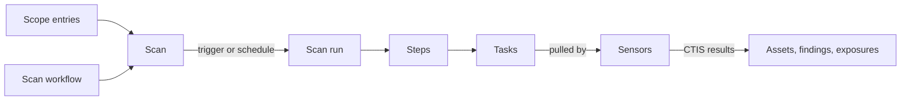

# Scanning

OpenCTEM plans scans on the platform and runs them on [sensors](../sensors/index.md)
in your networks. Every target passes one authorization gate before any
sensor sees it, and every result comes back through the same ingest path, so
findings and assets from scans, CI pipelines and imports land in one
inventory.

| Concept | What it is | Where |
|---|---|---|
| [Scope](scope.md) | What your organization may actively probe | Scoping > Scope |
| [How scope reaches sensors](scope-to-sensors.md) | Every point where scope and exclusions are enforced, up to the sensor | Scoping > Scope |
| [Scan workflow](scan-workflows.md) | A graph of steps, each one capability run by one tool | Discovery > Scans > Workflows |
| [Scan](scans-and-runs.md) | Targets, a single tool or a scan workflow, and a schedule | Discovery > Scans |
| [Scan run](scans-and-runs.md#scan-runs) | One execution of a scan; split into steps and tasks | Discovery > Scans > Runs |
| [Automatic coverage](asset-coverage.md) | The checks the platform runs on every in-scope asset by itself, and the asset's Coverage section | Asset details, **Coverage** |
| [Why a task waits](why-waiting.md) | Why a queued task has not started, and what to do | Run page, **Why waiting?** |
| [Stage streaming](stage-streaming.md) | How a step starts on the first results of the step before it, and when it does not | Run page, step lanes |
| [Tools](tools.md) | The scanners sensors run, and their availability | Settings > Scanning > Tools |
| [Data-flow traces](data-flow-traces.md) | The source-to-sink path of a SAST finding | Finding detail, **Data flow** tab |
| [Known false positives](../user-guide/known-false-positives.md) | How a decision on a finding is requested, approved and kept | Exposures > Findings, Exceptions |
| [CI/CD quickstart](ci-quickstart.md) | Connect a first pipeline in minutes | Discovery > CI/CD |
| [CI integration](ci-integration.md) | Code scanning in your pipelines, with a gate | Discovery > CI/CD |
| [Attack surface monitoring](easm.md) | Passive discovery and checks of your internet-facing names | Attack surface |

## Your first scan

*Figure: The New scan wizard.*

1. **Install and pair a sensor** where it can reach your targets
   ([Docker](../sensors/deploy-docker.md), [Pairing](../sensors/pairing.md)).
   Promote it to **Trusted** so it may run active checks.
2. **Add a scope entry** for what you want to scan under
   **Scoping > Scope > In scope**, for example `*.example.com` or
   `203.0.113.0/24`. Without one, internet-facing targets are refused.
3. **Create the scan**: **Discovery > Scans > New scan**. The wizard has
   five steps: **What**, **Targets**, **Options**, **Schedule** and
   **Review**. Pick a single tool or a scan workflow, then the targets
   (names, addresses, ranges or asset groups). The starter workflows include
   **Passive discovery** (passive sources and DNS only), **Subdomains**
   (finds subdomains, resolves them and probes their web services),
   **Standard recon** (adds port scans, a crawl and non-intrusive nuclei
   templates), **Deep recon**, **Web**, **Network** (finds the live hosts of
   address ranges, scans their ports, probes web services and runs
   non-intrusive templates) and **Code / CI**
   ([Starter workflows](scan-workflows.md#starter-workflows)). The Review step previews which sensor and
   zone each target goes to.
4. **Run it**: **Run now**, or give it a schedule.
5. **Follow the run** under **Discovery > Scans > Runs**: each step, its
   tasks, the sensors that took them and their logs. A task that has not
   started says why under **Why waiting?** ([Why a task waits](why-waiting.md)).
6. **Review the results** under **Assets**, **Findings** and
   **Attack surface**.

Two kinds of targets are expanded when a run starts, not when the scan is
saved:

- A wildcard such as `*.example.com` becomes the apex plus the names your
  inventory holds under it (at most 5,000 per wildcard, the most recently
  seen). A subdomain discovery tool gets the apex only; an active tool given
  the wildcard itself is refused (`WILDCARD_TARGET`).
- An address range is scanned in one of three ways, chosen on the
  **Targets** step under **Address ranges**: **Find live hosts first** (a
  light probe finds the live addresses, then the deeper steps scan those and
  the addresses the inventory already holds; the default for a new scan
  that can run it, and it needs a Host discovery step in a workflow),
  **Sweep the whole range**, or **Only the hosts already in the inventory**.

**Quick scan** (the **Quick scan** button on the Scans page) runs one
scanner against up to 1,000 targets now. Nothing is saved unless you choose
**Save as scan**; the run shows in the Runs list as a **Quick scan**. It
needs the `scans:write` and `scans:execute` permissions.

## What is checked before anything runs

| Check | Result when it fails |
|---|---|
| The target is valid (no loopback, link-local or metadata address; private addresses only inside a scan zone) | Refused |
| A wildcard goes only to a tool that can take it | Refused (`WILDCARD_TARGET`) |
| The scanner can scan at least one of the targets (names, addresses, ranges) | Refused (`NO_COMPATIBLE_TARGETS`) |
| An address range can be cut into at most 4,096 pieces around its exclusions | Refused (`RANGE_TOO_FRAGMENTED`) |
| **Find live hosts first** has a Host discovery step to run | Refused (`LIVENESS_NEEDS_HOST_DISCOVERY`) |
| An active scope entry covers the target at the needed tier, or the target is an unclassified inventory asset that the scope policy lets get low-impact checks; no exclusion matches | Refused, or the target is skipped with a run warning ([Scope](scope.md)) |
| The person (or the scan owner, for scheduled runs) may act on the asset | Refused or skipped |
| A sensor that may run the tool is online | Refused (`NO_SENSOR_FOR_TOOL`) |
| A scan sent to shared sensors is within the organization's **shared sensor scans a day** limit, and the platform's proof rule is met ([Shared sensors](../sensors/shared-sensors.md)) | Refused (`PLATFORM_SENSOR_REFUSED`); an organization at its **shared sensor jobs at a time** limit has its extra jobs wait |
| The scan and the organization are under their limits of runs at once | Refused (`MAX_CONCURRENT_RUNS`) |
| A scan window opens for the targets | Refused when it never opens (`SCAN_WINDOW_NEVER_OPENS`); otherwise the work waits for the window |
| The target is routed to a zone with sensors | Uncovered targets are skipped and listed |
| Enough time is left before the run's deadline for the step's tool | The step is not started (`DEADLINE_TOO_CLOSE`) |

Then, when a sensor claims the work, the scope is checked again, and on the
sensor its grant, its sensor-local policy and its target guard apply. A
queued task can still wait for free hosts or a free sensor: see
[Why a task waits](why-waiting.md). Targets a sensor refused or could not
reach are counted on the run: see [The run flow](scans-and-runs.md#the-run-flow).
