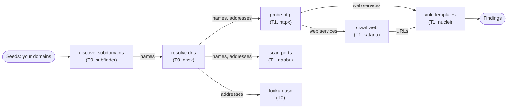

# Scan workflows

A **scan workflow** is a graph of steps. Each step runs one **capability**
(for example "discover subdomains" or "probe HTTP") with one tool, and what a
step finds becomes the input of the steps after it. A scan runs either a
single tool or a scan workflow.

Manage scan workflows under **Discovery > Scans > Workflows**: a visual
builder with a palette of capabilities, or the API `/api/v1/scan-workflows`.
They need the `scan_workflows` module and the `scans:workflows:read`,
`scans:workflows:write` and `scans:workflows:delete` permissions.

## Starter workflows

Every organization gets these system workflows, built only from capability
steps, so they run on whichever implementation your sensors have:

| Workflow | Steps |
|---|---|
| Passive discovery | discover subdomains and look up the domain registration, then resolve DNS, then look up the networks of the addresses. Every step is passive (T0) |
| Subdomains | discover subdomains, resolve DNS, then probe HTTP (and a takeover check, once a tool for it is installed) |
| Standard recon | discover subdomains, resolve DNS, then probe HTTP, scan ports and look up networks side by side, then crawl and run vulnerability templates (after the probe and the crawl) |
| Web | probe HTTP, crawl, then vulnerability templates |
| Deep recon | Standard recon plus the domain registration lookup, with higher target caps |
| Probe new assets | scan ports and probe HTTP, with no discovery step (the active half of **Continuous discovery**) |
| Network | find the live hosts of address ranges (host discovery), scan ports, probe HTTP, then vulnerability templates |
| Code / CI | secrets, SAST, dependency and IaC scans of a repository, in parallel |

*Figure: Scan workflows.*

System workflows cannot be edited; clone one to change it. Steps whose
capability has no tool yet (screenshots, service detection, the takeover
check) are optional: a run skips them with "available when a tool that runs
<capability> is installed" and never fails because of them.

**Retired workflows.** The earlier starters **Discover**, **Discover + Vuln**
and **Web app**, and the older presets, are retired. They are no longer
listed, and starting a new scan from one or copying one is refused with an
error that names its replacement: **Subdomains**, **Standard recon** and
**Web**. Scans and copies made from them keep working, and a copy's page says
which retired workflow it came from.

The **Standard recon** graph, as an example. Each arrow carries the assets the
earlier step found, and every new target passes the scope gate before the next
step probes it:

### Depth

A workflow scan has a **depth**: `passive`, `standard` (the default) or
`deep`. It is set through the API (`depth` on the scan) and copied into each
run:

- **Passive** runs only the steps that send nothing to the targets (T0).
  Every other step is skipped with the reason. A scan whose depth skips every
  first step of its workflow is refused at save (`DEPTH_RUNS_NOTHING`).
- A step can start at a minimum depth, and can use other settings and a
  lower target cap at each depth. In the recon workflows:

| Workflow | Passive | Standard | Deep |
|---|---|---|---|
| Passive discovery | every step, no announced ranges | adds announced ranges | adds every DNS record type |
| Subdomains | discovery and resolution | adds the web probe | adds every DNS record type |
| Standard recon | discovery, resolution, network lookups | top 1,000 ports (at most 1,000 targets), templates of critical, high and medium severity (at most 500), no crawl | same ports (at most 5,000 targets), crawl (at most 200), templates down to low (at most 2,000) |
| Web | refused (no first step would run) | templates of critical, high and medium severity, no crawl | adds the crawl, templates down to low |

Depth never raises a tier: the scan's intensity, the scope and the claim-time
checks still decide.

### Run rules

Two workflow settings change how a run moves on. Both are on in the recon
workflows and off for other workflows unless you turn them on:

- **Continue on a failed step** (`continue_on_failed_dependency`): a step runs
  once every step it depends on has ended, on the seeds and on what the steps
  that did produce results found. Without it, a step after a failed, skipped
  or timed-out step is skipped.
- **Delta gating** (`delta_gating`): template scans, crawls, screenshots and
  service detection take only the assets that are new, changed or due since
  the previous completed or partial run of the same scan. An asset is done
  when it was first seen before that run, has not changed since, and either
  that run's same step completed it within the last 7 days or its coverage
  for the capability is current. Done assets are recorded `unchanged`; a step
  left with none finishes at once with "nothing new since the last run". A
  partial, failed or skipped step of the previous run never counts as done,
  so cut-short work is redone. Without a previous run every asset is scanned,
  and seeds are never gated.

## Capabilities

The platform's capability catalogue decides which steps exist, what each one
consumes and produces, and its tier. A tenant, a sensor or a report cannot
widen it.

| Capability | Takes → produces | Tier | Tools (default first) |
|---|---|---|---|
| `discover.subdomains` | domain → subdomains, from passive sources | T0 | subfinder |
| `enumerate.subdomains` | domain → subdomains that resolve, by querying DNS for candidate names from a label list | T1 | dnsx-enum |
| `resolve.dns` | names → names, IP addresses | T0 | dnsx |
| `lookup.rdap` | root domain → its registration (registrar, name servers, dates) | T0 | rdap (built into the sensor) |
| `lookup.asn` | addresses, networks → their autonomous system and holder | T0 | asn (built into the sensor) |
| `discover.hosts` | addresses, ranges → live addresses (light TCP connect probes) | T1 | naabu |
| `scan.ports` | names, addresses → open ports | T1 | naabu |
| `probe.http` | names, addresses, ports → HTTP services, certificates | T1 | httpx |
| `crawl.web` | HTTP services, URLs → discovered URLs | T1 | katana |
| `vuln.templates` | web and network services → findings | T1 | nuclei |
| `dast.web` | web applications → findings | T2 | zap |
| `secrets.code` | repository → findings | T0 | betterleaks, trufflehog, gitleaks |
| `sast.code` | repository → findings | T0 | semgrep, opengrep, codeql |
| `sca.deps` | repository, container → findings | T0 | trivy, osv-scanner, grype |
| `iac.misconfig` | repository → findings | T0 | checkov, kics, trivy |
| `container.image` | container → findings | T0 | trivy, grype |
| `network_va.connector` | addresses, hosts, networks → findings | T1 | tenable_sc |

The official sensor ships subfinder, dnsx, naabu, httpx, katana, nuclei,
opengrep, semgrep, trivy and betterleaks (see [Tools](tools.md)). A step whose
capability has no tool on any of your sensors cannot run. Further
capabilities (for example `check.takeover`, `check.tls`, `cloud.posture`)
are defined but **planned**: they are listed as unavailable and cannot be
used in a step.

## Choosing the tool of a step

A step picks its tool in one of three ways:

- **Auto**: any implementation of the capability, the default first.
- **Prefer**: an ordered list of tools; each must implement the capability.
- **Pin**: exactly one tool.

The tool chosen is recorded on the step run. A tool that does not accept a
setting the step sets is not eligible, and the step says why instead of
dropping the setting.

## Step settings

Standard parameters of a capability are typed and checked on every save.
Each tool receives them under its own name. Tool-specific extras go under
`x.<tool>` and only on a step pinned to that tool. Settings the sensor
applies today:

| Tool | Settings |
|---|---|
| naabu | `ports`, `top_ports`, `exclude_ports`, `rate`, `retries`. Port lists only (`80,443,8000-8100`, `top-100`, `top-1000`, `full`); `rate` can only lower the sensor's rate. A port scan that names no ports scans the top 1,000; the whole range runs only when a step sets `full` |
| nuclei | `tags`, `exclude_tags`, `severity`, and `rate_limit`, `concurrency`, `bulk_size` up to the sensor's ceilings. `dos`, `fuzz`, `fuzzing` and `intrusive` are refused as tags; `exclude_tags` only adds to the sensor's exclusions |

*Figure: The workflow builder.*

A value the tool's settings schema refuses fails the step at save time
(`INVALID_STEP_SETTING`) and again on the sensor.

## How data flows between steps

- A step's targets are the run's seeds plus what its direct predecessors
  produced, of the types it takes.
- Data flows **through the inventory only**: the platform records the assets
  each task's report wrote and feeds those to the next step. A sensor never
  feeds another sensor, and cannot attribute output to another step or run.
- **Every hop passes the gate** before it becomes a target: strict name
  parsing, scope exclusions, the run's scan zone, the scope check of the
  person who triggered the run and the ownership check. A passive (T0) step
  may take any discovered name; an active (T1) step takes names your scope
  authorizes, and unclassified inventory assets only as the scope policy
  allows (low-impact checks by default, see [Scope](scope.md)); an intrusive
  (T2) step never takes derived targets.
- A derived target is at most **3 discovery hops** from the seeds. A port,
  service or URL on a host the run already reached keeps that host's hop.
- Each capability caps its fan-out (at most 10,000 targets per run, 5,000
  children per parent).
- A step whose predecessors produced nothing it can take completes with
  "no inputs" and the run moves on.

## Chunks and politeness

A step whose tool takes a list of targets is cut into **chunks**, one task
each, that any eligible sensor of the zone may claim:

| Capability | Chunk size |
|---|---|
| `lookup.asn` | 500 |
| `resolve.dns`, `probe.http` | 200 |
| `lookup.rdap` | 100 |
| `discover.hosts` | 64 |
| `discover.subdomains`, `scan.ports` | 50 |
| `enumerate.subdomains` | 1 (one root domain per task) |
| `vuln.templates` | 25 |
| `crawl.web`, `dast.web` | 10 |

Code, image and connector steps are not cut.

Address ranges reach only host discovery, port scans and the network
lookups. A range is cut into pieces of at most a /24 (IPv6 /120), around the
scope's exclusions; a range that would need more than 4,096 pieces is refused
(`RANGE_TOO_FRAGMENTED`). In a chunk a range weighs its number of addresses
and every other target weighs one: a `scan.ports` chunk reaches at most
1,024 addresses and a `discover.hosts` chunk at most 4,096.

With **Find live hosts first** (the default for a new scan that can run it),
the ranges go to the Host discovery step only; the port scan and the steps
after it get the live hosts it found plus the addresses the inventory already
holds in the ranges. A workflow without a Host discovery step cannot use it
(`LIVENESS_NEEDS_HOST_DISCOVERY`).

**Politeness.** Within an organization, a task is claimed only while no
other running task of the organization holds one of its hosts, so one host is
probed by one task at a time. A name or address is one host; an address and a
range scan of the same /24 conflict, two addresses of one /24 do not. Passive
workflow steps (subdomain discovery, DNS, lookups) hold no host. A running
task frees each host as soon as its targets on it settle (sensor v0.21.1 or
later). nuclei reports no end per host, so from sensor v0.23.0 it runs a task
over several hosts in up to 4 waves and frees each wave's hosts when that
wave ends. A waiting task says so on the run page: see
[Why a task waits](why-waiting.md).

## Validation and versions

- Every save checks the graph: capabilities exist and are routable, a pinned
  tool implements its step, edges connect compatible types (the builder
  suggests the step that would connect two incompatible ones, for example an
  HTTP probe between subdomain discovery and crawling), no cycles, at most 30
  steps and 120 edges. `POST /api/v1/scan-workflows/verify` checks a draft
  without saving it.
- When a run starts, the workflow is saved as an immutable version. The run
  uses that version to the end; an edit made while it runs changes the next
  run only.

## Preview before running

The new-scan wizard ends with a preview (`POST /api/v1/scans/workflow-preview`):
for each step the capability, tier, the tool that would run and whether a
sensor in the scan's zone can run it; the zone routing of a sample of the
targets, with the targets left out by exclusions; and which targets would
wait for a scan window. A step no sensor can run blocks the
scan with the same `NO_SENSOR_FOR_TOOL` reason the trigger would give.

## Automations are different

**Automations** (**Mobilization > Automations**, `/api/v1/workflows`) are
event rules: *when* something happens (a finding is created, a scan run
completes), *if* conditions match, *then* act (notify, open a ticket, start a
scan). A scan an automation starts goes through the same gate as any other
trigger. Automation-caused events never re-trigger the automation that caused
them, and chains stop after three levels.
