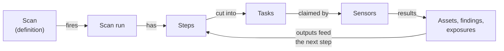
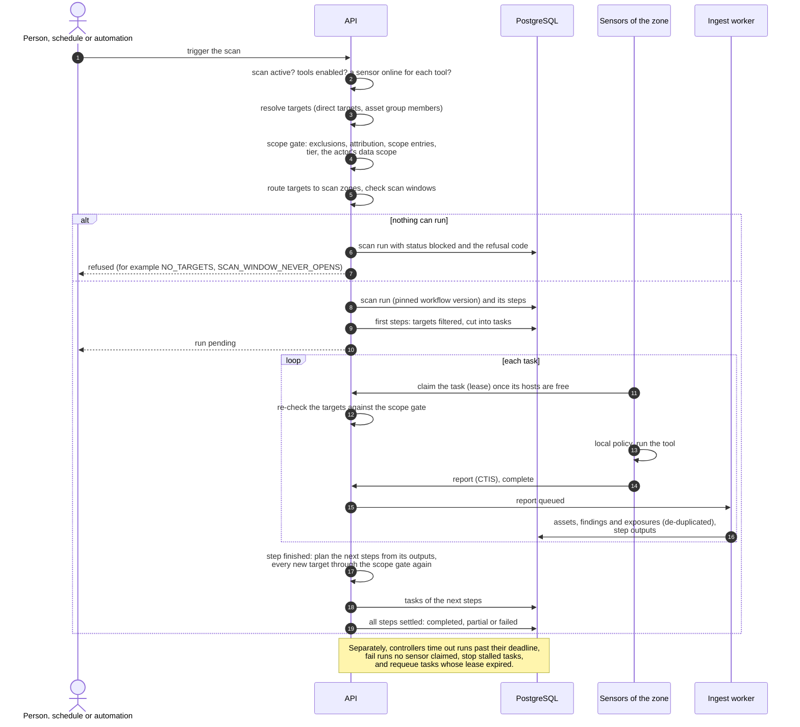

# Scans and scan runs

A **scan** says what to scan, with which tool or scan workflow, and when. Each
time it fires, it creates a **scan run**; the run is split into **steps** (one
per tool or workflow step), and each step is cut into **tasks** that sensors
claim and run. Results flow back into the inventory, and the next steps take
what the earlier ones found.

| Term | Meaning | API |
|---|---|---|
| **Scan** | What to scan, how, and when | `/api/v1/scans` |
| **Scan run** | One execution of a scan | `/api/v1/scan-runs` |
| **Step** | One step of a run: a single tool, or one step of a [scan workflow](scan-workflows.md) | in `GET /api/v1/scan-runs/{id}` |
| **Task** | One unit of sensor work of a step: one tool on a slice of the targets, held by one sensor under a lease | `GET /api/v1/scan-runs/{id}/tasks` |

Everything is under **Discovery > Scans**, with the tabs **Scans**, **Runs**,
**Workflows** and **Approvals**. Reading needs `scans:read`; creating, editing and
canceling need `scans:write`; running needs `scans:write` and
`scans:execute`.

## Scans

A scan has:

- **Targets**: names, addresses, CIDRs or URLs typed directly, and asset
  groups. Group members are read when the run starts. At most 10,000
  resolved targets per scan. Archived assets are skipped; stale ones are
  scanned (a scan is how they are seen again). A wildcard (`*.example.com`)
  and an address range are expanded when each run starts: see
  [Your first scan](index.md#your-first-scan).
- **What to run**: a single tool with its settings, or a scan workflow.
- **Sensor**: **Auto** (your organization's sensors first, then shared sensors),
  **Organization sensors** or **Shared sensors**. Shared sensors take public
  targets only and are described in [Shared sensors](../sensors/shared-sensors.md).
- **Scan zone**: **Automatic** (route each target to its zone) or one zone
  ([Scan zones](../sensors/zones.md)).
- **Schedule**: manual, once (at a date and time from a minute to a year
  ahead), daily, weekly or monthly at a time, a cron expression, or a recurrence
  rule (RFC 5545 `RRULE` parts, for example `FREQ=WEEKLY;BYDAY=MO;BYHOUR=2`),
  in a time zone you choose. Schedules more frequent than every 15 minutes are
  refused. The scan page lists the next occurrences
  (`POST /api/v1/scans/schedule-preview`).
- **Max duration** (optional, under **Advanced: job size, timeout and
  retries**): from 30 seconds to 24 hours. Empty means no limit of its own:
  the workflow's timeout applies, else the platform's 24-hour cap. Clearing
  the field (or sending `timeout_seconds: 0`) removes it. See
  [Run deadline](#run-deadline).
- **Targets per job**: how many targets one sensor task scans.
- **Retries**: up to 10, with a backoff (default 60 seconds).
- **Status**: `active`, `paused` or `disabled`. Only active scans run on
  their schedule.

*Figure: Scans.*

Creating or editing a scan runs the [scope gate](scope.md) on its direct
targets: a target your organization may not probe refuses the whole request
(`TARGET_OUT_OF_SCOPE`, each target with its reason).

Other actions:

- **Edit** (scan page header and the scan's menu in the list): every setting,
  targets and asset groups included. A cron or recurrence schedule is kept.
  When scan approvals are on, a scan whose targets changed needs approving
  again.
- **Clone** (same places): a copy with a new name that keeps every setting,
  intensity included, and **starts paused**. It passes the same checks as a
  new scan.
- **Quick scan**: one scanner on up to 1,000 targets now, without saving a
  scan (**Save as scan** keeps it). It needs `scans:write` and
  `scans:execute`. A quick scan never run again is archived after 30 days.
- **Managed scans**: the scans [automatic coverage](asset-coverage.md) and
  automatic enrichment run are listed read-only under **Managed by
  continuous coverage**. They cannot be edited, run, scheduled or deleted;
  **Clone as my scan** makes a copy you own.
- Pause, activate and disable; export and import
  (`GET /api/v1/scans/{id}/export`, `POST /api/v1/scans/import`); bulk
  activate, pause, disable and delete.

## Starting a run

A run starts only from a scan (a quick scan creates an unsaved one), so every
run passes the same gate:

- **Run now** in the console, or `POST /api/v1/scans/{id}/trigger`;
- **Quick scan**;
- the scan's **schedule**;
- an [automation](scan-workflows.md#automations-are-different) step;
- an automatic **retry** of a failed run.

Retests and validation of findings also create runs; the Runs list shows the
kind of each run (**Scan**, **Quick scan**, **Retest**, **Validation** and
others) and can filter by it.

When a run starts, the targets are resolved (direct targets and group
members), checked against scope, exclusions and the actor's access, routed to
zones and cut into tasks. If nothing can run, the trigger is refused before a
run exists, for example `NO_TARGETS`, `ALL_TARGETS_EXCLUDED`,
`NO_ZONE_COVERAGE`, `ZONE_SPLIT_REQUIRED`, `NO_SENSOR_FOR_TOOL`,
`TOOL_DISABLED`, `WILDCARD_TARGET`, `MAX_CONCURRENT_RUNS` or
`SCAN_WINDOW_NEVER_OPENS`. **Run now** shows the reason with a fix.

The whole path of a run, from the trigger to its final status:

- **One run per occurrence.** Each scheduled occurrence creates at most one
  run, however many API replicas are running.
- **No overlap.** A scheduled occurrence is skipped while the scan's
  previous run is still active. Occurrences missed while the platform was
  down are skipped, not replayed.
- **Scan windows.** Policies under **Settings > Scanning > Scan windows**
  say when targets may be scanned (allow windows) or never (blackouts). A
  scheduled run none of whose targets may run now is moved to the next
  opening; a manual run starts and its waiting targets wait for their window.
  A target whose windows never open refuses the trigger
  (`SCAN_WINDOW_NEVER_OPENS`).
- **Concurrency limits.** A trigger is refused with `MAX_CONCURRENT_RUNS`
  when the scan, or the organization, already has as many active runs as
  allowed.
- **Rollover.** When a run reaches its deadline, its unfinished targets are
  recorded and the next scheduled run plans them first.

## Scan runs

**Discovery > Scans > Runs** opens on the runs started by people. The
**Origin** filter (**People**, **System**, **All**) also shows the runs the
platform starts on its own (continuous coverage, enrichment), which carry a
**Managed by the platform** badge and stay listed and exportable. While
system runs are hidden, one line says how many runs continuous coverage
started, with **Show system runs** and a link to the coverage settings. API:
`GET /api/v1/scan-runs?origin=user|system`; each row carries `managed_by`.

*Figure: Scan runs.*

| Status | Meaning | Final |
|---|---|---|
| `pending` | Created; no task claimed yet | no |
| `running` | At least one task claimed or started | no |
| `completed` | Every task completed | yes |
| `partial` | Some work completed and some failed, or the deadline passed with work done, or zone routing left targets uncovered. Results are kept | yes |
| `failed` | No task completed: all failed, or no sensor claimed any task within 4 hours (scheduled runs) or 1 hour (other runs). A run whose work waits for its scan window, for its hosts, or for a busy sensor of your organization (online, with no free slot) is not failed this way | yes |
| `timeout` | The deadline passed and no task completed | yes |
| `canceled` | Stopped by a person | yes |
| `blocked` | Refused before anything was dispatched (scope, scan window, no sensor or tool, no target) | yes |

A finished run never changes again: a late result, a cancel racing a
completion or a duplicate report cannot reopen it or count its findings
twice.

### Success rate and recent runs

The scan list's **Recent runs** column shows a scan's latest ten runs, oldest
to newest, as the same status icons the run list uses, followed by the success
rate over those runs. Hover or focus it for the breakdown.

- A run counts as a success when it did its job and kept results: `completed`,
  or `partial` (finished with coverage gaps). A host that did not answer is a
  fact about that host, not a scan failure, so it never lowers the rate.
- Only `failed` and `timeout` runs (the sensor, the scanner or the platform
  failed) count against it.
- `blocked`, `canceled` and running runs are not counted.
- With fewer than three counted runs the rate shows "-".

The scan page and the scan drawer apply the same rule to all of a scan's runs.

When a scan's latest run is `blocked`, the list says why under its status, on
a phone too, with a link to where you fix it: targets not authorized for
active scanning or excluded go to **Scope**, no available sensor goes to
**Sensors**, a scan window that never opens goes to **Scan windows**, a
disabled scanner goes to **Scanners**. Open the run for the full message.

### Run deadline

A run has no fixed default deadline. Its deadline is the scan's **Max
duration** when one is set, else the scan workflow's timeout, else the
platform's 24-hour cap. The run page says which one applies and why.

Waiting in the queue does not use up the deadline. When a sensor claims a
task, the run gets at least the time the task's targets need at that
sensor's measured speed (twice over, plus 5 minutes), or the run's
configured timeout from the claim when the sensor reports no speed. The
deadline only moves forward, never past the 24-hour cap, and never when the
scan sets a **Max duration**; the run page then says "Moved when a sensor
took the work". The task's own deadline is always set to the run's current
deadline at the claim, so a task that waited in the queue for hours, across
an earlier claim that moved the run, gets the run's time and not the least
budget (30 seconds) of a deadline that had already passed. A run whose open tasks all wait for a busy sensor of your
organization, or for their hosts, is not timed out at its deadline. A step
is not started when less time is left before the deadline than its tool needs
to do anything useful: it fails with `DEADLINE_TOO_CLOSE`, and its targets
count as the run's unfinished targets.

### Steps and tasks

Each step of a run shows its state (pending, waiting for a sensor, running,
succeeded, partial, failed, skipped, canceled), the tool the planner chose,
its tasks by state, and the findings it produced. The run page offers:

- **Tasks**: each task, its state and the sensor that took it, with its
  **Logs** (what the tool and the sensor logged, kept 14 days). The Logs
  dialog of a queued or running task re-reads the log every 3 seconds,
  follows the newest line while you are at the bottom of the list, and reads
  once more when the task finishes so its last lines show; a running task
  with no lines yet says it is waiting for them. A task
  refused before any tool started shows the refusal reason. A running task
  shows its progress (`{done}/{total} targets done`, when it last moved and
  its time budget). A queued task says what it waits for in the **Sensor**
  column (**Waiting for a sensor**, **Waiting for its hosts: another task is
  scanning them**, or **Handed back: its sensor is still scanning one of its
  hosts**); **Why waiting?** explains it ([Why a task waits](why-waiting.md)).
  A completed task lists the targets it skipped and the hosts it did not
  fully cover, each with its reason, for example **the scan's proxy failed**
  (the host was not checked because the scan's proxy pool failed).
  Names that no longer resolve are skipped, not failed: a task whose every
  target is such a name completes, and the run shows "N names no longer
  resolve" with a **No longer resolve** skip group.
- **Run map**: the run's steps as one flow, drawn on the workflow version the
  run executes (v0.9.6). See [The run flow](#the-run-flow).
- **Stages**: per step, how many targets came from the seeds or from earlier
  steps, and how many were skipped and why. A run that ran its scan's tool
  directly (a quick scan, every coverage run) records no stage plan, and
  says so once it has finished.
- **What this run did to findings**: new, still detected and reopened
  findings, counted live as each report lands while the run is running.
  **Untouched** is counted when the run finishes. A run that ended partial,
  failed or timed out says that only the tasks that finished cleanly could
  close findings.
- **Timeline**, **Dispatch** and **Timing**: when each task ran, and how the
  run was dispatched.

### The run flow

The **Run map** section of a run draws its steps as one flow (v0.9.6):

- Each step is a card with its state (colour, icon and label), its tool, a
  progress bar of its chunks, its outputs and findings, its duration, and
  the comparison with the scan's previous run ("Compared with the last run").
  Only steps that finished their work (completed or partial) are compared,
  so a step that did not run never shows the last run's assets as gone.
  Text wraps; nothing is cut.
- When steps run side by side, the flow is a graph, left to right or top to
  bottom, whichever fits, with each arrow labelled with what it hands to the
  next step. **View** switches between **Graph** and **List**. A chain of
  steps, and a phone screen, always get the list.
- A skipped step says which step it waited on, for example
  "Skipped: HTTP probe failed" or "Skipped: HTTP probe did not run".
- Click a card (or press Enter on it) to open the step's panel: its tasks,
  logs and outputs.

Above the flow, a finished step that delivered less than its targets says
why:

| Shown | Meaning |
|---|---|
| *Step* **could not reach N targets (blocked by the sensor's network confinement).** | The sensor's [tool confinement](../sensors/security.md#tool-confinement) kept the tool from reaching these targets. They count as settled and are not handed out again. Shown instead of "produced nothing". |
| *Step***: N targets refused by the sensor's target guard (not run).** | The sensor's target guard refused these targets (an address that may never be scanned, a name that does not resolve, an unsafe target), so they were never run. See [What targets need](../sensors/network.md#what-targets-need). |
| *Step* **produced nothing.** | The step finished with no output, and neither reason above applies. When the previous run produced something, the line says how much. |

The counts come from the sensor and are never more than the task's own
targets. The API returns them per task as `egress_refused_targets` and
`guard_refused_targets` (`GET /api/v1/scan-runs/{id}/tasks`). The first
needs sensor v0.22.0 or later. The per-target guard count needs sensor
v0.22.2 or later: up to v0.22.1 the guard refuses the whole task on
its first refused target, and the task fails.

*Figure: A completed run: each stage with its tool, inputs and planned targets, and the timeline of its tasks.*

When a sensor claims a task, the platform runs the scope gate again on the
task's targets, with the same inputs the run was dispatched with (tier, act
scope of the person who triggered it, scan zone). A task can wait in the queue
while scope changes: an exclusion is added, an entry is removed or lowered, an
asset is marked "Not ours", a zone shrinks, or the person loses access. Targets
that are now refused are removed from the task before the sensor receives it.
A task left with no target is not handed out: it fails with `SCOPE_CHANGED`,
naming each removed target and its refusal code, and its step fails with the
same code (not retried). If the check itself cannot run, the task stays queued
for a later claim.

A task is claimed by a sensor under a lease that the sensor's heartbeats
renew. If a sensor goes silent, its tasks go back to the queue about a minute
after the lease runs out (3 minutes by default) and another sensor of the
zone takes them.

Within one organization, a task is not handed out while another task of the
organization is scanning one of its hosts. See
[Why a task waits](why-waiting.md#waiting-for-its-hosts).

### Liveness and stalls

A task is not cut off by a fixed timeout. Each task carries a time budget
that the platform works out from the tool and the number of targets (a
per-target budget, a budget for the whole task between 5 minutes and 24
hours, and a stall window between 5 minutes and 1 hour). The sensor's
heartbeat reports, for each task it holds, how many targets are finished and
whether the tool is still producing records, output or CPU time.

- **Slow but working** tasks keep running: any of those signals moving
  counts.
- **Stalled**: when none of them moved for the task's stall window, the
  platform asks the sensor to stop the task and hand back what it finished.
  The task completes `partial` with the finished targets' results, and only
  its unfinished targets are queued again as a new task. If the sensor does
  not answer within 5 minutes, the whole task is queued again. A task that
  stopped with nothing finished is queued again, not failed.
- **Overrun**: a task still running past the deadline its sensor enforces,
  plus 5 minutes, is taken back at once, whatever the signals say. That
  deadline is the step's timeout when the task carries one (at most 24
  hours), else twice the task's budget. Before v0.9.6 the platform used
  twice the budget even when the step allowed more, so a slow but healthy
  task could be restarted until it failed with "Max dispatch attempts
  exceeded".
- **Hand-backs are free**: a sensor that hands a task back because its hosts
  are busy there or it has no free slot, and a task that waits for its
  hosts, never count a dispatch attempt.
- **Unfinished targets only**: when a sensor ends a task with some targets
  done and others unfinished (for example when the task's budget ran out),
  only the unfinished targets run again; a finished target is never scanned
  twice because a later one stopped the task.

Stopping and handing back is something the platform does on a stall; there
is no console action that stops a run and keeps its partial results.
Stopping on request and per-target outcomes need sensor v0.21.0 or later
(sdk-go v0.28.0 or later); with an older sensor a stalled task is queued
again whole.

### Failures and retries

- Permanent failures (refused targets, `SCOPE_CHANGED`, invalid settings,
  missing tools) are never retried.
- Lost work and timeouts are retried twice, with a backoff.
- Other failures follow the scan's retry setting.

**A task that fails for a reason that is not the target's moves to another
sensor.** A sensor says why a task failed: the tool crashed or is missing,
it ran out of memory or disk, the tool's content could not be read, or its
own network or resolver failed. Routed scan work then goes to another
eligible sensor, and the sensors that already failed it are left out
(**Why waiting?** shows "The sensor already failed this task"). A lost lease
leaves out the old holder too, when another sensor could take the work.

- A task has 3 attempts in all, whatever the causes. When they are spent, or
  no other sensor can take it, it fails naming every cause, with the codes
  `TOOL_UNAVAILABLE`, `TOOL_CRASHED_ON_INPUT`, `RESOURCE_EXHAUSTED`,
  `CONTENT_UNAVAILABLE` or `SENSOR_LOST`.
- When the same tool and content version fails on 2 different sensors within
  30 minutes, the task is not moved to more sensors and fails with
  `FLEET_TOOL_FAILURE`.
- Targets that failed because of the sensor's own network or resolver go out
  again on another sensor. Targets that failed because of the target
  (unreachable, blocked or challenged by a WAF or CDN, rate limited) are
  never resent from another sensor in the same run.
- The run's **Timeline** explains every move.

A scan task a sensor refuses under its
[local policy](../sensors/network.md#sensor-local-policy) goes back to the queue
instead of failing: to another eligible sensor at once, or it waits up to 6
hours ("waiting for an eligible sensor"); a sensor whose policy changes is
offered the tasks it refused again. After three refusals, or when the wait
ends, the task fails with a reason that names the target, the sensors that
refused and the policy file. A refusal of the platform's signed scope fails
closed and is never handed to another sensor, and a target on the sensor's
built-in deny list fails at once. The platform offers no scan to a sensor
whose policy allows no target; a trigger only such sensors could run is
refused with the sensor's name and the file to edit.

**Late results are fenced.** Results are bound to the lease the task was
claimed under. A result stated for an older lease epoch is refused
(`command-not-found`), and a queued report is dropped when its task was taken
back and handed out again after the report was accepted, so an older run
never overwrites a newer one. When a claim fails after the tasks were claimed
(the organization's HTTP policy, program rules or tool settings cannot be
read), every claimed task is handed back at once, without counting an attempt
or marking the sensor offline.

### Cancel a run

**Cancel run** on the run page or in the run's panel in the Runs list, or
`POST /api/v1/scan-runs/{id}/cancel` (`scans:write`). Only a run that has
not finished can be canceled. The run becomes `canceled` at once; its open steps and tasks
are closed and never re-queued. A sensor holding a task hears about it on its
next heartbeat (within about 5 seconds while it works) and stops the tool; an
offline sensor hears it when it reports the task again. A canceled task
delivers nothing more; results ingested before the cancel stay. Canceling
again does nothing.

## Results

Sensors send results as CTIS reports bound to their task. The platform
accepts a report only from the sensor that holds the task's current lease,
for that task's tool and targets, and only with the asset types the tool is
declared to produce. Out-of-contract assets are, by default, held in the
sensor results quarantine for review instead of applied. A quarantined report is marked accepted only once it has been applied; an accept or discard while it applies answers `409`. Findings and assets then appear under **Findings**, **Assets** and
**Attack surface**, with the scan run as their source.

A finding that a later scan no longer sees can close only when that scan
really covered its host, and only as your organization's closing mode
allows: see [Closing findings](../user-guide/closing-findings.md).

## Scan profiles

A **scan profile** (**Settings > Scanning > Scan profiles**,
`/api/v1/scan-profiles`) is a reusable set of tool settings: which tools are
enabled with which options, an intensity (`low`, `medium`, `high`), a timeout,
and for template-based tools which templates to use (`default`, `custom` or
`both`, with the custom template ids). The platform provides system profiles;
organizations clone and adapt them, and one profile can be the default. A
scan can reference a profile.
