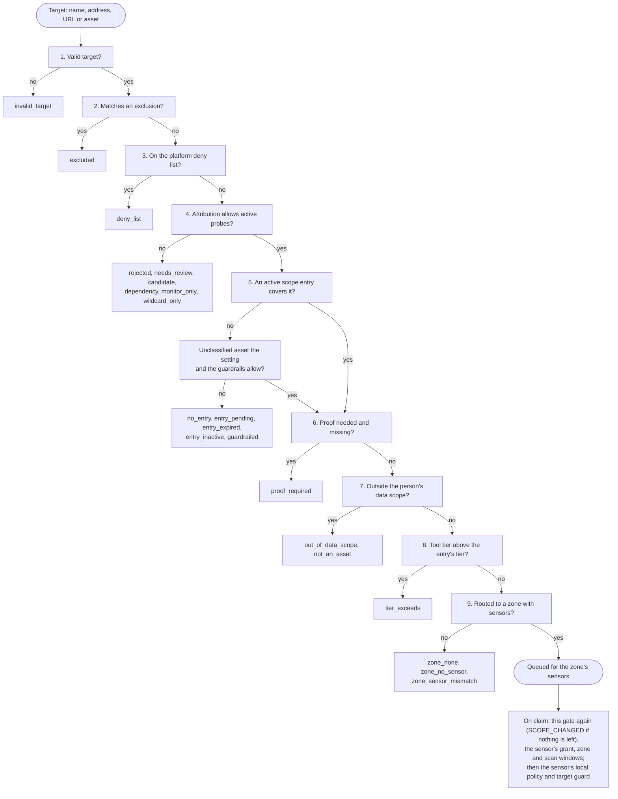

# Scope and authorization to scan

**Scope** is what your organization may actively probe.

- An **active scope entry** authorizes the full scan of what it covers.
- An inventory asset that no entry covers, and that nobody excluded or
  marked "Not ours", is **unclassified**. By default it gets low-impact
  checks only, and platform guardrails keep shared, CDN, cloud and unknown
  networks and names outside your domains passive
  ([Unclassified assets](#unclassified-assets)).
- **Exclusions** and **Not ours** always win.
- A verified domain is proof of control, never authorization.

There is no switch that turns the scope checks off. How each decision is
enforced on the way to a sensor is in
[How scope and exclusions reach sensors](scope-to-sensors.md).

Manage scope under **Scoping > Scope**, with the tabs **In scope** (entries),
**Out of scope** (exclusions), **Domain proof** and **Networks** (the last two
with the Attack surface module). An **Approvals** tab appears only while the
organization's scan approval is **Strict** or a change still waits for a
decision. The organization's rules are in **Settings > Policies > Scope
policy**.

Design: [RFC-054](https://github.com/openctemio/openctem/blob/develop/api/docs/rfcs/RFC-054-scope-model.md).

## Patterns

| Entry | Covers |
|---|---|
| `example.com` | exactly `example.com` |
| `*.example.com` | `example.com` and every name below it, at any depth |
| `*.example.com` plus the exclusion `example.com` | the names below `example.com`, not `example.com` itself |
| `203.0.113.10`, `203.0.113.0/24`, `203.0.113.10-203.0.113.20` | those addresses |

Matching ignores case and one trailing dot, and compares internationalized
names in their ASCII form. A name grant never becomes an address grant: an
address is covered only by an address, range or CIDR entry, never because an
in-scope name resolves to it.

**Exclusions always win.** An exclusion matching the target, its URL or
`host:port` forms, or the inventory name of the asset behind it, refuses the
probe on every path.

## Entries

Each entry has a status and a tier ceiling:

- **Status.** `active`, `inactive` or `expired`, and `pending` (waiting for
  approval, only under Strict scan approval; authorizes nothing).
- **Permanent or one-off.** A one-off entry has an expiry (default 7 days, at
  most the organization's maximum, never more than 30) and a reason. It stops
  authorizing the moment it expires.
- **Intrusive (T2) entries** follow their own limit, set by an owner: 7, 30
  (default), 90 or 365 days, or permanent. Long and permanent T2 entries are
  confirmed periodically (see below).
- **Highest tier** (`max_tier`): `t0` passive only, `t1` non-intrusive active
  checks (the default), `t2` intrusive. The tier is a ceiling only while the
  organization's scan approval is **Strict**: then a probe above an entry's
  tier is refused with `tier_exceeds`. In **Off** (the default) and **On** an
  entry is a list of targets, and how hard a target is probed is the scan's
  choice (its intensity and the approval rules).
- **Discovery.** A permanent domain entry with discovery on is a root for
  [attack surface monitoring](easm.md): Certificate Transparency and DNS
  checks watch it, and names found under it join the inventory.

| Tier | Means | Examples |
|---|---|---|
| T0 | No traffic to the target beyond DNS | subdomain discovery, DNS resolution, code and dependency analysis |
| T1 | Non-intrusive active checks | port scans, HTTP probes, crawling, nuclei templates (intrusive, DoS, fuzzing and brute-force templates are always excluded) |
| T2 | Intrusive | DAST. Derived targets are never fed to it. Needs a verified domain when the platform requires proof, and a T2 entry under Strict |

*Figure: Scope entries in effect.*

## Widening scope

Creating, activating, extending or raising the tier of an entry, and removing
or shortening an exclusion, **widen** scope. Every widening needs the scope
write permission (`attack_surface:scope:write`) and a fresh identity check
(re-authentication), takes effect only through the scope service, is audited
and notifies every owner and administrator. Narrowing (deactivating, deleting,
an earlier expiry, a lower tier) is always one step.

Whether a second person must agree follows the organization's **scan
approval** setting (**Settings > Scanning > Scan approval**, owner only), or
the platform administrator's policy when the platform forces one:

| Scan approval | Scope changes |
|---|---|
| **Off** (default) | A widening takes effect at once. No requests, no approvals, no tier ceilings. |
| **On** | The same for scope. Approval rules apply to **scans** (for example intrusive scans, or active scans of production assets), not to scope entries. |
| **Strict** | A widening waits for approval by other approvers (the organization's approval count; by default one when the organization has two or more administrators, and always at least one for a T2 entry). Members only **request** a one-off entry. New exclusions wait for another approver. Entry tiers are ceilings. |

Under Strict, a pending entry shows how many approvals it still needs and who
can give them (owners, administrators and members with the scope approval
permission, never the person who asked). They are told in-app, by email and
on the organization's notification channels; **Remind approvers** sends the
request again, at most once an hour. When nobody else can approve (an
organization with a single owner), the owner who asked may approve the
entry themselves with a reason and a code from their authenticator app.
This is recorded in the audit log and every administrator is told; nothing
is ever approved automatically.

*Figure: Under Strict scan approval: a cloud account and an exclusion waiting for approval.*

When an organization leaves Strict, entries and exclusions still pending are
put into effect by an hourly job, audited as a system decision, and the
administrators are told once.

### Confirming intrusive (T2) entries

A T2 entry that lasts longer than the confirmation period (every 90 days by
default; an owner sets 30 to 180) is confirmed by an approver: "Keep T2 for
`<pattern>`?" arrives in-app, by email and on the channels, and the
**Approvals** tab offers **Keep T2**. Without a confirmation within 14 days
the entry falls back to non-intrusive (T1) probes. It is not removed;
raising it to T2 again is a widening. These limits apply to entries marked T2
under every scan approval setting.

### Scope policy settings

| Setting | Values | Default |
|---|---|---|
| Add discovered names automatically | on, off | on |
| Review discovered assets first | on, off | off |
| Confirming an asset adds it to scope | on, off | on |
| Scan unclassified assets | Off (passive only), Low-impact, Full | Low-impact (Off under Strict scan approval) |
| Who adds one-off entries (requests: Strict only) | administrators; administrators and requests; nobody | administrators and requests |
| Maximum days for a one-off entry | 1-30 | 7 |
| Approvals for widening (Strict only) | default, 0, 1, 2 | default: `min(1, administrators - 1)` |
| Default tier of new entries | `t0`, `t1` | `t1` |
| Longest intrusive (T2) entry (owners only) | 7, 30, 90, 365 days, permanent | 30 days |
| Confirm long T2 entries every (owners only) | 30-180 days | 90 days |

- **Add discovered names automatically**: a name discovery finds under a
  permanent scope entry is confirmed as yours. Off: such names stay
  *discovered* until a person confirms them (a scope entry still lets scans
  reach them).
- **Review discovered assets first**: off (the default), what discovery
  finds joins the inventory at once. On, names outside every permanent entry
  wait in **Attack surface > Suggestions** before they join the inventory.
  It never changes what may be scanned.
- **Confirming an asset adds it to scope**: a person who confirms a domain,
  subdomain or public address as yours also adds the scope entry for exactly
  that name, with the same re-authentication, notice and audit. Addresses
  behind your names are never added this way. Under Strict scan approval
  confirming records ownership only.

## Ownership of discovered names

Discovered assets join the inventory at once; scope decides what is
actively scanned. Besides scope, an asset must not be refused by its
**attribution**:

- names the organization marked "Not ours", and every name below them, are
  never actively probed;
- dependencies and monitor-only names, and names a person put back to
  `needs_review` or `candidate`, are not actively probed;
- names discovery found that nobody has decided on yet are
  [unclassified](#unclassified-assets);
- a name that resolves only through a wildcard DNS record is passive until a
  person confirms that very name (`wildcard_only`; **Confirm and allow
  scanning** on the asset).

Names covered by a permanent scope entry are confirmed automatically.
Decisions on the rest, and on the addresses your names resolve to, are on
**Attack surface > Suggestions**. See
[Attack surface monitoring](easm.md#suggestions).

## Unclassified assets

An inventory asset is **unclassified** when no scope entry covers it and
nobody excluded it, marked it "Not ours" or held it for review. (The scan
target filter uses the same word for an asset without a type; that is
unrelated.) **Settings > Policies > Scope policy > Scan unclassified
assets** decides what it gets:

| Value | Unclassified assets get |
|---|---|
| **Off (passive only)** | Passive checks only, until an entry covers them. Strict scan approval always means Off. |
| **Low-impact (default)** | Low-impact active checks: the tools naabu, httpx, nuclei, dnsx, tlsx, subfinder, rdap and asn; the ports 21, 22, 25, 53, 80, 110, 143, 443, 465, 587, 993, 995, 3306, 3389, 5432, 8080 and 8443; at most 10 requests per second and 2 at a time; HTTP requests to `/` and `/.well-known/` only; nuclei templates tagged `tech` or `exposure` at severity info. Never custom templates, callbacks (interactsh) or top-ports lists, and never an intrusive (T2) job. When a sensor claims a job beyond this profile, the platform fits the job to it or refuses it with `low_impact`. |
| **Full** | The scan's own intensity. |

**Platform guardrails** keep an unclassified asset passive in Low-impact and
Full alike (refusal `guardrailed`); no organization setting turns them off:

- an address in a CDN, shared-hosting or cloud-provider network (its own
  record says CDN, its network's holder is a provider, or it is in a
  published CDN edge range);
- an address nothing is known about (no network data);
- an address that names of three or more registrable domains resolve to
  (shared hosting);
- a name under none of the organization's registrable domains (its scope
  entries and verified domains);
- anything that cannot be placed, and every asset when a lookup fails (fail
  closed).

Before the guardrails, the gate itself refuses the platform deny list,
names under a rejected name, wildcard-only names and exclusions. An
unreadable setting counts as Off. The exact scope entry always makes a
guardrailed asset scannable.

**Port scans of names.** A port scan of a name reaches only the web ports
(80, 443, 8080, 8443) while an address the name resolves to may not be
probed on its own, or nothing is known about its addresses (refusal
`web_ports_only`). This applies to names in scope too. Add the address, or
your own prefix offered on **Attack surface > Suggestions**, to scope for a
full port scan.

## Web paths

A path exclusion (Scoping > Scope > Out of scope, **Path prefix**) keeps web
tools away from part of a host. It has a **Testing mode**: **Blocked**,
**Read-only** or, for at most 90 days, **Allowed**. Web jobs carry these
rules as their web scope, and the sensor's forwarder enforces them on every
request. nuclei, validation and retest jobs with a web scope run only on a
sensor that confines its tools' network. See
[How a path exclusion becomes web scope](scope-to-sensors.md#how-a-path-exclusion-becomes-web-scope).

## Proof of control

A **verified domain** proves that your organization controls a domain's DNS.
It is proof, not authorization: a scope entry is still required. Proof is
needed only when the platform administrator turns on **Require a verified
domain before platform sensors scan a target** (admin console, **System >
Platform scanning**; off by default). Then:

- a job goes to shared platform sensors only when every target is at or under
  a verified domain;
- an intrusive (T2) probe needs one on any sensor.

The **In effect now** section of the scope policy shows whether the platform
requires proof.

*Figure: Domain proof.*

To verify a domain, open **Scoping > Scope > Domain proof** (needs the Attack
surface module and `attack_surface:scope:write`), add the domain and publish the TXT record
shown:

| Host | Value |
|---|---|
| `_openctem-verify.example.com` | `openctem-domain-verification=<token>` |

Then choose **Check now** (up to 10 checks per organization per hour). The
platform re-checks every verified domain every 12 hours; a domain whose
record is gone becomes **failed** and stops counting as proof. Verifying a
domain here never enables sign-in for it: SSO domains are set up by the
platform administrator. Public suffixes and shared consumer domains are
refused.

## Platform guardrails

The platform operator sets these; no organization can change them.

| Setting | Effect |
|---|---|
| Require a verified domain before platform sensors scan a target | Admin console, **System > Platform scanning**. Off by default. On: platform sensors scan only targets at or under a verified domain of the organization, and intrusive (T2) probes need one on any sensor. Changing it needs a super administrator, a fresh authenticator code and a reason; it is audited and the other platform administrators are emailed. (The environment variable `SCOPE_ACTIVE_PROOF` of earlier releases is retired: the API refuses to start while it is set.) |
| Scan approval policy | Admin console, **System > Scan approval**: the platform default or a per-organization override (`tenant_controlled`, `off`, `on`, `strict`). |
| Public suffixes | No entry may be, or wildcard, a public suffix (`*.com`, `*.co.uk`, `*.azurewebsites.net`) |
| Government and military names | Refused |
| Shared provider apexes | Refused as wildcard roots (`*.amazonaws.com`); exact names under them stay allowed |
| `0.0.0.0/0`, `::/0`, link-local and metadata addresses | Refused |
| `SCOPE_DENY_EXTRA` | The operator's own comma-separated domains and CIDRs that no organization may target |
| `SCOPE_MAX_PUBLIC_CIDR_V4` / `_V6` | Largest public range an entry may cover: `/16` and `/32` by default |

A deny-listed target is refused at dispatch too, even inside an
organization's own entry.

## Private networks

Private addresses and internal names are not authorized by scope entries but
by [scan zones](../sensors/zones.md): a private target is accepted only when
one of your zones covers it, and is scanned only by that zone's sensors.

## The gate, check by check

Every target goes through the same ordered checks before a sensor may receive
it. The first check that fails refuses the target with its code (table below).

1. Malformed, loopback, link-local and metadata addresses are invalid;
   private addresses are valid only inside one of your scan zones.
2. Exclusions always win.
3. The operator's guardrails (below).
4. Names marked "Not ours", awaiting review, dependencies, monitor-only
   names and wildcard-only names are never actively probed
   ([Ownership](#ownership-of-discovered-names)).
5. Only `active` entries authorize. A target no entry covers goes on only
   when it is an unclassified inventory asset that the setting and the
   guardrails allow ([Unclassified assets](#unclassified-assets)). Its jobs
   are then held to the low-impact profile unless the setting is Full.
6. When the platform requires proof, a job on platform sensors and a T2 probe
   need a verified domain ([Proof of control](#proof-of-control)).
7. The person who triggered the run (or the scan owner, for scheduled runs)
   must be allowed to act on the asset. This check comes before the tier check,
   so a target the person may not scan is reported as out of their data scope
   and reveals nothing about the scope entries that cover it.
8. Under Strict scan approval, each entry's highest tier caps the probes it
   allows.
9. See [Scan zones](../sensors/zones.md#how-a-target-is-routed).

The gate runs when a scan is created or edited, when a run is triggered, for
every target a workflow step derives from an earlier step, for validation and
retest jobs, and for `POST /api/v1/scope/check` (which dispatches nothing).
When a sensor claims a task, the platform runs this gate again on the task's
targets with the inputs recorded at dispatch: targets that left scope since the
task was queued are removed, and a task with none left fails with
`SCOPE_CHANGED` ([Scans and scan runs](scans-and-runs.md)). It also checks the
sensor's grant, its zone and the scan windows, and the sensor then applies
its own local policy and target guard before any tool starts. Every point
where an exclusion is enforced is listed in
[How scope and exclusions reach sensors](scope-to-sensors.md).

## Check before you scan

`POST /api/v1/scope/check` (`attack_surface:scope:read`) runs the whole gate for up to 200
targets or asset ids without dispatching anything, and answers for each one
whether it is allowed, why not, and what would fix it. Every refusal on any
path carries the same codes:

| Code | Meaning | Typical fix |
|---|---|---|
| `no_entry` | No scope entry covers the target, and it is not an unclassified asset the setting allows | Add an entry, or request a one-off |
| `guardrailed` | No entry covers it and a platform guardrail keeps it passive | Add its exact scope entry, if it is yours |
| `low_impact` | No entry covers it, so it gets low-impact checks only, and this job goes beyond them | Add it to scope for the full scan |
| `web_ports_only` | An address the name resolves to is not in scope, so a port scan of the name reaches only the web ports | Add the address to scope |
| `wildcard_only` | The name resolves only through a wildcard DNS record | Confirm that name on the asset (**Confirm and allow scanning**) |
| `constrained` | Only port- or path-limited entries cover it, and the job could reach other ports or paths | Narrow the job, or widen the entry |
| `program_platform` | Only bug-bounty program entries cover it, and platform sensors never probe those | Use your own sensor |
| `entry_pending`, `entry_expired`, `entry_inactive` | Covered only by an entry that is not in effect | Approve, renew or activate it |
| `tier_exceeds` | Covering entries allow a lower tier (Strict only) | Raise the entry's tier |
| `excluded` | An exclusion matches | Remove the exclusion |
| `rejected`, `needs_review`, `candidate`, `monitor_only`, `dependency` | The asset's attribution does not allow active probes | Review the asset |
| `proof_required` | Proof is required and the target is not under a verified domain | Verify the domain |
| `deny_list` | Platform policy | Contact the platform operator |
| `invalid_target` | Malformed, loopback, link-local, metadata, or private outside a zone | |
| `zone_none`, `zone_no_sensor`, `zone_sensor_mismatch` | Scan-zone routing | Add or fix a zone |
| `out_of_data_scope`, `not_an_asset` | The person may not act on this target | |

A scan that names refused targets is refused as a whole at creation
(`TARGET_OUT_OF_SCOPE`, with each target and its code). At run time, refused
targets are skipped with a warning on the run.
