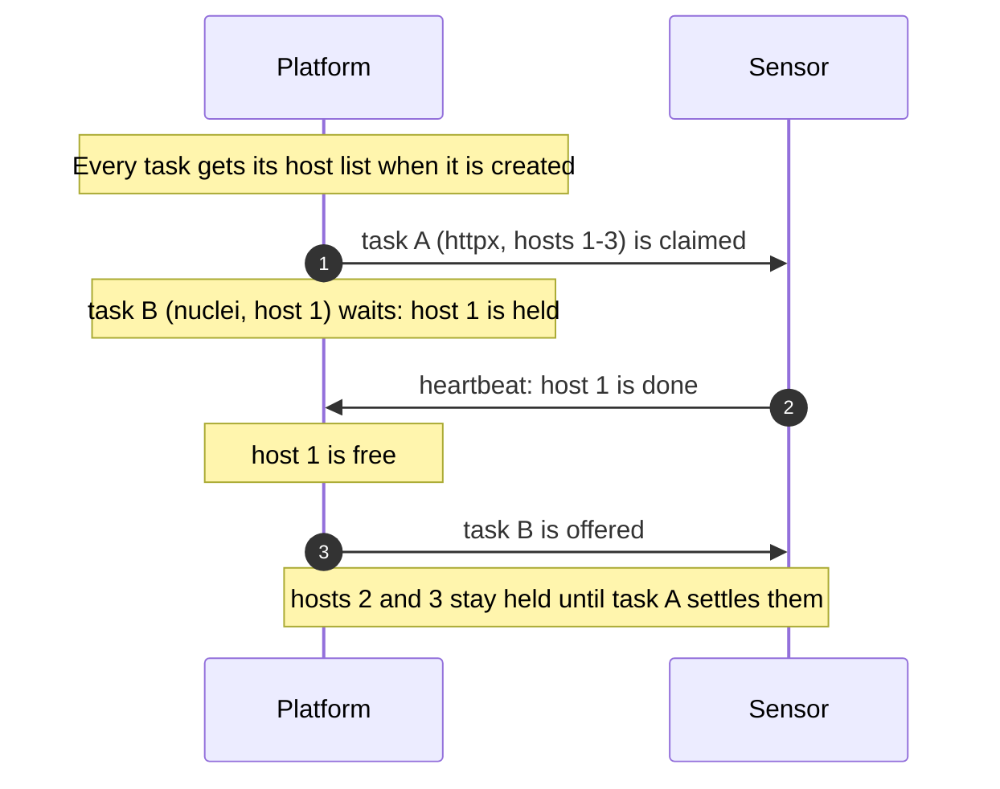

# Why a task waits
{: .no_toc }

A scan run is cut into tasks that sensors claim (see
[Scans and scan runs](scans-and-runs.md)). A task can stay queued for a
while, even when your sensors have free slots. This page explains where to
see why, what each reason means, and what to do.

1. TOC
{:toc}

---

## Where to look

Open the run (**Discovery > Scans > Runs**) and its task list. The **Sensor**
column of a queued task says what it waits for:

| Shown | Meaning |
|---|---|
| **Waiting for a sensor** | No sensor has taken it yet. Open **Why waiting?** for the reason. |
| **Waiting for its hosts: another task is scanning them** | Another task of your organization is scanning one of its hosts. See [Waiting for its hosts](#waiting-for-its-hosts). |
| **Handed back: its sensor is still scanning one of its hosts** | A sensor took it, found one of its hosts busy on that sensor, and gave it back. |
| **Withheld:** *reason* | A sensor asked for work and its checks kept this task from it: its grant, its local policy, or the scan's intensity. The reason is the same one the panel lists (see [Reasons that rule out one sensor](#reasons-that-rule-out-one-sensor)). |

**Why waiting?** on the task row opens the placement panel. It needs
`scans:read`; the per-sensor verdicts in it need `sensors:read` as well. The
same answer is in the API:
`GET /api/v1/scan-runs/{id}/tasks/{task_id}/placement`.

## Reading the panel

The panel starts with one summary line:

| Summary | Meaning |
|---|---|
| **It is held whatever the sensor:** | A reason that holds the task for every sensor (the list below). No sensor change helps. |
| **Waiting: N of its M hosts are being scanned by** *tool* **(step** *step***). It starts when those hosts are free.** | A host wait. **Open the run scanning them** links the run that holds the hosts. |
| **Sensors that can take it: N, all busy now. It starts when one frees up.** | Sensors can run it; they are all at their limit of tasks at once. |
| **Sensors that can take it: N (B busy). It should start shortly.** | A sensor can take it now. See [Other delays](#other-delays) if it still waits. |
| **The organization has no sensor.** | Install and pair a sensor ([Sensors](../sensors/index.md)). |
| **None of the N sensors can take it:** | Each sensor is ruled out; the list counts the reasons. Open **Each sensor** to see them one by one. |
| **It waits for platform scanning.** | The task runs on a platform sensor, not one of yours. |

At most 100 sensors are checked; with more, the panel says **Only the first
sensors by name were checked.**

**The last sensor that asked for work withheld this task:** followed by a
reason appears when a sensor's own checks (grant, local policy, intensity)
kept the task from it the last time it asked for work. It also shows for a
task that waits for platform scanning or for shared sensors, whose sensors
are never named: only the reason is shown. The API returns it as `withheld`
with `withheld_at`.

## Reasons that hold the task for every sensor

| Reason | What to do |
|---|---|
| It waits for its scan window to open. | Nothing: it starts by itself when the window opens (**Settings > Scanning > Scan windows**). |
| Another task is scanning one of its hosts. | Nothing: it starts when that task is done with those hosts. See below. |
| The sensor that took it is still scanning one of its hosts, so it handed the task back. | Nothing: it runs when that host is free on that sensor, or on another sensor. |
| The task expired before a sensor took it. | Run the scan again. |

## Reasons that rule out one sensor

| Reason | What to do |
|---|---|
| The sensor is disabled or revoked. | Enable the sensor, or use another one. |
| The sensor is offline. | Start the sensor or check its connection. |
| The task is reserved for another sensor. | No action needed. |
| The sensor already refused this task. | Check the sensor's local policy. |
| The sensor already failed this task, or lost it while running it, and is not offered it again. | Check the sensor's logs and health. See [Failures and retries](scans-and-runs.md#failures-and-retries). |
| A proxy pool carries this sensor's scans, and the sensor does not report that it can use one (no proxy support, or no network confinement). | Upgrade the sensor and run it with network confinement, or set its network path to **Direct** on its page ([Proxies](../sensors/proxies.md)). |
| A proxy pool carries this sensor's scans, and its validation probes do not go through the pool. | Upgrade the sensor, or run validation on a sensor with a direct path. |
| The sensor is not in the task's scan zone, or lacks the tool there. | Assign a sensor with the tool to the zone ([Scan zones](../sensors/zones.md)). |
| The sensor did not report the tool as installed. | Install the tool on the sensor, or use an image that has it. |
| The sensor does not offer a capability the task requires. | Use a sensor that offers it. |
| The task needs a sensor whose tool network is confined (a web scope), and this sensor does not report it. | Run the sensor with its seccomp profile ([Tool confinement](../sensors/security.md#tool-confinement)). Template scans of a host with an excluded path run only on a confined sensor. |
| The sensor's grant does not allow it (*dimension*). | Widen the sensor's grant ([Grants and trust](../sensors/pairing.md#grants-and-trust)), or use another sensor. A sensor at trust level New gets passive work only. |
| On this sensor the task probes harder than the scan's intensity. | Raise the scan's intensity, or use another sensor. |
| The sensor's grant or policy could not be read, so nothing goes to it for now. | Retry shortly; if it lasts, an administrator checks the platform's logs. |
| The task has private targets, and the organization requires a sensor-local policy for them. | Install a local policy on the sensor ([Sensor-local policy](../sensors/network.md#sensor-local-policy)). |
| The task uses an option the organization has not enabled (callbacks or custom templates). | Enable the option for sensors, or change the scan. |
| The sensor's local policy refuses the task. | The owner of the scanned network reviews the policy. |
| The sensor runs as many scans as it can. | Nothing: it takes the task when a slot frees up. |

## Waiting for its hosts

Within one organization, only one task at a time scans a given host. A
task is not offered to any sensor while another task of the organization
holds one of its hosts, even when sensors have free slots. The free slots
take other work in the meantime.

- **Every task has its hosts**: the platform works out a task's hosts when
  it creates the task, whatever created it (a run step, a quick scan, a
  single scanner, validation, a retest), and sends that list to the sensor.
  The sensor admits the task under the same list, so the platform and the
  sensor never disagree about which hosts a task touches.
- **What counts as one host**: a name, or an address. An address and a range
  scan of the same /24 (IPv6 /120) conflict; two different addresses of one
  /24 do not.
- **Which tasks hold hosts**: every task that sends traffic to its targets:
  workflow steps that probe, single-scanner scans, quick scans, validation
  and retests. Passive workflow steps (subdomain discovery, DNS, lookups)
  hold none, and a code scan of a local path holds none.
- **When hosts are freed**: a running task frees each host as soon as its
  targets on that host settle, so, for example, the template scan of hosts
  httpx has already probed starts while httpx still works on the rest. This
  needs **sensor v0.21.1 or later** (sdk-go v0.31.0 or later); an older
  sensor holds all of a task's hosts until the task ends.
  nuclei reports no end per host: from sensor v0.23.0 a nuclei task over
  several hosts runs in up to 4 waves of whole hosts and frees each wave's
  hosts when the wave ends; before, it held them all until the task ended.
- **On your own sensors, only your organization counts**: another
  organization's scans never hold your tasks back, and you never see them.
  On the shared sensors, a job starts only while fewer than two shared jobs
  of any organization hold one of its hosts (one for intrusive work), so the
  platform's addresses never hit one host from many organizations at once.
  You see only that the job waits for its hosts, never who else scans them.
- **What the panel shows**: host counts only, never host names. The holding
  task's run and step are named only when you may read that run.
- **It does not fail the run**: a run whose work waits for its hosts (or for a
  scan window) is not ended as "no sensor picked up this run's work".
- **It does not use up attempts**: waiting for hosts, and a sensor handing a
  task back because its hosts are busy there or it has no free slot, never
  counts as a dispatch attempt, so such a task is never failed with "Max
  dispatch attempts exceeded".

What to do: usually nothing; the task starts when the hosts are free. If the
holding run is not needed, cancel it ([Cancel a run](scans-and-runs.md#cancel-a-run)).
To spread the work, scan fewer targets per run or split them across scans
that run at different times.

## Other delays

A few things delay a task without being listed as a reason. They show as
"It should start shortly":

- **Queue fairness.** Queued tasks are handed out by priority, and a task
  that waits gains priority over time (one class every 30 minutes). Within a
  priority, tasks of different runs take turns.
- **Sensor backoff.** A sensor that found nothing to take waits a little
  before it asks again.
- **A scheduled start.** A task held for a later time (for example a scan
  window opening) is not offered before it.

## Automatic coverage stops runs that cannot succeed

Automatic coverage (the scans the platform starts on its own to keep every
asset covered) learns from its runs instead of repeating them:

- **No sensor takes its runs.** When three coverage runs of one capability
  in a row end with no sensor taking the work, the capability is paused for
  your organization. The asset's **Coverage** section shows it as *Paused:
  no sensor took its last runs*, and administrators get a "Coverage paused"
  alert. It resumes by itself when your sensors, their grants or local
  policies, their zones or the shared-sensor setting change, or else with
  one trial run after 2 hours. Each further trial no sensor takes doubles
  the wait, up to 48 hours. Open **Why waiting?** on a task of a recent run
  to see the reason, often the sensor's grant.
- **A target does not answer.** A target that times out or cannot be
  reached is not run again every few hours. It is checked again after 1 day,
  3 days, then weekly, as long as the same sensor or scan zone still cannot
  reach it. A different sensor or zone gets a fresh try at once. The asset's
  **Coverage** section says *unreachable from your sensors* (or from the
  named sensor or zone of your organization), and administrators get an
  alert with the number of unreachable assets per capability. Check that a
  sensor in the target's network can reach it, or retire assets that are
  gone.

## Related

- A run whose tasks no sensor claims at all is failed after 1 hour (4 hours
  for a scheduled run), except while it waits for a scan window or its hosts.
  When a sensor's checks withheld its tasks, the run's message names the
  reason (for example "withheld by sensor permissions: credentials") and its
  tasks keep showing **Withheld:** *reason*. Fix that reason (often the
  sensor's grant) before running it again.
- A running task that stops making progress is stopped and its unfinished
  targets are queued again: [Liveness and stalls](scans-and-runs.md#liveness-and-stalls).
- A sensor that is online but takes no work:
  [Online, but it gets no work](../sensors/troubleshooting.md#online-but-it-gets-no-work).
