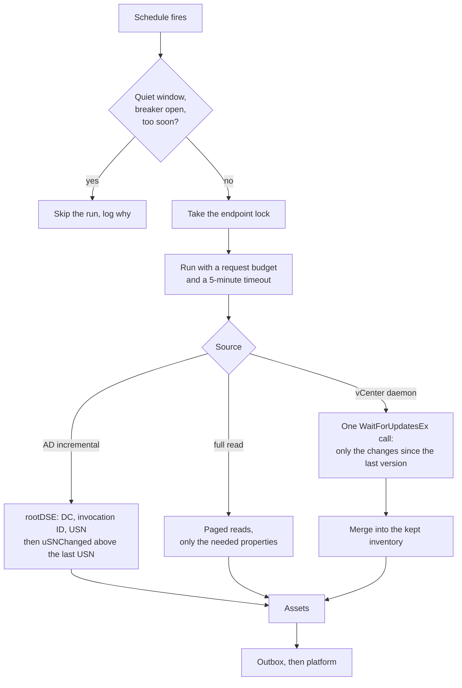
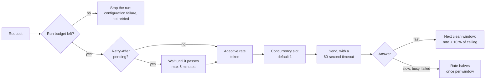

# Safe collection against production systems
{: .no_toc }

The collector reads systems an organization depends on: vCenter, domain
controllers, monitoring and log servers. It is built so that it never loads
them in bursts. This page explains what it does, which defaults it uses,
how to tune it, and how to read the load it causes.

## In short

- **It reads only what changed.**
  - vCenter (daemon mode) asks for the changes since the last run. That is
    one request when nothing changed.
  - Active Directory (incremental) asks for the objects committed since the
    last run on the same domain controller.
- **It sends one request at a time,** at an adaptive rate under a ceiling.
  It slows down as soon as the system answers slowly, says it is busy, or
  fails.
- **A run has a budget** of requests and of time.
- **It never retries refused credentials,** and it stops reading a failing
  system (circuit breaker) instead of hammering it.
- **It leaves nothing behind.** Every session, view and filter is released,
  on errors and at shutdown too.
- **`doctor` prints the expected load** before the first run. Metrics show
  the real load of every run.

## Collection flow



## Protections on every request



The rate controller (sdk-go `adapt.SourcePacer`) works per endpoint and is
shared by every collector instance that reads the same host:

- it starts at **half** of `sensor.requests_per_second`;
- every clean 10-second window adds a tenth of the ceiling, and it never
  goes above the ceiling;
- it **halves** at once on 429, 503, an LDAP busy or unavailable result, a
  timeout, a reset or another server error, and holds every request for
  the source's `Retry-After`;
- it also halves when the median answer time of a window is more than three
  times the endpoint's own normal (and above 250 ms). A vCenter or a domain
  controller under load slows down before it starts to fail, so the
  collector backs off first;
- a source that stays slower for good becomes the new normal within a few
  minutes, and the rate recovers instead of staying at the floor (0.2
  requests per second).

## vCenter

- **Watch mode (daemon default):**
  - One session and one property filter are kept between runs. The filter
    sits on a property collector of the collector's own and covers one
    container view, with only the properties the mapping uses.
  - The first run reads everything once, in pages.
  - Every later run is one `WaitForUpdatesEx` call with the last version and
    no wait. vCenter merges changes, so ten power cycles of a VM are one
    update.
  - The collector keeps what it was sent and reports the whole inventory,
    so the platform still gets a full report every run.
- **Full read again:**
  - every `full_sync_interval` (default `24h`), in a new session, so a
    disabled account or a rotated password takes effect within a day;
  - after a session timeout or a vCenter restart;
  - when vCenter forgets the filter or the version.
- **Idle session:** kept alive by one cheap request per 10 minutes without
  traffic. The daemon destroys the filter, its view and the session when it
  stops.
- **Watch mode off:** `incremental: false`, and one-shot runs, use a new
  session and a paged full read per run (500 objects per page). That is
  about 40 requests for 10,000 VMs.
- **What it never reads:** events, tasks, performance data, hardware
  details or snapshots.

Measured on the vCenter simulator with 10,000 VMs:

| Run | Requests | Data from vCenter |
|---|---|---|
| Full read (watch off, every run) | 41 | 26.5 MB |
| Watch, first run | 106 | 29.9 MB |
| Watch, 50 VMs changed | 1 | 14 KB |
| Watch, nothing changed | 1 | about 0 |

**Account:** a vCenter user with the built-in **Read-only** role on the
vCenter root, or on the datacenter you collect, with *Propagate to
children*. It needs no other privilege. The collector holds one session.

## Active Directory and LDAP

- **Search:** a paged search for computer objects (`page_size`, default
  100, at most the directory's MaxPageSize of 1000) with only the
  attributes the mapping uses.
- **Incremental runs (`incremental: true`, daemon):**
  - Each run first reads the domain controller's `highestCommittedUSN`, its
    name and its invocation ID (two small base reads).
  - It then searches `uSNChanged` above the last run's value, which returns
    exactly the objects committed since.
  - A USN belongs to one domain controller. When another DC answers, or the
    DC was restored from a backup, the run reads everything.
- **Pin one DC:** point `url` at a domain controller by host name
  (`ldaps://dc01.example.local`), not at the domain name or a load-balanced
  name. Prefer a DC that does not hold the PDC emulator role. The collector
  warns once when the DC that answers is not the one in `url`.
- **Account:** a plain domain user. It needs no "Replicating Directory
  Changes" right: the collector does not use DirSync.

Measured on the test directory with 50,000 computers (page 1000):

| Run | Searches | Entries sent |
|---|---|---|
| Full read | 52 | 50,002 |
| Incremental, 100 changed | 3 | 102 |

## Defaults and how to tune them

| Setting | Default | When to change it |
|---|---|---|
| `sensor.requests_per_second` | `5` | The ceiling of the adaptive rate. Lower it for a small or busy system. Raising it rarely helps: with watch and incremental modes a run is a few requests. |
| `sensor.max_concurrency` | `1` | Keep it at 1 for production systems. |
| `sensor.max_requests_per_run` | `10000` | Only a runaway reaches it. If a real inventory does, narrow the scope (`datacenter`, `search_bases`) first. `0` turns the budget off. |
| `sensor.quiet_windows` | none | Business hours or backup windows in which no run starts, e.g. `["08:00-18:00"]`. |
| `sensor.jitter` | `30s` | Spreads collectors that share a schedule. |
| `sensor.breaker_threshold`, `sensor.breaker_cooldown` | `3`, `15m` | Failed runs before the collector leaves a system alone, and for how long (doubling to 6 hours). |
| `vcenters[].incremental`, `full_sync_interval` | `true`, `24h` | Turn watch mode off, or read everything more or less often. |
| `ldap_servers[].incremental`, `full_sync_interval` | `false`, `24h` | Turn on incremental runs (daemon, state volume). |
| schedule | `sensor.interval` (1h) | Never more often than every 5 minutes. |

## Before the first run

```sh
docker run --rm -v "$PWD/config.yaml:/app/config.yaml:ro" \
  -v collector-state:/var/lib/openctem/state \
  ghcr.io/openctemio/asset-collector:latest doctor -config /app/config.yaml
```

For each vCenter, `doctor` logs in, counts the VMs, hosts and containers (3
requests: the member list of one view, no properties), logs out, and
prints, for example:

```
[ok  ] vcenter-1 (vcenter): reachable, credentials accepted; expected load: 10000 VMs, 3 hosts,
       25 containers: a full read is about 41 requests (at most 5/s, so at least 8s); watch mode
       (daemon default) reads everything once in about 107 requests, then about 1 request per
       run plus 1 keep-alive per 10m0s without traffic
```

`dry-run` collects once without sending and prints, per collector, the
requests and the time it took:

```
[vcenter-1] would send 10003 asset(s) (vcenter): host=10003; read with 41 request(s) in 8.2s
```

## Reading the load

| Metric | Meaning |
|---|---|
| `openctem_collector_run_requests{collector}` | Requests the last run sent (also `last_requests` in doctor's run history) |
| `openctem_collector_endpoint_requests_total{endpoint,outcome}` | Every request by outcome (HTTP status, `ok`, or a failure class) |
| `openctem_collector_endpoint_rate{endpoint}` | The current adaptive rate; below the ceiling means the endpoint pushed back |
| `openctem_collector_endpoint_latency_seconds{endpoint}` | How long the endpoint takes to answer |
| `openctem_collector_breaker_open{collector}` | 1 while the collector leaves a failing system alone |
| `openctem_collector_runs_skipped_total{collector,reason}` | Runs skipped for a quiet window, an open breaker, a lock or a too-early restart |

The log line `endpoint slowed down` gives the reason (`slow_answers`,
`busy`, `failed`, `retry_after`) and the new rate. In the vSphere Client,
the vCenter's **Monitor > Sessions** view shows one session for the
collector's user. In Active Directory, event 1644 (with field engineering
logging on) lists expensive searches; incremental runs filter on the
indexed `uSNChanged` attribute.
