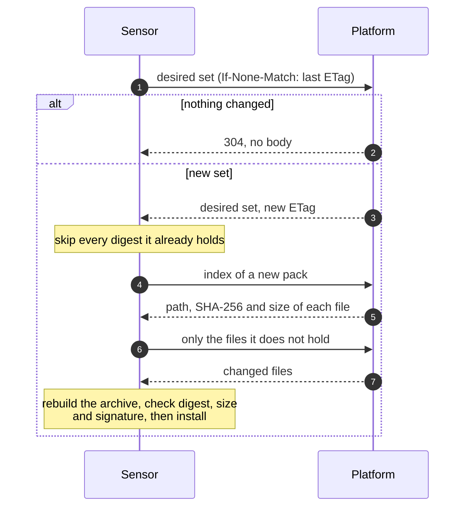

# Scanner content and content packs
{: .no_toc }

Scanners need content: nuclei templates, SAST rules, the trivy database,
wordlists. This page says where a sensor gets it today, what content packs
are, how the platform serves packs to sensors by digest, and how signed
packages from the content catalog are installed.

1. TOC
{:toc}

---

## What a sensor scans with today

Sensor releases up to v0.23.2 (the current ones) manage their own content. Each sensor
downloads it from its upstream, verifies it, and switches to it atomically:

| Content | Where from | Verified by |
|---|---|---|
| nuclei templates | The nuclei-templates release (the default image also ships a pinned release) | The release checksum |
| SAST rules (opengrep, semgrep) | The signed OpenCTEM rules pack release | Its keyless cosign signature, checked offline |
| trivy database | Its OCI repository | The OCI digest |

Mirrors, local paths and the refresh interval are sensor settings:
[Scanner content without internet access](network.md#scanner-content-without-internet-access).
The organization's content policy (**Settings > Scanning > Scanner content**)
sets refresh intervals, maximum ages and pinned versions. Check what a
sensor holds with `openctemio-sensor -content-status`, or in the sensor's
sheet under **Discovery > Sensors**.

## Content packs

A **content pack** is a signed, immutable archive of one kind of content:
`nuclei-templates`, `semgrep-rules`, `wordlist`, or a third-party kind
`x-<namespace>/<kind>`. The platform stores each pack once, in a canonical
form (files sorted, fixed owner, mode and time), and names it by the SHA-256
of that archive: its **digest**.

On ingest the platform:

1. checks the archive's limits: regular files and directories only, no
   links, no absolute paths or `..`, and caps on size and file count;
2. lints every file for its kind. nuclei templates that use the `code`,
   `javascript`, `headless` or `file` protocols, self-contained templates
   and unsafe regexes are not accepted: an organization pack with such a
   file is refused; in a platform pack the file is left out and listed;
3. refuses an organization pack that contains credentials, unless the
   uploader acknowledges them (audited at high severity);
4. signs a statement of the pack (organization, name, version, kind,
   digest, size, file count) with a content key, and stores it. An unsigned
   pack is never stored.

There are two kinds of packs:

| Pack | Managed by | Where |
|---|---|---|
| **Organization pack** | People with `scans:content:write` (owners and administrators by default), with a recent sign-in | API: `/api/v1/content-packs` (upload, list, download, revoke). Signed with the organization's content key. |
| **Platform pack** | Platform super administrators, each change with a reason and a fresh authenticator code | Admin console, **System > Content packs**: **Add pack** uploads an archive or imports a release by `https` URL with its expected digest. Each pack name has a `stable` and a `canary` channel. Signed with the platform content key. |

Organizations read the platform packs and channels with `scans:content:read`
(`/api/v1/platform-content-packs`). Revoking a platform pack moves every
channel that names it back to the newest older active pack of that name.

## Delivery to sensors by digest

From platform v0.9.6, the platform serves packs to sensors over the sensor
channel, with the sensor's own credentials:

| Route | Returns |
|---|---|
| `GET /api/v2/sensor/content/desired` | The organization's **desired set**: its active packs and the platform's packs on the `stable` channel, each with digest, size and signature, plus the revoked digests. It carries an `ETag`; a request with `If-None-Match` and the current one gets `304` with no body. |
| `GET /api/v2/sensor/content/packs/{digest}` | The pack's canonical archive. Immutable (`ETag` is the digest), with `Range` support to resume. |
| `GET /api/v2/sensor/content/packs/{digest}/index` | The pack's files: path, SHA-256 and size. |
| `GET /api/v2/sensor/content/packs/{digest}/files/{sha256}` | One file of the pack. |

- **A held digest is never fetched again.** Packs are addressed by digest,
  so a sensor that holds one has nothing to download.
- **File-level deltas.** For a new version of a pack, the sensor fetches
  the index, copies the files it already holds, and downloads only the
  changed ones. It rebuilds the canonical archive and checks it against the
  signed digest and size, so a delta install is as safe as a full download.
  Any mismatch falls back to the full archive. Measured with 3 sensors: a
  new version with 2 of 40 files changed cost 92% less traffic than full
  downloads.
- **Conditional checks.** An unchanged desired set costs a `304` with no
  body.
- **Signatures.** The sensor installs a pack only when its statement is
  signed by a key the sensor's operator pinned (the organization's content
  key for an organization pack, the platform content key for a platform
  pack), names the same digest and, for an organization pack, the sensor's
  organization. A key the platform merely sends is never trusted. The public
  keys are at `/api/v1/content-packs/signing-key` and
  `/api/v1/platform-content-packs/signing-key`.
- **Isolation.** A sensor reads only the digests in its own organization's
  desired set. Another organization's pack, a revoked pack, an unknown
  digest, or a file that is not in the named pack all answer
  `404 content-not-found`.
- **Revocation.** A revoked pack leaves the desired set within 10 seconds,
  and its digest is listed as revoked.

The client side of these routes is in sdk-go v0.32.0 (`contentcache`, with
delta installs, conditional requests, a jittered prefetch and hit, miss and
bytes-saved counters). **Current sensor releases (up to v0.23.2) do not use these routes yet**: it
keeps managing its content as described in
[What a sensor scans with today](#what-a-sensor-scans-with-today), and
scans do not run content packs. There is nothing to configure on the sensor
for content packs.

## Content catalog

The **content catalog** is a second, separate way to bring content in: signed
packages (rules, templates, wordlists, scan profiles, report templates,
playbooks, policy packs, feeds, tool adapters, sensors) that an organization
installs for itself. Everything is verified offline: the instance never needs
to reach a catalog server.

**Trust.** A signed catalog bundle is imported by a platform super
administrator (admin console, with a reason and a fresh authenticator code;
`POST /api/v1/admin/content-catalog/import`, audited). The import checks the
bundle against the catalog roots pinned in the release, the signed index and
the revocation list, and every package's digests and publisher signature
(Sigstore keyless, checked offline against the trusted root embedded in the
release). With no trusted root, imports are refused. Packages whose version is
revoked are left out.

To add your own root or a newer Sigstore trusted root, set
`CONTENT_TRUST_ROOT_KEY_IDS` (comma-separated `SHA256:<hex>` key ids) or
`CONTENT_SIGSTORE_TRUSTED_ROOT` (path of the trusted root JSON). Setting either
writes a high-severity admin audit entry at start-up. A separate secret,
`APP_CONTENT_SIGNING_KEY`, is the master of each organization's content pack
signing key; see [Environment variables](../configuration/environment-variables.md).

**Use it.** **Settings > Content catalog** (needs `content:read`, held by every
default role):

| Tab | What it does |
|---|---|
| **Catalog** | Imported packages, filtered by type or installed state. A row opens the package: versions, what each asks for (tier, side effects, network, declared hosts, credentials, data scopes), license, dependencies, and signatures and provenance. |
| **Installed** | What the organization runs, with **Update**, **Roll back**, **Pin** (stops automatic updates) and **Uninstall**. |
| **Requests** | Pending install requests when approval is required. |
| **Settings** | **Require approval**: every install, update, rollback and uninstall becomes a request that another member with `content:install` approves or rejects. Turning it on is immediate; turning it off takes effect 24 hours later, and owners and administrators are notified meanwhile. |

Installing, updating, rolling back, uninstalling and deciding requests need
**Install content** (`content:install`: owners and administrators) and a recent
sign-in. A version whose license does not allow use as a service needs an
explicit acknowledgement, which is audited. An unpinned installation follows
the newest compatible, non-revoked version that asks for no more than the
installed one. A revoked version cannot be installed, and its installations
become revoked. An executable type (sensors, tool adapters) is refused while the
revocation list is missing or expired.

**Private packages.** A member with **Publish private content**
(`content:publish`) can publish a package for the own organization only
(`POST /api/v1/content/private-packages`); a super administrator can publish
one for every organization (`POST /api/v1/admin/content-catalog/packages`).
Private packages hold rules, templates or wordlists, never ask for
credentials, and become content packs of the organization or the platform.

Installed catalog packages are not yet delivered to sensors by digest;
sensors keep using their own content as described above.
