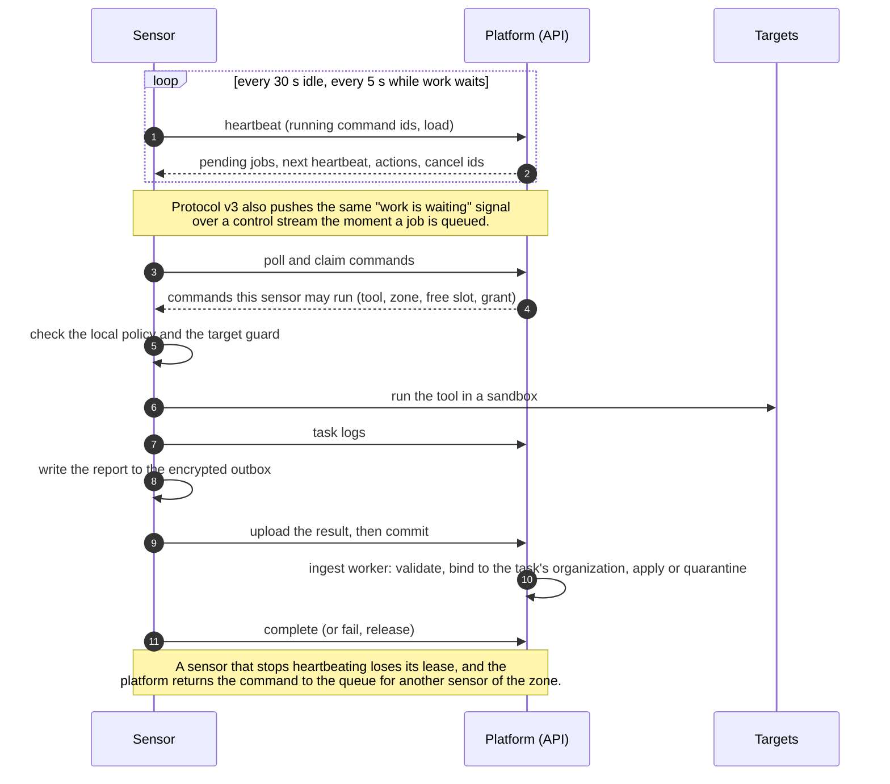

# How sensors work
{: .no_toc }

Background for operators. To install a sensor, start with the
[quickstart](index.md#quickstart-a-working-sensor-in-five-minutes).

1. TOC
{:toc}

---

## Roles

Every sensor has one role. The role decides what work it may receive.

| Role | Type in the API | Does | Status |
|---|---|---|---|
| Scanner | `worker` ("Worker (scans)" in the console) | Assesses other hosts and repositories: runs the scans the platform dispatches. Routed by [scan zone](zones.md). | Shipped: `openctemio/sensor` |
| Collector | `collector` | Pushes inventory from systems inside your network on its own schedule. Takes no dispatched scans; its tools have the kind `collector` and cannot be picked in a scan. | Supported by the platform and the SDK runtime |
| Endpoint | `sensor` ("Endpoint" in the console) | Reports only about the host it is installed on (grant profile `endpoint-agent`). | Planned: no endpoint sensor is released yet |

CI pipelines are not sensors. They report with their CI provider's OIDC
identity; see [CI integration](../scanning/ci-integration.md).

## Organization sensors and platform sensors

- **Organization sensors** are installed by an organization, appear on its
  **Sensors** page and only ever take that organization's work.
- **Shared sensors** (also called platform sensors) belong to the installation.
  The instance administrator enrolls and operates them in the platform admin
  console, they never appear on an organization's Sensors page as nodes, and
  their output never names them. They run public-target scans for the
  organizations the administrator allows, in shared mode (every job sandboxed,
  nothing shared between jobs). They are off until a super administrator turns
  them on, and an organization can opt out. Where an operator requires it,
  every target must be at or under a verified domain (see
  [Scope](../scanning/scope.md#proof-of-control)). See
  [Shared sensors](shared-sensors.md).

## How work reaches a sensor

A **command** is the sensor-side name of a [scan run's task](../scanning/scans-and-runs.md#steps-and-tasks).

1. **Heartbeat.** About every 30 seconds while idle, every 5 seconds while
   work is waiting. The answer says whether work is waiting (the "doorbell");
   it never carries a job. On protocol v3 the doorbell is also pushed over a
   control stream, so a job starts as soon as it is queued.
2. **Pull and claim.** The sensor claims the commands it may run. A command
   is offered only to a sensor that reports the command's tool installed,
   belongs to the command's scan zone, has a free slot, and whose
   [grant](pairing.md#grants-and-trust) admits the job.
   - **Work is spread.** Every eligible sensor is woken, but a task queued less
     than 10 seconds ago is left to the least-loaded eligible sensor (the
     largest share of free slots, then the fewest recent claims). After that
     window any eligible sensor takes it. A claim never takes more scans than
     the sensor's free slots, even when two claims of one sensor race. The
     task's placement panel says when a sensor left a fresh task to a
     less-loaded one.
   - **Host pressure.** A sensor that reports its host's pressure (sensor
     v0.29.0 or later) is given less while the report is fresh: an
     **overloaded** host gets no new scan while it already runs one (one when
     idle), an **elevated** host at most one, and selection prefers less
     pressured sensors. A task waiting for this reason says `sensor_overloaded`.
     The sensor page has a **Host pressure** section and warns when other
     programs on the host use most of its CPU. The report can only lower what
     a sensor is offered.
   - **A failure that is not the target's moves on.** When a task fails because
     the tool crashed or is missing, the sensor ran out of memory or disk, the
     tool's content could not be read, or the sensor's own network or resolver
     failed, the task goes to another eligible sensor, and the sensors that
     already failed it are left out. The 3 attempts per task are shared by every
     cause; when they are spent the task fails naming each cause
     (`TOOL_UNAVAILABLE`, `TOOL_CRASHED_ON_INPUT`, `RESOURCE_EXHAUSTED`,
     `CONTENT_UNAVAILABLE`, `SENSOR_LOST`). When the same tool and content
     version fails on 2 sensors within 30 minutes, the task fails with
     `FLEET_TOOL_FAILURE` instead of moving on. Targets that failed because of
     the target (unreachable, blocked by a WAF or CDN, rate limited) are never
     resent from another sensor in the same run.
   - **A withheld task says why.** When a sensor's grant, local policy or the
     scan's intensity keeps a task from every sensor, **Why waiting?** names
     the reason, and a run no sensor picked up ends with it (for example
     "withheld by sensor permissions: credentials").
3. **Lease.** A claimed command is held under a lease (3 minutes by default)
   that every heartbeat renews. If the sensor stops heartbeating, the lease
   runs out and the command goes back to the queue for another sensor of the
   same zone. A sensor that lost a command can no longer complete it, so a
   result is never stored twice.
4. **Local checks.** Before any tool starts, the sensor checks the job against
   its [local policy](network.md#sensor-local-policy) and its target guard.
5. **Results.** Results are written to an encrypted on-disk outbox first and
   deleted only after the platform accepted them, so a restart or an outage
   loses nothing.
6. **Cancel.** Canceling a run tells the holding sensor at once (control
   stream) or on its next heartbeat; it stops the tool.

## Protocols and transports

| Protocol | Transport | Path |
|---|---|---|
| v3 | gRPC over mutual TLS | The platform's port 443 through the gateway, a dedicated sensor host name, or a port of its own |
| v3 | HTTPS (Connect), every request signed with the sensor's key | `/api/v3/sensor/*` on the platform URL |
| v2 | HTTPS (JSON), signed with the sensor's key or a legacy API key | `/api/v2/sensor/*` on the platform URL |

Every v3 call is served by the same code as its v2 counterpart, with the same
checks and limits. Protocol v3 needs a paired (key-bound) sensor and sensor
v0.12.0 or later. Which transport a sensor uses, and why, is explained in
[Transport](transport.md).

## What runs inside

The sensor runs the tools installed next to it and reports them, with their
versions, on every heartbeat. Nothing is declared on the platform: a scan for
a tool is dispatched only to sensors that report that tool installed.

Images are published as `ghcr.io/openctemio/sensor:<version>` (and
`<version>-<variant>`); pin a version.

| Image | Tools | Default command |
|---|---|---|
| `sensor:<version>` (also `-default`) | nuclei, subfinder, dnsx, naabu, httpx, katana, with a pinned nuclei-templates release | `-verbose` (the daemon, taking platform commands) |
| `sensor:<version>-nuclei` | nuclei | `-tool nuclei --help` |
| `sensor:<version>-semgrep` | semgrep | `-tool semgrep --help` |
| `sensor:<version>-opengrep` (v0.22.0 and later) | opengrep | `-tool opengrep --help` |
| `sensor:<version>-trivy` | trivy | `-tool trivy --help` |
| `sensor:<version>-betterleaks` | betterleaks | `-tool betterleaks --help` |

{: .note }
From sensor v0.11.0 the default image carries nuclei and the recon tools only.
Code scanning in CI moved to [`openctemio/ci`](../scanning/ci-integration.md).
A daemon that must run opengrep, semgrep, betterleaks or trivy uses the per-tool image.
The per-tool images set `CI=true`, so they run one scan and exit unless you
pass `-daemon` or set `CI=false`.

A sensor started with no mode flag runs as the daemon and takes platform
commands. It enables every tool whose wrapper is in the build and whose binary
passes its check, and reports only those. `openctemio-sensor -list-tools`
prints each scanner and whether it is available. To narrow the tools, use the
local policy's `tools.allow`. `SENSOR_TOOLS` (or `-tools`) is deprecated: in
the daemon it only narrows the detected tools, and a listed tool that is not
installed is ignored and named in the log. To take no platform commands, pass
`-enable-commands=false`, set `sensor.enable_commands: false` in the config
file, or use `-standalone`. How each tool's options are set is in
[Tool settings](tool-settings.md).

Every tool run is confined: a private throwaway directory, resource limits,
no privilege escalation, Landlock file access rules (Linux 5.13 or later) and
a seccomp filter. `SENSOR_SANDBOX=required` makes the sensor refuse to start
when the host cannot enforce all of it. The sensor never uses a Docker socket
and never accepts inbound connections.

## Progress, stalls and per-target outcomes

A task carries one or more targets. While it runs, the sensor reports its
progress on every heartbeat: targets done out of the total, and how many
records, output bytes and CPU time the tool has produced. The platform treats
a task as **stalled** only when none of these moved for the task's stall
window (between 5 minutes and 1 hour, derived from the tool's expected time
per target); a slow but working task is never taken back. There is no fixed
per-task deadline beyond the run's own limit.

- **On a stall** the platform asks the sensor to stop the task and deliver
  what it finished. The task completes as partial, and only its unfinished
  targets are queued again as a new task. When the sensor does not answer
  within five minutes, the whole task is queued again.
- **On a cancel** the sensor stops the task and delivers nothing from it.
- **Each target has its own outcome**: done, failed, skipped or unfinished.
  A failed target names its class (`unreachable`, `timeout`, `tool_error`,
  `refused`, `excluded`, and from v0.22.0 `egress_refused`: the task's
  network confinement refused every connection the tool made toward it).
  One target that times out or cannot be reached never fails a recon task;
  the task fails only when the tool failed on every target.
- **httpx and naabu** scan a task's whole target list in one process, so a
  host that does not answer costs only its own timeout, and each target
  settles as soon as its first result arrives.
- **Hosts are freed per target** (sensor v0.21.1 and later): as each target
  settles, the sensor releases its hosts on the heartbeat, so the platform
  can start the next task for those hosts without waiting for the whole task.
  See [Why is a task waiting?](../scanning/why-waiting.md).
- trivy gets a `--timeout` equal to the run's limit, so large image and
  repository scans are not cut at trivy's own five-minute default.

## Health on the Sensors page

**Discovery > Sensors** lists the organization's sensors with a computed
state: `online`, `degraded` (online with a health reason, for example a
failed setup check or stale scanner content), `late`, `stale`, `offline`,
`never_connected`, `disabled` or `revoked`. A sensor that is `late` still
takes work; `stale` and `offline` sensors do not, and their pending work is
released to the rest of the zone. Each sensor's drawer shows its setup
checklist, tools and content, grant, local policy state, transport and
activity.

*Figure: The Sensors page.*
