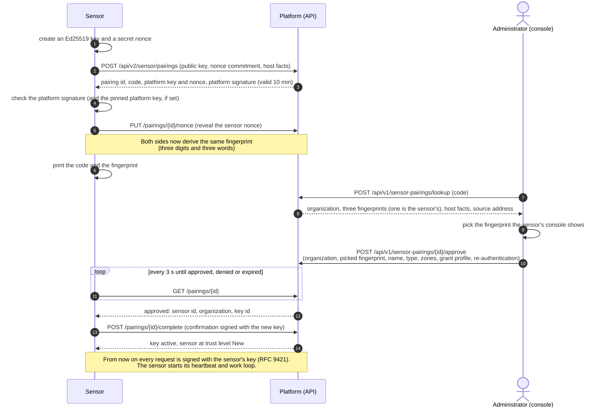

# Pairing and enrollment

Pairing connects a new sensor to your organization without any secret being
copied or pasted. The sensor creates its own Ed25519 key, which never leaves
its host. An administrator approves the sensor by picking, in the console, the
fingerprint the sensor's host shows. From then on the
sensor signs every request with its key (HTTP Message Signatures,
RFC 9421), and the platform stores only the public key.



When the sensor starts with a code made first (below), the order of the first
steps changes: the code exists before the sensor, and the sensor sends it in
its first request; the administrator then sees the fingerprint on the code
and approves it the same way. The work loop that follows is described in [How work reaches a sensor](how-it-works.md#how-work-reaches-a-sensor).

Design: [RFC-052](https://github.com/openctemio/openctem/blob/develop/api/docs/rfcs/RFC-052-sensor-pairing-and-authorization.md).

## Who can pair

| Step | Permission |
|---|---|
| Open the approve page, enter a code, create a pairing code, reject a request | **Pair sensors** (`sensors:pair`) |
| Approve | **Approve sensors** (`sensors:approve`), plus re-authentication: your authenticator code if you enrolled one, otherwise your password |
| Promote to Trusted, widen a grant | **Widen sensor grants** (`sensors:grant:widen`) |

Owners and administrators hold all of them.

## Add a sensor: one command, one approval

Add sensor offers one path. The command carries a single-use code, so the
console finds the sensor by itself, and the sensor prints the same code, a
link to approve it on and its fingerprint.


*Figure: Approving a pairing request.*

1. In the console open **Discovery > Sensors > Add sensor**. Under **Where
   will it run?** pick Docker, Docker Compose, Kubernetes or a Linux service.
   The dialog shows **Run this command on the host**: copy it and paste it on
   the host. A platform behind a private certificate authority gets a command
   that pins that authority (the dialog names its SHA-256).
2. The sensor starts, creates its key and prints:

   ```
   Pair this sensor: open https://openctem.example.com/activate?code=K7QM-4ZTD
     Code:        K7QM-4ZTD
     Fingerprint: 821 · melon · basil · bagel    (expires 10:42)
     Key:         SHA256:...
   In the console, pick this fingerprint and approve. Waiting for approval...
   ```

   With Docker, read it with `docker logs <container>`; on Kubernetes with
   `kubectl logs`. The line with the link needs `APP_URL` to be set on the
   platform; without it the sensor prints the code and you enter it on the
   approve page.
3. The Add sensor dialog shows **Waiting for the sensor** and moves to the
   approval by itself (it checks every 3 seconds; **Check now** checks at
   once). Or open the link the sensor printed. The link opens **/activate**
   (**Approve a sensor**), which takes the code out of the address bar and
   never approves when it loads. Without a code in the link, type the code
   the sensor printed.
4. The review names the organization the sensor joins ("The sensor joins
   *name*") and shows the host name, system, product, sensor and SDK version,
   the address the request came from with its network class (private network
   or public internet, and the edge or hosting provider when known) next to
   your own address, and how old the request is. If the address is not one
   you expect, reject the request: someone else's sensor, or a machine between
   the sensor and the platform, made it. Approve only a sensor you started
   just now on a host you run, never a link or code someone sent you.
5. **Which fingerprint does the host show?** The review lists three
   fingerprints, one of them the sensor's. Look at the host where you started
   the sensor and pick the same one. A wrong pick closes the request, is
   audited at high severity and notifies every administrator; the sensor then
   shows a new code and link.
6. Under **More options** choose the name, the type, **What it may do** (the
   grant profile, below) and the scan zones, then **Approve into** the
   organization, re-authenticating (your authenticator code, or your password;
   no prompt if you signed in recently).

The approval names the organization it was reviewed in: if you switched
organization after looking the code up, it is refused and you enter the code
again in the right one.

The sensor picks up its identity within a few seconds, confirms it, and the
command ends by itself once the sensor is paired. Every administrator of the
organization is notified. The sensor follows the organization's scope; the
install commands write no local policy file. The owner of the host may add a
narrowing `/etc/openctem/sensor-policy.yaml` and the `STOP` kill switch at any
time ([Sensor-local policy](network.md#sensor-local-policy)).

A start with a code uses it as the request's own code, so a command run after
its code expired still pairs through the link. A sensor that was stopped
before anyone approved it keeps its key: start it again, with a new code or
the same one, and it opens a new request (the earlier requests nobody approved
are closed and audited as `sensor.pairing_superseded`). A sensor that was
approved while it was stopped, and never confirmed within 10 minutes, is
removed again (it has no key and no jobs) and the removal is audited.

For several sensors on one host the
[multi-sensor kit](run-the-sensor.md#several-sensors-on-one-host) does the
same in one command: `./sensors.sh add NAME --api-url URL` prints the link and
the fingerprint and ends once the sensor is paired.

### When the sensor does not arrive

The console explains a refusal the sensor met on a code, in plain words and
only to the organization that made the code:

| The console says | Do |
|---|---|
| The sensor's clock is *N* seconds ahead or behind | Signed requests need clocks within 2 minutes. Sync the host with NTP (`chronyc makestep`); the sensor retries by itself. |
| A sensor tried this code too often | Leave it running; it retries. Do not restart it in a loop. |
| Another sensor already attached to this code | If you started only one sensor, reject the request and get a new command. |
| Its key still has another pairing request open | Leave it running: it attaches when the earlier request closes. |
| Its key is already registered to a sensor | A key pairs once. If the host lost its sensor, use [Re-pair](#re-pair-a-sensor) on that sensor; otherwise remove the sensor's identity (its data volume or state directory) and run the command again. |

Every start without a token answers with `user_code` and, when `APP_URL` is
set, `verification_uri` and `verification_uri_complete`. A key that was ever
registered to a sensor is refused with `409` and the problem type
`pairing-key-registered`; a start that loses a race for its key gets `409`
`pairing-key-busy` with a `Retry-After`.

## Start from a code made first (automation)

For automation, a code can exist before the sensor. The Add sensor dialog no
longer offers this choice, but the API does (`POST
/api/v1/sensor-pairings/expectations`, **Pair sensors**): it returns a
single-use code valid for 10 minutes, with an optional name, scan zones and
grant profile.

1. Run on the sensor host:

   ```bash
   openctemio-sensor pair K7QM-4ZTD
   ```

   Or give the code to a container or service in the environment and start
   the daemon as usual: `SENSOR_PAIRING_CODE=K7QM-4ZTD`. The sensor attaches
   to the code on its first start. The variable is read only while the sensor
   has no identity, no `SENSOR_API_KEY` and platform commands on; it is
   ignored once the sensor is paired, and it is never logged. A code that is
   not in the form `XXXX-XXXX` stops the sensor with exit code 2. With the
   multi-sensor kit: `./sensors.sh add NAME --api-url URL --pairing-code
   XXXX-XXXX`.

2. The sensor prints its fingerprint; the console shows the fingerprint it
   received as soon as the sensor connects. Pick the fingerprint and approve
   as above.

## Enroll a shared sensor

A sensor that serves every organization of the installation (a
[shared sensor](shared-sensors.md)) is not approved in an organization. A super
administrator issues a single-use enrollment token in the admin console
(**Scanning > Platform scanning > Enroll a shared sensor**), and the sensor
starts with `SENSOR_INSTANCE_ENROLLMENT_TOKEN`: it pairs with its own key and is
enrolled without a further approval, with no organization and the
least-privilege grant. The token cannot be combined with
`SENSOR_PAIRING_CODE`. Everything else on this page (the key, the identity
directory, re-pairing) applies to it the same way.

## The `pair` command

`openctemio-sensor pair [flags] [CODE]` pairs and exits, for a host prepared
before the daemon runs. The daemon does the same on its first start when it
has neither an API key nor an identity.

| Flag | Environment | Meaning |
|---|---|---|
| `-api-url` | `SENSOR_API_URL` | The platform URL (required) |
| `-state-dir` | `SENSOR_STATE_DIR` | Where the identity is kept (`<dir>/identity`); default `/var/lib/openctem/state` |
| `-name` | `SENSOR_NAME` | The name to propose |
| `-ca-fingerprint` | `SENSOR_CA_FINGERPRINT` | SHA-256 of the platform's CA. With it, `SENSOR_API_URL` must name the platform by the host name in its certificate, not an IP address |
| `-platform-key` | `SENSOR_PLATFORM_KEY` | Thumbprint of the platform's pairing key; a pairing signed by another key is refused |
| `-repair` | | Replace this sensor's key (see below) |

`CODE` is a code made first (see above); without it the command prints the
sensor's own code and link to approve. The daemon reads the same code from
`SENSOR_PAIRING_CODE` instead; the `pair` command takes it only as
an argument.

`SENSOR_CA_FINGERPRINT` and `SENSOR_PLATFORM_KEY` are public values. They stop
a fake platform from answering the sensor's first contact.

A platform behind a private certificate authority needs no extra step: the
console's command pins the platform's root CA by SHA-256
(`SENSOR_CA_SHA256`), and the sensor fetches that CA from the platform
before it pairs. See [Sensors behind a private CA](https://github.com/openctemio/openctem/blob/develop/api/docs/how-to/sensors-behind-a-private-ca.md).

## Where the identity lives

The identity is in `<state dir>/identity/` (`signing.key`, `identity.json`,
and the transport's client certificate and pinned CA): files with mode `0600`
in a `0700` directory, owned by the user the sensor runs as. The sensor
refuses to start when the permissions are looser and prints the `chmod` or
`chown` that fixes it.

This directory is the sensor's **only credential**. The platform keeps only
the public key.

- **Back it up**, encrypted, like a password. Losing it means pairing again.
- **Never share or copy it** to a second running sensor. Anyone who has a copy
  can act as the sensor. Two processes with one identity are flagged
  `identity_cloned` (critical) and every administrator sees it.
- **Restore** it only to a host that replaces the sensor, after the old one
  is gone.
- If a copy may have leaked, [re-pair](#re-pair-a-sensor): the old key is
  revoked at once.

`identity.json` also records what pairing pinned: the platform's TLS identity
(the sensor then refuses a platform certificate from another CA) and the
platform's job-signing keys (the sensor then runs only signed jobs).

## Re-pair a sensor

Re-pair gives a sensor a new key when its key is lost or may have been stolen,
its host was rebuilt or moved, or you switch install method. Start it in the
console, so that only a code made for that sensor can replace its key.

1. Open the sensor and choose **Re-pair...** (**Sensors > the sensor >
   Re-pair...**). Pick why: **Its identity is lost**, **The host was rebuilt
   or moved**, **Its key may be compromised** or **Switching install
   method**.
2. Decide what happens to the current key. By default it keeps working until
   you approve the re-pair, so a re-pair that fails never takes the sensor
   offline. Turn on **Revoke the current key now** when the key may be
   compromised: the sensor stops at its next request, its running jobs go
   back to the queue, and it stays offline until you approve.
3. **Create re-pair code**. The dialog shows a code and the command to run
   for this sensor only; run it on the host where the sensor should run. If
   the old service, container, volume claim or state directory still holds
   its identity, remove that first (the dialog says how for your install
   method), or the sensor keeps its old key.
4. The dialog waits for the sensor and then shows **Before and now**: what
   the platform last knew (hostname, system, version, address, last seen)
   against the host asking to pair, with changes marked. Pick the fingerprint
   the host shows and approve (**Approve re-pair of** the sensor) with your
   second factor.

The sensor keeps its name, zones, grant and history and returns to trust
level **New**. Its earlier keys are revoked and the jobs it held are taken
back at approval, also when its last key was already revoked. A re-pair never
changes the organization: to move a sensor to another organization, add a new
sensor there and remove this one. A re-pair code that expires before approval
changes nothing; create a new one.

The code decides what an approval does. An ordinary Add sensor code always
adds a sensor, and a re-pair code always re-pairs its sensor. An approval of
a re-pair must name the sensor it re-pairs (`repair_sensor_id`, `409
REPAIR_NOT_ACKNOWLEDGED` otherwise). A newer re-pair code for the same sensor
closes the earlier ones.

On the host, with the single-sensor commands:

```bash
openctemio-sensor pair -repair
```

or with Docker, run it with the sensor's data volume while the daemon is
stopped:

```bash
docker stop openctem-sensor
docker run --rm -it -e SENSOR_API_URL=https://openctem.example.com \
  -v openctem-sensor-data:/var/lib/openctem \
  ghcr.io/openctemio/sensor:{{ site.data.versions.sensor }} pair -repair
docker start openctem-sensor
```

`pair -repair` makes a new key and prints the code and link like a new
pairing; approve it in the console. With the multi-sensor kit use
`./sensors.sh repair NAME --pairing-code XXXX-XXXX` with the code from the
console ([Several sensors on one host](run-the-sensor.md#re-pair-one-sensor-of-the-kit)).
A sensor whose identity directory is gone has nothing to re-pair with
`pair -repair`: use the console's re-pair code, or pair it as a new sensor and
delete the old one.

## Revoke a sensor or a key

Disable, revoke access to or delete a sensor from the **⋯** menu of its sheet under
**Discovery > Sensors**; revoke a single key with
`POST /api/v1/sensors/{id}/keys/{key_id}/revoke` (see [API](#api)):

- The platform refuses the sensor's next request. Open gRPC streams are told
  at once and end within seconds.
- The sensor never answers a refusal by trying a weaker transport. It logs
  the refusal, keeps sending only its heartbeat (reason `identity_refused`)
  and waits.
- A **disabled** sensor keeps heartbeating, logs `paused by platform` and
  takes no jobs until it is enabled again. A revoked key or sensor does not
  come back: re-pair the host, or pair it as a new sensor. Revoked is final:
  `POST /api/v1/sensors/{id}/disable` on a revoked sensor answers 403, as
  activate and the status edit do, so a revoked sensor cannot be turned into
  a paused one and brought back.

## Grants and trust

Every sensor has a **grant**: the job types, zones, tools, highest tier,
target networks, credentials, push ingest and remote actions it may receive.
The platform checks it on every poll, claim and result. A missing or
unreadable grant withholds all work (fail closed).

The approver picks a profile as the starting grant:

| Profile | For |
|---|---|
| Internal network scanner (`internal-network-scanner`, default) | Scans and validation in the chosen zones; no credentials |
| External attack surface (`easm-external`) | Internet-facing targets only; no private addresses, no credentials |
| Authenticated scanner (`authenticated-scanner`) | Like the internal scanner, and may receive scan credentials once Trusted |
| Collector (`collector`, optionally `collector:<integration>`) | Runs one connector; no target scanning |
| CI runner (`ci-runner`) | Code scanning only; no network targets |
| Endpoint (`endpoint-agent`) | Inspects its own host only |

Every new sensor starts at trust level **New**, whether it was paired or
installed with a key:

- it receives **passive (T0) work only**: subdomain discovery, DNS
  resolution, code, dependency and image analysis. Active tools such as
  naabu, httpx, katana and nuclei are not dispatched to it;
- it receives no credentials;
- it cannot send results that are not bound to a job.

Open the sensor, review its **Grant**, narrow it if needed, and choose
**Promote to Trusted** when you are satisfied. The full grant then applies.
Promoting, widening and pairing approvals are audited at high severity and
notify every administrator. Narrowing is always one step.

## Bearer keys (legacy)

Older sensors authenticate with an API key (`octs_…`, older `rda_…`). New
organizations cannot create key-based sensors: pairing is the only way in.
An organization may allow them again by turning off **Require key-bound
sensor identity** in **Settings > Organization > General**; the Sensors page
then also offers **Install sensor**, which creates a sensor and shows its key
once, with ready-made install snippets.

A key-based sensor keeps a renewed key in its state directory
(`sensor-credentials.json`), so keep that volume too.

From sensor v0.13.0 a key-based sensor moves to its own signing key by itself
when the platform offers it: it makes a key, binds it once with its API key
(the platform retires the API key; the sensor keeps its id, grant and
history), and logs `This sensor is now key-bound: ...`. From then on its state
directory is its only credential, as for a paired sensor; remove `SENSOR_API_KEY`
from its configuration. `SENSOR_KEY_BIND=off` keeps the API key. When the
organization turned on **Require approval of sensor keys**, the bind is
refused (`Key bind refused: the organization requires an administrator to
approve this sensor's key; ...`) and the sensor keeps its API key until it is
re-paired. The bundled sensor of
the Helm chart currently uses a key; see
[Kubernetes](deploy-kubernetes.md#option-a-the-bundled-sensor-of-the-openctem-chart).

## API

| Route | Permission |
|---|---|
| `POST /api/v1/sensor-pairings/lookup` (body `code`; answers the organization and `fingerprint_choices`) | `sensors:pair` |
| `POST /api/v1/sensor-pairings/expectations`, `GET /api/v1/sensor-pairings/expectations/{id}` (a pairing code made first; with `repair_sensor_id` and `repair_reason` a re-pair code) | `sensors:pair` |
| `POST /api/v1/sensor-pairings/{id}/approve` (body `organization_id`, `fingerprint`, and `repair_sensor_id` for a re-pair) | `sensors:approve` |
| `POST /api/v1/sensor-pairings/{id}/reject` (body `code`) | `sensors:pair` |
| `GET` / `PUT /api/v1/sensors/{id}/grant`, `GET /api/v1/sensors/grant-profiles` | `sensors:read` / narrow or widen |
| `GET` / `PUT /api/v1/sensors/identity-policy` | `sensors:read` / narrow or widen |
| `GET /api/v1/sensors/{id}/keys`, `POST /api/v1/sensors/{id}/keys/{key_id}/revoke` | `sensors:read` / `sensors:write` or `sensors:revoke` |

{: .note }
**Upgrade note for API clients that approve pairings.** Send `fingerprint`
(one of the lookup's `fingerprint_choices`; `fingerprint_confirmed` is no
longer accepted) and `organization_id` (the value the lookup returns; an
approval for another organization answers `409 ORGANIZATION_MISMATCH`).
Rejecting a request no organization claimed yet needs its `code`, like an
approval. A failed code lookup that locks a user's lookups is audited
(`sensor.pairing_lookup_locked`, high). Sensors older than the sdk-go release
that reads `verification_uri_complete` still pair: the dialog finds them, or
enter their code on **/activate**.

## Troubleshooting

| Symptom | Cause |
|---|---|
| The console says the code is not found | It expired (10 minutes), was used, or was mistyped. Start the pairing again on the sensor. |
| The sensor keeps waiting after you made a code first | The code typed on the sensor was wrong; run `pair` again with the code from the console. |
| The console says another fingerprint was picked | The request was closed and a new code and link were printed: pick the fingerprint printed on this host. |
| A sensor shows `identity_cloned` and gets no new work | The same key was seen in use from two hosts: the platform withholds new work from it on every claim path (work it holds finishes). A waiting task names the reason in **Why waiting?**. [Re-pair](#re-pair-a-sensor) it on the host you keep and stop the other copy; a re-pair or a regenerated bearer key clears the flag. |
| `certificate chain does not contain the pinned CA` | `SENSOR_CA_FINGERPRINT` does not match the CA the platform presents, or a TLS-inspecting proxy sits in between. |
| `platform certificate does not match the pin stored at pairing` | The platform now presents a certificate from another CA than at pairing (a changed CA, or a TLS-inspecting proxy added since). Re-pair, or set `SENSOR_CA_FINGERPRINT` to the new CA after a deliberate change. |
| The sensor stops at start with an identity permission error | Run the `chmod` or `chown` it printed. On Kubernetes see [the fsGroup note](deploy-kubernetes.md#identity-files-and-fsgroup). |
| The container exits during pairing with `connection refused` | The platform was not reachable. The restart policy starts it again; check [Network requirements](network.md). |
| The sensor is online but gets no nuclei or port scans | It is still **New**. Promote it to Trusted. |

## Many sensors: enrollment tokens

For unattended installs (Kubernetes, Terraform, a fleet of hosts) an
administrator with **Approve sensors** opens **Discovery > Sensors >
Enrollment tokens > Create token** (a recent sign-in is asked for). A token
has:

- an expiry (1 hour to 30 days) and a limit on how many sensors it may enroll
  (1 to 1000; a sensor asking again with the same key counts once);
- the scan zones, grant profile and labels every sensor it enrolls gets;
- optional allowed source addresses (CIDRs);
- an optional **Approve each sensor**: sensors then wait under **Waiting for
  approval** until you compare the fingerprint and approve them.

The token is shown once. Put it in a root-only file or a Kubernetes Secret
and point the sensor at it with
[`SENSOR_ENROLLMENT_TOKEN_FILE`](settings.md#SENSOR_ENROLLMENT_TOKEN_FILE)
(or pass it in `SENSOR_ENROLLMENT_TOKEN`; sensor v0.27.0 or later, older
sensors keep pairing interactively). The token cannot be combined with
`SENSOR_PAIRING_CODE` or `SENSOR_INSTANCE_ENROLLMENT_TOKEN`, is never printed,
and an organization token is never accepted as an instance token or the
reverse. Each sensor that starts with it
pairs with its own key and joins the organization at trust level New; you
are notified of every enrollment, and every creation, enrollment, refusal and
revocation is in the audit log. **Revoke** stops the token at once; sensors it
already enrolled keep working until you revoke them.

