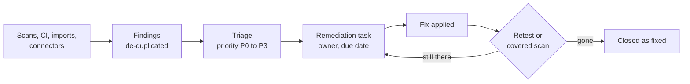

# Security analyst

You work in the web console: you keep the inventory honest, decide which findings
matter, prove them and their fixes, and get them fixed. The
[user guide](../user-guide/index.md) follows the same order as the CTEM loop.

## Tutorials

- [Getting started and the dashboard](../user-guide/01-getting-started.md): sign in, find your way around, read the dashboard.

## How-to guides

- [Scoping](../user-guide/03-scoping.md): crown jewels, cycles and what may be tested.
- [Discovery and the asset inventory](../user-guide/04-discovery.md) and [attack surface monitoring](../scanning/easm.md).
- [Run scans](../scanning/scans-and-runs.md) and [build scan workflows](../scanning/scan-workflows.md).
- [Exposures and findings](../user-guide/05-exposures-and-findings.md): triage, assign, comment, approve.
- [Prioritization](../user-guide/06-prioritization.md): priority classes, rules, exposure chains and attack paths.
- [Validation](../user-guide/07-validation.md): retests, pentest campaigns and checklists.
- [Closing findings](../user-guide/closing-findings.md): closing modes and the Ready to close list.
- [Mobilization](../user-guide/08-mobilization.md): remediation tasks, campaigns, SLAs and exceptions.
- [Insights and reports](../user-guide/09-insights-and-reports.md).
- Import results another tool exported: [upload a report](../api/ingest.md#upload-a-report-another-tool-exported) or [map any CSV, JSON or XML](../user-guide/import-mappings.md).

## Reference

- [The vulnerabilities list](../user-guide/vulnerabilities.md) and [known false positives](../user-guide/known-false-positives.md).
- [Tools and capabilities](../scanning/tools.md) and [why a task waits](../scanning/why-waiting.md).
- [Query language](../api/query.md) for dashboards and saved views.
- [Glossary](../overview/glossary.md).

## Concepts

- [Concepts](../overview/concepts.md): assets, findings, exposures, priority.
- [Scope and authorization to scan](../scanning/scope.md).
- [AI suggestions and approval](../user-guide/ai-suggestions-and-approval.md).
