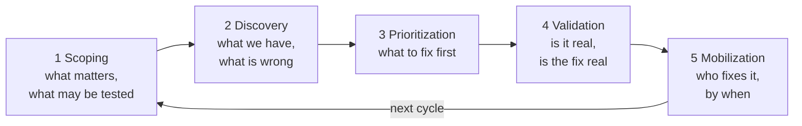

# Start here

Pick the role that matches what you came to do. Each page lists the documentation
for that role in the order you will need it, sorted by the kind of page.

| You are | You want to | Read |
|---|---|---|
| **Operator** | Install OpenCTEM, keep it running, upgrade it, place sensors | [Operator](operator.md) |
| **Security analyst** | Find, rank, prove and close exposures day to day | [Security analyst](analyst.md) |
| **Organization administrator** | Set up sign-in, roles, scope, integrations and policies for one organization | [Organization administrator](admin.md) |
| **Developer** | Automate with the API, gate CI pipelines, write a tool, contribute | [Developer](developer.md) |

## Kinds of page

The documentation has four kinds of page. Each role page groups its links by kind, so
you can tell a step-by-step lesson from a lookup table before you open it.

| Kind | Answers | Example |
|---|---|---|
| **Tutorial** | "Show me, from nothing to a working result." Follow it once, top to bottom. | [Quickstart](../quickstart.md) |
| **How-to guide** | "How do I do this one task?" Assumes you know the basics. | [Upgrading](../operations/upgrade.md) |
| **Reference** | "What exactly does this setting, field or permission do?" Look things up. | [Environment variables](../configuration/environment-variables.md) |
| **Concepts** | "Why does it work this way?" Read to understand. | [Architecture](../overview/architecture.md) |

## The loop in one picture

Everything in OpenCTEM serves the five stages of Continuous Threat Exposure
Management. Each stage has its own chapter in the [user guide](../user-guide/index.md).

