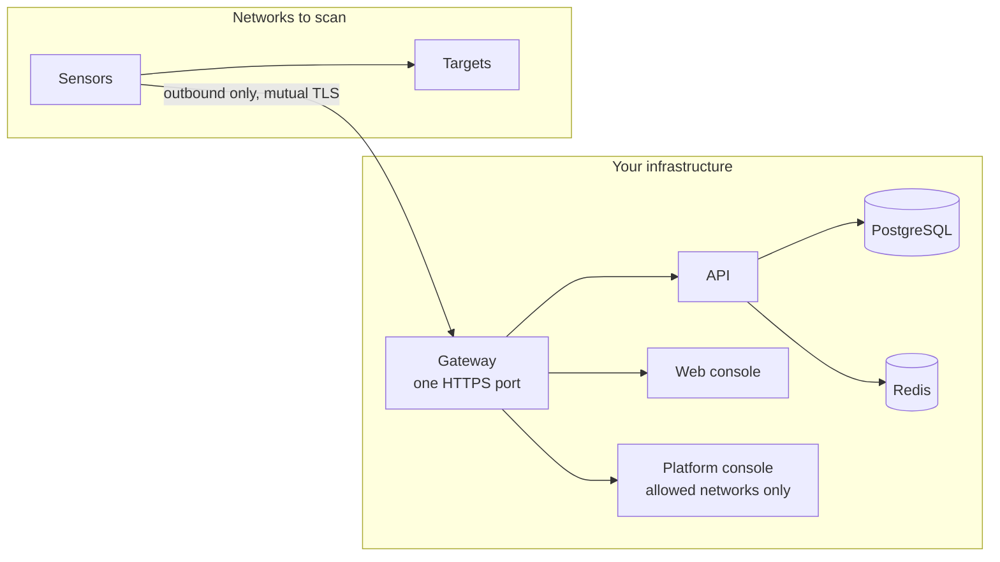

# Operator

You install the platform, keep it healthy and up to date, and place the sensors that
scan. You administer the installation from the [platform console](../console/index.md),
which is separate from the organizations' web console.

## Tutorials

- [Quickstart](../quickstart.md): install, pair a sensor and run a first scan in about 15 minutes.
- [First administrator](../install/first-admin.md): create the platform administrator and the first organization.

## How-to guides

- Install: [Docker Compose](../install/docker-compose.md), [all-in-one image](../install/all-in-one.md), [Kubernetes (Helm)](../install/kubernetes.md), [Ansible](../install/ansible.md), [binaries](../install/binaries.md).
- No internet access: [air-gapped and private registry](../airgap/index.md).
- [TLS and the gateway](../install/tls-and-gateway.md) and [going live](../install/production-go-live.md).
- Sensors: [deploy with Docker](../sensors/deploy-docker.md), [on Kubernetes](../sensors/deploy-kubernetes.md) or [as a binary](../sensors/deploy-binary.md); [pair](../sensors/pairing.md) and [operate](../sensors/operate.md) them.
- Day two: [upgrade](../operations/upgrade.md), [back up and restore](../operations/backup-restore.md), [monitor](../operations/monitoring.md), [scale](../operations/scaling.md), [troubleshoot](../operations/troubleshooting.md).
- Harden: [production hardening](../security/hardening.md).

## Reference

- [Environment variables](../configuration/environment-variables.md), [email](../configuration/email.md), [file storage](../configuration/file-storage.md).
- [Sizing](../install/sizing.md), [network requirements](../sensors/network.md), [sensor settings](../sensors/settings.md).
- [Log reference](../operations/logs.md), [versioning and releases](../operations/versioning.md).
- Platform console: [organizations and users](../console/organizations-and-users.md), [settings](../console/settings.md), [monitoring](../console/monitoring.md).

## Concepts

- [Architecture](../overview/architecture.md): components, trust boundaries, data flow.
- [How sensors work](../sensors/how-it-works.md) and [transport](../sensors/transport.md).
- [Security model](../security/index.md) and [data handling](../security/data-handling.md).
