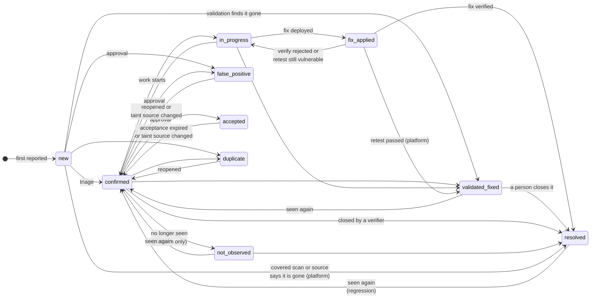
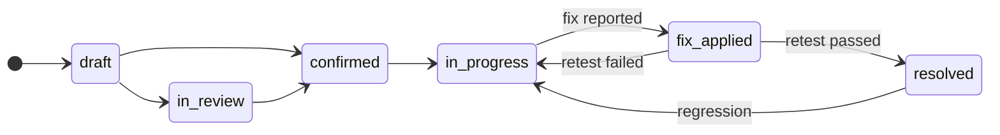

# Exposures and findings

Discovery produces two related kinds of records. Knowing the difference helps
you use the right page for the job.

- A **finding** is **one security issue** on a specific asset or location: a
  static-analysis issue on a line of code, a secret committed in a repository, a
  CVE on a host, a pentest finding. A finding has a severity, a status, a
  priority class, an assignee, evidence and comments, and moves through a status
  workflow. It is the analyst's main unit of work, handled in **Findings**
  (`/findings`).
- An **exposure event** is a **change to your attack surface that needs a
  decision**: an open port, a new subdomain, an expiring certificate, a leaked
  credential, a dangling DNS record. Repeated scans do not create new events: one
  exposure is one record with a first-seen and last-seen time, a state (active,
  resolved, accepted, false positive) and a history of state changes. Exposure
  events are handled in **Exposures** (`/exposures`).

Software components (the SBOM) are covered in
[Discovery](04-discovery.md#software-components-sbom).

As everywhere in the console, buttons and columns are hidden or disabled
according to your permissions (for example `findings:write`,
`findings:approve`, `findings:verify`).

## The findings list

**Findings** (`/findings`, in the top group of the sidebar) is the central
workbench for every finding in the organization, whatever its source (static
analysis, dependency scanning, dynamic scanning, secrets, infrastructure as
code, containers, attack-surface scanning, pentest, imports, manual).

*Figure: The findings list.*

### Header and metrics

- **Approvals** opens the [approval requests](#approval-requests); it is also an
  entry under **Findings** in the sidebar, with the number of requests waiting
  for you when you are an approver.
- **Import results** loads a scanner report (see
  [Import results](#import-results)).
- **Add finding** records a finding by hand (title, description, severity,
  source, asset and location).

The metric strip is also a set of quick filters: **Total**, **Open**,
**Critical open**, **High open**, **Overdue SLA**, **In CISA KEV** and **Awaiting
verification** (fixes waiting to be verified; opens the
[verify view](#verify-fixes)).

### Search, filter, group and save views

- Search by title, CVE, rule or location.
- **Finding state**: **Open** (default), **Fixed**, **Dispositioned** (false
  positive, accepted risk or duplicate; never counted as fixed) or **All**.
- The filter panel: **Assigned to me** (yours, on assets you own, or your
  team's), **Severity**, **Hide informational**, **Priority** (P0 to P3),
  **In CISA KEV**, **Reachable**, **Status**, **SLA**, **Branch** (only on a
  feature branch) and **Source**. Draft and In Review pentest findings are hidden
  until you filter on a status.
- **Group** the list by CVE, rule, asset, owner, severity, source, component,
  type or family (findings sharing one fix). Each group shows its progress (open, fixing, applied,
  resolved). Groups count only the findings that match the list's search and
  every filter, and the search box stays available in the grouped view.
- **Views**: save the current filters as a view, for yourself or shared with
  your groups.
- **Export** as CSV or JSON. With the export permission the server exports every
  matching finding (up to 100,000 rows; audit-logged); otherwise the current page
  is exported.

### When the list is empty, or fails

The list tells three empty states apart, each with the next step:

- **No findings in this organization yet** (nothing narrows the list and the
  organization has none): **Import results**, **Set up a scan** and a link to
  **Integrations**.
- **No findings match** (filters, the search or the state hide findings): it
  says how many findings of the viewed state are hidden and by what ("1,204 open
  findings are hidden by 2 filters and your search"), with **Clear filters** (or
  **Clear search**) and **Search all statuses**.
- **You do not have access to these findings**: your role cannot read findings
  here; the message names the missing permission when the server does.

If the list fails to load, the error appears in the table area with **Retry** and
**Copy request ID** (quote it to support). The page header, search and filters
stay, and there is no second pop-up message. While the list reloads, the rows
stay on screen with a thin progress bar above the table.

The findings list, its filters, the table controls, the bulk bar and saved views
are translated into English and Vietnamese.

### Columns and badges

Columns: **Title**, **Severity**, **Priority** (P0 to P3), **Location**,
**Status** and **Due / SLA**. **Source** and **Created** are hidden until you
turn them on in **View**. **Location** shows the asset on one line and the
place on it below (URL path, file and line, or port). A long path is cut in
the middle, so its end stays visible; the tooltip has the full value. On a
phone, each card shows the location too. The title carries
inline badges: **KEV** for a CVE in the CISA Known Exploited Vulnerabilities
catalog (with its remediation date), **EPSS x%** for the probability of
exploitation in the next 30 days, and an icon when attack-path (data-flow) data
exists.

### Row and bulk actions

Click anywhere on a row to open the finding. A row's menu: **View details**,
**Open to assign…**, **Open to change status…**, **Open to mark as false
positive…** (these three open the finding, where the assignee picker and the
approval flow live), **Create Jira Ticket** (when ticketing is set up), **Add to
remediation**, **Copy ID**, **Copy link** and **Delete** (permanent, asks for
confirmation).

Select rows to **Assign to…**, create a **Remediation task**, or change the
**Status** to Confirmed, In Progress or Resolved (Resolved needs the verify
permission). False positive and accepted risk are never offered in bulk because
they need approval.

- A selection belongs to the rows on screen. Changing the page, the page size,
  the sort, the search, a filter, the view or the grouping clears it, so a bulk
  action never reaches a finding you cannot see.
- A bulk assignment asks you to confirm your identity again when your
  organization requires it for the change, and shows the server's message when
  it is refused.
- On a phone, every finding card has the same checkbox and the same menu as a
  table row. Tapping the card opens the finding; the checkbox selects it.
- While a finding is open in the side panel, **J** and **K** open the next and
  previous finding of the list (see **Help**, **Keyboard shortcuts**).

In the grouped view:

- **Mark fixed** on a CVE or asset group with work in progress records what you
  did ("What did you do to fix this?", an optional reference, and optionally the
  related CVEs of the same component).
- When grouped by owner, **Assign to asset owners** assigns the unassigned group
  to each asset's owner.

### Verify fixes

The **Awaiting verification** metric opens the verify view: fixes marked
**Fix Applied**, grouped by CVE. People with the verify permission click
**Approve** to accept the fix, or **Reject** with a reason (for example
"Vulnerability still present"); rejected findings go back to the assignee as In
Progress.

### Import results

**Import results** loads findings from a file: Nessus, Qualys (with an optional
Qualys KnowledgeBase), SARIF, trivy, grype, semgrep, gitleaks, nuclei, ZAP, vuls,
CycloneDX, SPDX, OSV, CSAF, OpenVEX, DefectDojo, or a ZIP of these. Click
**Preview** for a dry run (nothing is written), then **Import**. Findings land
only on assets you can change, and an import never resolves other findings. See
also [Ingesting results](../api/ingest.md).

After an import the dialog shows its **receipt**: how many findings were
**New**, **Still detected**, **Reopened**, **Closed**, **Untouched**, **Skipped**
and **Failed**, and whether the upload's coverage could close anything (an
import from the console always has partial coverage, so it closes nothing).
Before you choose a file, the dialog lists your **Recent imports**.

The same counts appear on a scan run's page as **What this run did to
findings**, and a finding's overview shows **Last seen in**: the newest import
or run that created, saw again, reopened or closed it.

## A single finding

Click a row to open the **drawer**; click **Open full details** (or press
<kbd>⌘</kbd>/<kbd>Ctrl</kbd>+<kbd>Enter</kbd>) for the full page
(`/findings/{id}`).

### The drawer

- The header shows the title, source, CVE and asset, with **Status**,
  **Severity** and **Assignee** selectors. Every change shows a toast with
  **Undo**. The menu has **Copy link** and **Create ticket**.
- **Why it matters** (the priority class and its signals), the fix,
  properties (priority, SLA due, asset, found by, first and last seen,
  occurrences, tickets, tags, ID), the description, the approval history (for
  false positive or accepted findings) and the activity.

### The full page

**Header.** Source, type, CVE (links to NVD) and CWE (links to MITRE) badges and
the title, with:

- **Re-verify**: queues a safe re-check of the finding by a validation-capable
  sensor (not offered for pentest, bug bounty, red team or manual findings;
  needs `findings:write`). See [Validation](07-validation.md#re-verify-a-finding).
- **AI Triage** (when the AI triage module is on and AI is configured): asks for
  an assessment; the result appears as **AI analysis** on the Overview tab.
- The **⋯** menu: **Copy link**, **Create ticket** and **Mark as duplicate**
  (search a finding on the same asset; comments, retests, evidence and tickets
  move to the original).

*Figure: A finding on its own page.*

*Figure: The Evidence tab: the request and response that proved the finding.*

**Properties rail.** Status, Severity, Priority, Assignee, SLA due, Asset, Found
by, First seen, Last seen, Occurrences, Resolved, Tickets, Tags and ID. For
human-sourced findings (pentest, bug bounty, red team, manual) Status, Severity
and Assignee are read-only here. A callout appears when the SLA is overdue or
breached.

**People** (in the side panel of the finding page and of the drawer): the
assignee, the **watchers** with the reason each one watches (commented, was
added, was assigned, and so on), the owners of the asset as context, and a
**bell** to watch the finding or stop watching it.

- A watcher is told about comments, status changes (a fix claim included) and
  assignments on the finding, in addition to its assignee. Watching grants no
  access: only active members who can read the finding at that moment are told,
  never the person who made the change, never someone who stopped watching, and a
  team-only comment on a pentest finding never reaches a campaign client. Changes
  made by a scanner, the system, an integration or AI still reach the assignee only.
- You start watching when you comment, change the status of one finding or claim
  its fix, are assigned it, or request an approval on it. A bulk status change
  subscribes nobody. Stopping on one finding always wins over starting again.
  **Settings › My account › Notifications › Watch what I take part in** (on by
  default) turns the automatic start off; the bell still works.
- **Add** (for people who may assign findings) adds up to 10 watchers at once, all
  or none; the picker lists only members who can read the finding. A finding has
  at most 50 watchers. People who can see the member list see names; others see the
  count. Viewers and pentest clients can still use their own bell. You can remove
  yourself, and anyone with permission to assign can remove others.
- Notifications to a watcher say "Finding assigned" instead of "You have been
  assigned", and notifications about the same finding that come within 10 minutes
  fold into the unread one instead of adding rows.
- Offboarding a member removes their watches.

**Retest** (nuclei findings with a rule ID): **Retest now** (needs the verify
permission) re-runs the detection and reports Fixed, Still vulnerable,
Regression (reopened), Not reproduced or Inconclusive.

**Retest check** (any finding, for example a pentest, bug bounty, manual or DAST
finding that has no automatic retest): attach a check so **Retest now** and the
proof of fix can re-run it on a sensor. **Add check** (needs the
`findings:retest_checks:write` permission) opens an editor with two tabs:

- **HTTP assertion**: method (GET, HEAD, POST or OPTIONS), a path relative to the
  finding's target, headers, a body for POST, and matchers (status codes, words or
  regular expressions in the body or headers, optionally "must not appear"),
  combined with "All must match" or "Any may match". No code.
- **Nuclei template**: paste YAML, upload a `.yaml`/`.yml` file (up to 256 KB), or
  pick a template from the organization's template library.

**Validate** shows errors per field, the tier (T0 passive, T1 active, T2
intrusive) with its reason and the template that will run; **Save** is enabled
after a valid validation of exactly what is in the form. **Remove** detaches the
check; its template stays in the library. Rules:

- The check always runs against the finding's own target, and credentials
  (Authorization or Cookie headers) are not allowed.
- A match means the issue is still there. A check proves a fix only after it has
  matched this finding once (**Calibrated**); until then a no-match reads "not
  reproduced", not fixed. A check that cannot load or run is inconclusive and
  never resolves the finding.
- An intrusive (T2) check runs only after a second person with scope approval
  rights clicks **Approve** (a recent sign-in is asked for). The author of a
  version cannot approve it. Editing a check resets its approval and calibration.
- While the template awaits approval for your sensors, a note links to the
  template library. Retest history shows "Checked with custom check <name>
  (sha256:…)" for retests that ran the check.

**Why it matters.** The priority class and the deadline to fix it, the reason
sentence, and risk-signal chips grouped into exploitation, exposure and business
impact. **Set manually** marks an overridden class, "Set by rule" names the
[priority rule](06-prioritization.md#priority-rules) that set it, and an
"Ownership not confirmed" note (with **Verify ownership**) appears when the class
is held at P2 because the asset's ownership is unconfirmed. Open **How this was
scored** for the transparent priority score (see
[Prioritization](06-prioritization.md#the-transparent-priority-score)).

**Tabs:**

- **Overview**: AI analysis (when triaged), description, context, identifiers
  and scores (CVSS, EPSS, CISA KEV, CWE, OWASP, related CVEs), code location,
  scanner output and targets.
- **Evidence**: tool evidence, affected code and context, stack traces,
  attachments and uploaded evidence, validation evidence, compliance mapping, and
  **Notes** with **Add Evidence** (description, type, URL). Masked secrets in
  tool evidence can be revealed for 60 seconds by people with the reveal
  permission; every reveal is audited.
- **Remediation**: progress, recommendation, auto-fix code, remediation steps
  (**Add Step**), references, and the **Definition of Done & Acceptable Fixes**
  card (see [Mobilization](08-mobilization.md#the-engineering-ticket-brief)).
- **Attack path** (when the scanner reported a data flow): the taint trace
  from the source to the sink, with each step's code, file and line, and a
  link to that line at the scanned commit. See
  [Data-flow traces](../scanning/data-flow-traces.md).
- **Related**: findings with the same CVE, similar findings, duplicates, links
  and occurrences.

Pentest findings show a **Pentest details** tab instead of Attack path.

**Activity.** Open it from the rail ("Activity · N comments"), or press
<kbd>C</kbd>. It shows the timeline live (creation, status changes, AI triage,
comments), filtered by **All**, **Comments** or **Changes**. Write comments in
Markdown (**Write** / **Preview**); an **Internal** comment is visible only to
your organization and never sent to Jira or other integrations. You can edit and
delete your comments and add reactions. Posting needs `findings:write`.

### Status workflow

Every finding, whatever its source (scanner, import, CI or pentest), takes its
status from one set:

**New → Confirmed → In Progress → Fix Applied → Resolved**, plus **Validated
Fixed**, **Not Observed** (set by the platform when a finding is no longer
seen), **Duplicate**, **False Positive** and **Risk Accepted**.

| Status | Group | Set by |
|---|---|---|
| `new` | open | The first report from a scan, an import or an integration; or the platform when the suppression rule that closed a finding is deleted or expires. |
| `confirmed` | open | A person; or the platform when a closed, validated-fixed or not-observed finding is seen again, a retest finds it still vulnerable, an accepted risk expires, or a re-scan reports another taint source for a false positive or accepted risk. |
| `in_progress`, `fix_applied` | in progress | A person, or a Jira or GitHub issue linked to the finding. |
| `validated_fixed` | in progress | A validation re-check that no longer reproduces the finding. Not closed: a person with the verify permission resolves it. |
| `not_observed` | in progress | The platform only: a later scan with the same coverage no longer reports it, or a branch-only finding expired. Nobody can choose it. |
| `resolved` | closed | A person with the verify permission, a passing retest (when the retest settles findings automatically), or a scan that no longer sees it when the operator enables coverage auto-resolve (`INGEST_COVERAGE_AUTO_RESOLVE=enforce`; the default `dry_run` only records what it would resolve). |
| `false_positive`, `accepted` | closed | An approved request, or an approved [suppression rule](08-mobilization.md#exceptions). |
| `duplicate` | closed | A person. |
| `draft`, `in_review` | open, hidden | Pentest findings before publication; left out of dashboards and the open findings list. |

How a finding was closed is recorded as its resolution method, not as a status:
`scan_verified`, `retest_verified`, `security_reviewed`, `admin_direct`,
`source_mitigated`, `source_retired` or `vex_not_affected`. The API refuses an
unknown status, in a status change and in a list filter, with `400`.

A finding that was resolved and is reported again is reopened as
`confirmed` and flagged as a **regression** (its reopen count goes up),
unless it was closed as a false positive, an accepted risk or a duplicate.

Pentest findings use the same statuses plus **Draft** and **In Review**:
**Draft → In Review → Confirmed → In Progress → Fix Applied → Resolved**. A
pentest finding is closed as fixed only through a retest, and is then
`resolved` with the resolution method `retest_verified`; a resolved finding goes
back to In Progress when the fix stops holding. Campaign roles decide who may
make each move (see [Validation](07-validation.md)).

From any step before Resolved a pentest finding can also be marked
`false_positive` or `accepted` (with approval), and either can be reopened to
`draft` or `confirmed`.

### Sub-statuses and your own lifecycle

An organization can add its own labels inside each status and its own rules for
moving between them, under **Settings › Findings › Finding lifecycle** (needs the
**Manage Finding Lifecycles** permission). A label never changes what a metric,
an SLA or an export counts: they keep reading the status.

- **Sub-statuses** are labels inside one status, for example "In review" inside
  In Progress. A sub-status inside a closed status is bound to one closure reason.
- **Lifecycles** add moves between sub-statuses and the requirements each needs
  (a note of a minimum length, fields such as a ticket link, a fix reference or a
  due date, or a permission), for the findings their conditions select (finding
  type, severity, source, tool, priority class, KEV); the first lifecycle is the
  default for every finding. A move can only add requirements: permissions,
  four-eyes approval and evidence rules still apply. A draft is checked, then
  **Publish**ed as a new version (you may be asked to confirm your identity), and
  can be rolled back. When a move needs details, the status dialog asks for them
  and keeps them on the finding's timeline.

### Approval rules

- **False Positive** and **Risk Accepted** always need approval. Choosing
  them opens **Request Status Approval**: enter a justification (up to 2,000
  characters) and, for Risk Accepted, the date the acceptance ends, then
  **Submit for Approval**.
- An accepted risk always ends. The date is 90 days ahead by default and at
  most one year ahead. When it passes, the finding reopens as Confirmed, and
  the CI gate stops honoring the acceptance on that date. A false positive has
  no end date.
- Resolving a finding by hand needs the verify permission.
- Who approves, and how many people, is set under **Settings › Findings ›
  Finding approvals** (see [Settings](10-settings-and-integrations.md#findings--assets)):
  by the risk of the finding, with a security pool and an expiry for the decision.
  A request made by a ticket, a VEX statement or AI triage, with no person behind
  it, needs one more sign-off. When VEX `not_affected` statements in a scan report
  request false positives (`INGEST_VEX=enforce`), the approvers in scope are
  told.

### Approval requests

**Approval Requests** (`/findings/approvals`, from the **Approvals** button) is
the queue of requests to move findings to false positive or accepted risk.

*Figure: Approval requests.*

- Cards and tabs: **Pending**, **Approved**, **Rejected**, **Canceled** and
  **All**; search by justification.
- Columns: status, finding, requested status, justification, created, expires.
- On a pending request, people with `findings:approve` (owners and admins by
  default) can **Approve** (the status changes immediately) or **Reject** with a
  reason (up to 2,000 characters). You cannot approve your own request, and
  expired requests cannot be approved or rejected.
- The requester can **Cancel** their own request.
- A request marked **Proposed by AI triage** was made by
  [AI triage](../api/ai-triage.md#false-positive-proposals), not by a person.
  Any approver may decide it; the finding does not change until a person
  approves it.

How decisions carry over to new scans, CI jobs and other tools is described
in [Known false positives](known-false-positives.md).

## Exposures

**Discovery › Exposures** has five tabs: **Overview**, **Vulnerabilities**,
**Secrets**, **Code weaknesses** and **Misconfigurations**.

*Figure: Exposures.*

### Overview: exposure events

**Overview** (`/exposures`) lists attack-surface changes that need a decision:
resolve, accept or dismiss them.

1. The tabs **All exposures** and **Analytics**; the metrics **Total
   exposures**, **Needs attention**, **Resolved** and **Mean time to resolve**.
2. Search, filter by **Severity** and by state (**Needs attention**, **Closed**,
   **All states**), and **Export** to CSV.
3. Columns: exposure (with its type), severity, state (Active, Resolved,
   Accepted, False positive), source and first seen. A row's menu: **View
   details**, **Mark resolved**, **Accept risk**, **Mark false positive** or
   **Reactivate**.
4. Select rows to **Resolve**, **Accept risk** or mark **False positive**.
   Accepting and false positive need a reason (recorded in the audit log) and the
   approval permission (`findings:approve`).
5. On a **high or critical** exposure, **Accept risk** and **False positive**
   take two people. The first click stores a request, and the exposure shows
   **Awaiting approval**. A different approver opens it and clicks **Approve**
   or **Reject**; the requester can **Cancel request**. When nobody else in
   the organization can approve, the owner may confirm their own request, and
   that is recorded as a critical audit event. Low and medium exposures change
   at once.
6. Click a row for its details: description, **Security context** (effective
   criticality, CISA KEV, EPSS, CVE, internet reachability), **Timeline** (first
   seen, last seen, resolved), **Details** (credential, database, source, code
   location and network fields; sensitive values are masked, with **Reveal
   secrets**) and **Activity** (every state change with who and why).

**Analytics** charts exposures by severity, by state and by event type.

The metrics and the charts count only the exposures you may see, the same set
as the list. A member limited to some assets sees numbers for those assets,
not for the whole organization. Exposures of deleted assets are not counted.

Where exposure events come from (they are created automatically, not typed in):

| Source | Event types |
|---|---|
| Recon results (open ports, services, certificates) | `port_open`, `service_detected`, `certificate_expiring`, `certificate_expired`, `ssl_issue` |
| Secret findings | `credential_leaked` |
| Infrastructure-as-code and cloud-configuration findings | `misconfiguration` |
| Certificate Transparency monitoring | `subdomain_discovered`, `certificate_expiring`, `certificate_expired` |
| DNS checks on your domains | `dangling_cname`, `dangling_ns`, `email_security_weak`, and `subdomain_takeover` when a takeover is confirmed |
| Credential imports | `credential_leaked` |

Each source uses a stable fingerprint, so a repeated scan only updates the last
seen time (and can reactivate a resolved exposure) instead of creating a new
record.

The platform also keeps a catalog of standardized exposure classes (CTEM IDs),
refreshed daily from a public feed. It is available through the API
(`GET /api/v1/ctem-ids`, and `PUT /api/v1/exposures/{id}/ctem-id` to tag an
exposure); there is no console page for it.

### Vulnerabilities, Secrets, Code weaknesses, Misconfigurations

These four tabs are dashboards over findings of one kind. Each has **View N
findings**, which opens the findings list filtered to that kind.

- **Vulnerabilities** (`/exposures/vulnerabilities`): vulnerability findings and
  the CVEs behind them. The **Summary** tab shows totals, a severity
  distribution, the status mix and the finding trend. **Active CVEs** (CVEs
  affecting your assets) and **CVE catalog** (the global catalog, with CVSS,
  EPSS, public exploit and CISA KEV flags) need `vulnerabilities:read`.
- **Secrets** (`/exposures/secrets`): secrets committed to code (API keys,
  tokens, passwords): totals, repositories affected, critical secrets ("Rotate
  immediately"), risk score, severity distribution, status and remediation
  priority.
- **Code weaknesses** (`/exposures/code`): static-analysis findings: totals,
  critical, high, repositories with findings, severity distribution, finding
  trend and assets by type.
- **Misconfigurations** (`/exposures/misconfigurations`): infrastructure and
  application misconfigurations found by IaC scanning: totals, critical
  misconfigurations, asset coverage, risk score, findings by severity, assets by
  type and priority fixes.

Until there is data, each tab shows an empty state with a suggested next step.
