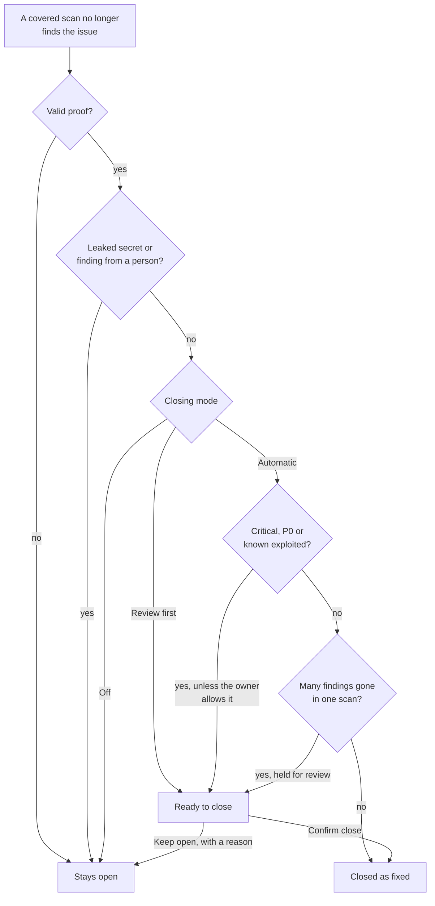

# Closing findings

A finding can close because a scan no longer finds it. This page explains when
that is allowed, how your organization controls it, and where people review
the closes that wait for a decision.

## The principle

A finding closes only when the same check looks again and the issue is gone.
Nothing else counts as proof of a fix. These never close a finding:

- A scan that was blocked (for example by a WAF or CDN), could not reach the
  target, or was rate limited.
- A partial or interrupted scan.
- A proxy or sensor failure.
- A scan from a different tool than the one that found the issue.
- A scan whose template release changed since the finding was raised. The
  results of two releases are not comparable, so this does not prove a fix.

Two kinds of finding are never closed by absence at all:

- **Leaked secrets.** A secret that is no longer visible has not been made
  safe. It closes when it is rotated.
- **Findings from people** (pentest, manual and bug bounty findings). A person
  closes them.

## Closing mode

Owners and administrators choose how the platform handles a close in
**Settings > Finding lifecycle > Closing findings**.

| Mode | What happens |
|---|---|
| **Automatic** | A covered scan that no longer finds an issue closes it. Critical findings wait for review. |
| **Review first** | Every close the platform would make waits in **Ready to close** until a person confirms it. |
| **Off** | Only a person closes findings. |

How the platform decides, from a scan that no longer finds an issue to a closed
finding. Valid proof means the same tool, a complete scan that was not blocked, and
the same template release ([the principle](#the-principle)).

New organizations start in **Automatic**. Organizations created before this
setting existed start in **Review first**. The API is
`GET` and `PUT /api/v1/organization/settings/closure` (owners and
administrators).

In Automatic mode, a finding counts as critical when its severity is critical,
it is P0, or it is known to be exploited. Only the organization owner can let
covered scans close critical findings without review.

### Making the setting looser

Moving to a looser setting is a sensitive change. These changes are loosening:

- Off to Review first or Automatic.
- Review first to Automatic.
- Letting critical findings close without review.

A loosening change:

1. asks you to sign in again;
2. takes effect 24 hours later;
3. notifies the owners and administrators.

Until it takes effect, the stricter setting stays in force. The settings page
shows the waiting change ("A change takes effect on ..."), and anyone allowed
to change the setting can cancel it with **Cancel this change**
(`DELETE /api/v1/organization/settings/closure/pending`). Making the setting
stricter applies at once.

### Platform ceiling

The operator of the platform decides whether scans may close findings at all
on the installation. While automatic closing is in a dry run, nothing closes
automatically, whatever your organization chose: the platform only records
what it would have closed.

Self-hosted operators set this with the environment variable
`INGEST_COVERAGE_AUTO_RESOLVE` (see
[Environment variables](../configuration/environment-variables.md)):

| Value | Meaning |
|---|---|
| `off` | No automatic closing anywhere. |
| `dry_run` (default) | Dry run: the platform logs, counts and audits what it would close, and closes nothing. |
| `enforce`, or its alias `tenant` | Each organization's closing mode applies: in **Automatic**, a covered scan closes standard and high findings and proposes critical, P0 and known exploited ones; in **Review first**, every close is proposed; in **Off**, nothing closes. |

Proposed closes are stored in **Ready to close** only with `enforce` (or
`tenant`).

## What counts as a covered scan

A scan closes a finding it no longer reports only when it covered the
finding's host:

- **Per target.** When the sensor reports how each target ended, a target
  counts as covered only when it finished (`done`) and no coverage gap,
  unreached target or refused target names its host. One host that stopped
  answering, sat behind an edge block, hit the rate floor or timed out no
  longer stops the other hosts of the run from closing their findings; it
  closes nothing itself. An asset whose host or address the result names as
  uncovered never closes, whichever target it falls under (a subdomain of a
  domain target, an address inside a range). A target without an outcome, or
  a cut-short gap list, counts as not covered.
- **Hosts with nothing found.** With per-target outcomes, a covered target's
  own host can close its old findings of the same tool even when the run
  reported nothing there.
- **Uncovered hosts.** A run that reported coverage gaps (hosts it gave up
  on or that blocked it), unreached targets or targets its local policy
  refused closes nothing on those hosts.
- **Same check.** The same tool and scan profile as the last sighting, and
  the same template release. A finding that recorded no template release is
  marked as not observed by a run that reports one, not resolved.
- **Older sensors.** A sensor that does not report per-target outcomes keeps
  the earlier rule: only a full, clean run closes, and only on the assets its
  report named.
- **Held for review.** When many findings disappear in one scan, nothing
  closes: every candidate is proposed in **Ready to close** instead.

Imports follow their own rules: a full-coverage import closes findings only
for an uploader who also holds `findings:verify` (otherwise it imports and
closes nothing, and the receipt says `needs_verify`), leaves critical and
known exploited findings open, and closes only findings whose latest
sighting was an upload, never one a platform sensor saw last. A recon
results import never closes findings.

Retests also need evidence that survives a second look:

- A CDN or WAF challenge or block at the finding's endpoint is
  `edge_blocked`, not a fix.
- A retest of a finding that a scan sighted again after the check ran is
  recorded inconclusive (`seen_after_check`), and the finding stays open.
- A retest answered by a redirect to another page (a login) is inconclusive
  (`auth_changed`), unless the check is about exposure.
- A report observed before a finding was resolved no longer reopens it; a
  report observed after the fix still does.

## Out of scope is not fixed

A permanent **Not ours** or **Retired** exclusion, or a "Not ours" decision,
closes the open findings of what it matches with the reason "Asset out of
scope". These closes never count as fixed, and lifting the exclusion reopens
the findings. A **Do not scan** exclusion leaves findings open. See
[Exclusions](../scanning/scope.md#exclusions).

## Ready to close

**Findings > Ready to close** lists the closes that wait for a person, with
critical findings first. Each row shows why the finding can close:

- the method, **Covered scan**;
- the tool, the scan and when it ran;
- **Held for review**, shown when many findings disappeared in one scan. This
  is a safety guard against a scanner that is broken or blinded, so a person
  looks before anything closes.

For each finding you choose one of two actions:

- **Confirm close** closes the finding as fixed. You are recorded as the
  person who confirmed it.
- **Keep open** needs a reason: still there (checked by hand), the scan cannot
  be trusted, wrong asset, or other with a note.

To decide many at once, select several rows. A bulk action covers up to 200
findings. Confirming asks for a recent sign-in; keeping open does not. Each
finding's eligibility is checked again when you decide.

A finding that was seen again after the scan, or changed by someone in the
meantime, is skipped and stays open.

### Who can see and decide

- Anyone with `findings:read` sees the queue for the assets in their data
  scope.
- Confirming or keeping open needs the `findings:verify` permission.
- The sidebar shows a count next to **Ready to close** for people who can
  decide.
- API: `GET /api/v1/findings/closure/proposals` and
  `POST /api/v1/findings/closure/proposals/decide` (confirm or dismiss up to
  200), `GET /api/v1/findings/closure/auto-closed` (the last 7 days) and
  `POST /api/v1/findings/{id}/reopen`.

## Recently auto-closed

The second tab, **Recently auto-closed**, lists findings the platform closed by
itself in the last 7 days, with the scan behind each close.

If a close was wrong, choose **Reopen: not fixed** (needs `findings:status`).
The finding reopens as confirmed, the platform records that the automatic close
was wrong, and the reopening does not count as a regression.

## On a finding

The **Verify** panel of a finding has a covered-scan row. It says why a scan
will or will not close this finding, for example:

- Critical findings wait for review in auto mode.
- Your organization reviews every automatic close.
- Automatic closing is off for your organization.

## Audit

Every confirm, keep open, reopen and change of closing mode is recorded in the
audit log. A loosening change is logged at high severity.

## Related pages

- [Exposures and findings](05-exposures-and-findings.md)
- [Known false positives](known-false-positives.md)
- [Automatic coverage](../scanning/asset-coverage.md)
