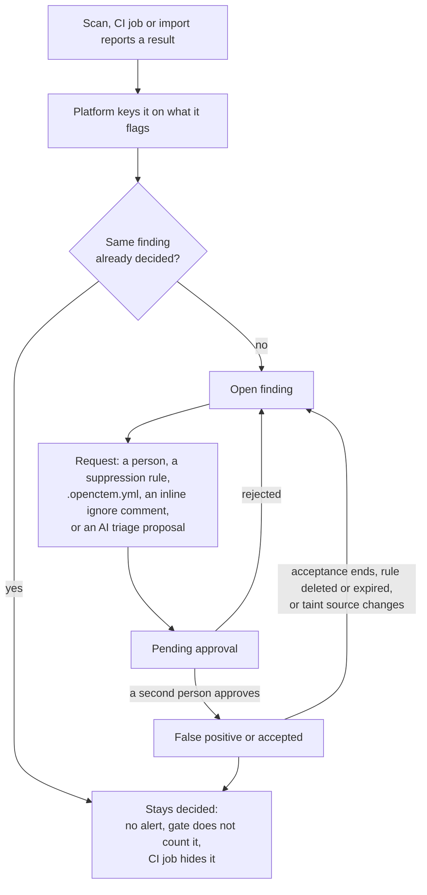

# Known false positives

A false positive, an accepted risk or a duplicate is decided once, in
OpenCTEM, by a person. The decision stays on the finding: later scans, CI jobs
and other scanners that report the same issue do not raise it again. This page
explains how a decision is made, how it carries over, and when it ends.

This behaviour needs platform v0.9.6 or later, sensor v0.22.1 or later and
the CI CLI v0.3.0 or later.

## The lifecycle

## Where a decision comes from

Every route ends in a pending request that a person approves. Nothing in a
scan result, a repository or a model output decides on its own.

| Route | What it creates | Who approves |
|---|---|---|
| A person marks one finding **False Positive** or **Risk Accepted** | A [status approval request](05-exposures-and-findings.md#approval-requests) | Someone with `findings:approve` other than the requester |
| A person writes a [suppression rule](08-mobilization.md#exceptions) | A pending rule for a class of findings (rule id, path, tool) | Someone other than the requester; approval closes the open findings it matches |
| A repository asks (`.openctem.yml`, an inline ignore comment, an ignore file) | A pending accepted-risk rule for that repository | As for any suppression rule |
| [AI triage](../api/ai-triage.md#false-positive-proposals) is confident a medium or low finding is a false positive | A pending false-positive request made by `ai_triage` | Any approver; never automatic |

How many people decide a false positive is an organization setting under
**Settings › Findings › Finding approvals** (**Approval policy**, **False positive**): **Always** (the default; a second
person approves every false positive), **Only for serious findings** (a second person only
for a critical or high finding, a known exploited one, P0 or P1, a validated
exploit, or a crown-jewel or internet-exposed asset) or **Never** (one person with
`findings:approve` and the finding in their data scope may decide alone, with
the closure reason and a note). An accepted risk follows the separate **Risk
acceptance** setting with the same three choices (default **Always**), and always
carries an end date. A false positive or accepted risk one person decided is
flagged for review when its severity rises, it is added to KEV or new evidence is
attached, and it is listed in the other approvers' daily approvals digest. A request made by a ticket, a VEX
statement or AI triage needs one more sign-off than its tier asks.

In every case the requester cannot approve their own request. For a rule,
the owner may approve their own only when nobody else can, and that is
recorded as a critical audit event. Exposure events follow the same rule for
high and critical items
([Exposures](05-exposures-and-findings.md#overview-exposure-events)).

### Claims in the repository

Code authors can mark results in the code itself. These are claims, not
decisions:

- **`.openctem.yml` exceptions** (see
  [Understand a blocked pull request](../scanning/ci-blocked-pr.md#request-an-exception-from-the-repository)).
- **Inline ignore comments** (`nosemgrep`, `noopengrep`, `nosem`) and
  **`.semgrepignore`**. The sensor and the CI CLI run opengrep and semgrep
  with `--disable-nosem` and without reading the ignore file, so the result
  is still reported and the gate counts it.

From a CI run on the default branch of a verified commit (not a fork), each
claim becomes a pending accepted-risk rule for the security team, bound to
that repository and expiring in 90 days. The rule names the CI identity as
its requester, and an audit entry records the run. A gate policy that does
not allow the repository's own file ignores these claims. Until a rule is
approved, the result counts.

## How a finding keeps its decision

A decision sticks because the platform recognizes the same issue on the next
report. It keys each finding on what it flags, not on the scanner's own
fingerprint:

| Kind | Keyed on | So |
|---|---|---|
| Static analysis (SAST) | The asset, the rule id, the file and a hash of the flagged code | Code inserted above a false positive keeps it one. Changing the flagged code makes a new finding that is judged again. The engine is not part of the key: findings from semgrep carry over to opengrep with the same rules, with their triage. |
| Secret | The asset, the file and a keyed hash of the secret | A CI job sends a keyed hash of the raw secret, never the secret. Two different secrets that mask alike are two findings. |
| Dynamic scanning (DAST) | The asset, the rule, the HTTP method, the URL with ids replaced, and the parameter names | A missing method counts as GET, so a newer sensor that reports the method differently re-sights the same finding. A fixed-path template that matches several of its own paths on one target is one finding. |

A finding keyed the older way moves to the new key the next time it is seen,
keeping its status and history.

### DAST: one issue found by two rules

Two rules can report one issue at the same injection point, for example a
generic detection and a CVE template. The platform makes them one finding:
the CVE finding is the primary and the other its duplicate. This only removes
noise:

- Findings on other assets, with other or broad weakness classes, or with two
  different CVEs never merge. Less certain pairs are only suggested as
  possibly related.
- The link is checked again on every scan. When the primary is not seen, or
  someone triaged it, the duplicate is released as a finding of its own.
  Triage never passes from one to the other.
- A person with triage rights can release a duplicate or confirm a
  suggestion (`POST /api/v1/findings/{id}/correlation/release` and
  `/correlation/approve`; `GET /api/v1/findings/{id}/detections` lists the
  detections of one issue).
- Owners and admins can turn automatic correlation or the suggestions off
  (`PATCH /api/v1/organization/settings/finding-correlation`, fields
  `auto_disabled` and `suggestions_disabled`). Both are on by default.

## What a decision does

- **New reports.** A re-sighted finding keeps its decision. A new finding that
  an approved suppression rule closes at ingest raises no alert: no
  finding-created workflow (notifications, tickets), no SLA deadline and no
  exposure event.
- **CI gate.** A finding marked false positive, duplicate, accepted (until its
  end date) or covered by an approved suppression rule does not count. A rule
  approved after the finding was first seen counts at once.
- **CI job output.** The upload of results answers with the results of that
  report that are already decided (`known`, by their index in the report).
  The CI CLI leaves them out of its summary, its SARIF and its merge request
  report, and logs how many it left out. The job learns nothing about
  findings it did not report. Without the platform (`--no-push`, a fork, a
  failed upload) nothing is hidden. Hiding is display only: the verdict comes
  from the platform.

## When a decision ends

- **Accepted risk always ends.** A request gets an end 90 days ahead unless
  it names one, and the finding's priority caps it (30 days for P0 or a known
  exploited vulnerability, 90 for P1, 180 for P2, 365 otherwise): a default
  never goes past the cap, and a later date is refused. At the end the
  finding reopens as Confirmed and the CI gate counts it again. A finding
  accepted by a suppression rule takes the rule's expiry; if it has none, it
  gets the default end like any other acceptance, and an acceptance without an
  end is never honored by the CI gate.
- **Suppression rules.** When a rule expires or is deleted, the findings it
  closed reopen as New, unless another active rule covers them.
- **Taint source changes.** A false positive or accepted risk on a taint
  finding usually argues about where the data comes from. When a re-scan
  reports a trace that starts at another source (another file, or other code
  at the source step), the finding returns to Confirmed for review. The
  earlier decision is kept and the change is audited. A change of the steps
  in between, or a report without a trace, keeps the decision. See
  [Data-flow traces](../scanning/data-flow-traces.md).
- **Reopen by hand.** A person can reopen a false positive or a duplicate.
